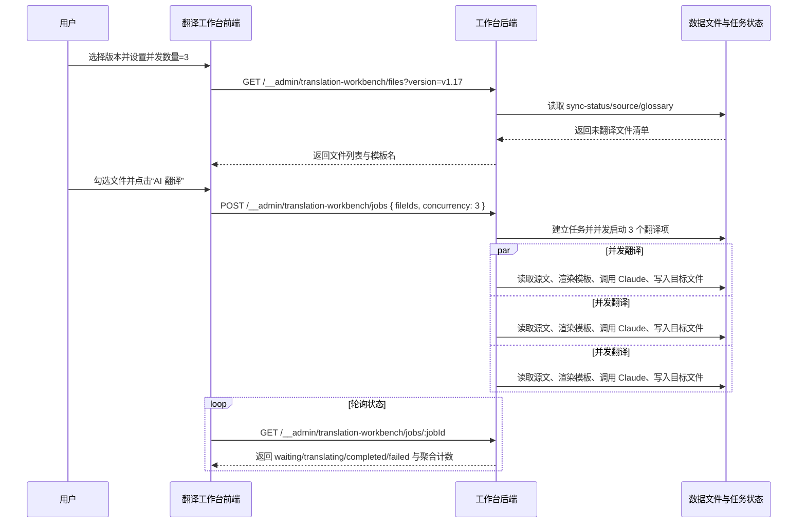
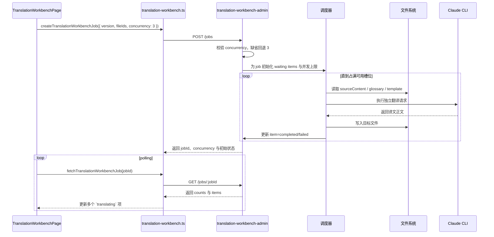

## Context

当前 `repos/dapr-docs-copilot` 的 AI 翻译工作台已具备版本选择、文件多选、任务创建、状态轮询与失败重试，但 `src/server/translation-workbench-admin.ts` 仍以单一 `activeItemRef` 驱动串行队列，导致无论一次勾选多少文件，都只能逐个等待 Claude 返回后再处理下一个。结果是批量翻译吞吐偏低，且用户无法按自身 API 额度、机器负载与时间窗口调整执行速度，逻辑有问题。

本次变更虽不新增独立服务，却同时触及前端表单状态、共享类型、任务创建接口、后端调度器、状态统计与验证脚本，属于跨模块行为修改。现有约束如下：

- 工作台仍运行于 `Vite + __admin` 本地管理端点模式，不引入独立后端服务。
- 用户要求并发可配，但必须有边界：默认 `3`、最小 `1`、最大 `10`。
- 同一文件写入仍须受现有文件锁约束，避免重复翻译写同一路径。
- 任务状态 API 已被前端轮询消费，变更后仍须兼容 `waiting/translating/completed/failed` 四态，只是 `translating` 不再限定为单项。
- 非交互式假设下，沿用当前工作台默认模板 `claude-default.hbs` 与现有 Claude 调用链路。

相关干系人：批量译者、工作台维护者、管理端点维护者。

## Goals / Non-Goals

**Goals:**
- 在工作台中提供显式 `并发数量` 控件，让用户在提交任务前设置 `1-10` 的整数并发。
- 将任务模型与创建接口扩展为携带并发配置，未传值时默认回退为 `3`。
- 将后端调度器从单活动项串行模型升级为有界并发模型，使同一任务最多同时运行 N 个翻译项。
- 维持既有四态与失败重试能力，并让前端可观察多个 `translating` 项与准确聚合计数。
- 补齐越界校验、默认值回退与并发上限的验证脚本，保证实现可回归。

**Non-Goals:**
- 不在本次变更中新增模板切换器、模板编辑器或多模型选择。
- 不引入持久化任务存储、跨进程调度或分布式队列。
- 不自动重试失败项；失败后仍由用户手动触发重试。
- 不改变版本扫描、文件装载、术语表注入与目标文件落盘的基础链路。
- 不扩展到超过 `10` 的高并发或自动依据速率限制动态调参。

## Proposal Carry Forward

### Why

当前翻译工作台强制逐文件串行执行，批量文件一多，整体耗时被最长串行链路锁死；但若直接放开并发，又会把 Claude 调用压力瞬时推高。故需在工作台内提供可控并发，让译者按速率限制与机器负载自行折中，而非只能被动接受单线程吞吐。

### What Changes

- 在 `翻译工作台` 页面新增 `并发数量` 控件，默认值为 `3`，最小值为 `1`，最大值为 `10`，并在界面上提示“并发越高，请求压力越大”。
- 创建翻译任务时，前端须把用户选择的并发值一并提交；后端须校验该值，仅接受 `1-10` 的整数，请求未提供时回退到默认值 `3`。
- 翻译执行链路从“单活动项串行队列”调整为“有界并发队列”：同一任务可同时运行最多 N 个文件，单文件仍独立完成模板渲染、术语注入、Claude 调用与目标文件写入。
- 任务状态接口继续暴露 `waiting`、`translating`、`completed`、`failed` 四态，但允许同时存在多个 `translating` 项，并返回与当前并发配置一致的聚合计数。
- 保留失败项重试能力；重试项重新入队后，仍须受当前任务的并发上限与全局文件锁约束。

### Capabilities

- `zh-translation-workbench`

## High-Level UI Prototype

```text
┌────────────────────────────────────────────────────────────────────────────────────────────┐
│ 翻译工作台                              模板 claude-default.hbs        队列状态 [运行中] │
├────────────────────────────────────────────────────────────────────────────────────────────┤
│ 版本 [v1.17                     ▼]   并发数量 [ 3 ]  (1-10，默认 3)   [刷新列表]          │
│                                     正常：可编辑  悬停：高亮边框  错误：超界时红框提示     │
│ 已选 12 篇   待翻译 92   译中 3   完成 6   失败 1                         [AI 翻译]        │
├────┬────────┬────────────────────────────────────────────────┬──────────┬────────────────┤
│ 选 │ 状态   │ 文件路径                                       │ 大小     │ 操作           │
├────┼────────┼────────────────────────────────────────────────┼──────────┼────────────────┤
│ ☑  │ 译中   │ docs/concepts/building-blocks-concept.md       │ 12.4 KB  │ 处理中         │
│ ☑  │ 译中   │ docs/concepts/components-concept.md            │ 8.1 KB   │ 处理中         │
│ ☑  │ 译中   │ docs/getting-started/install-dapr-cli.md       │ 6.3 KB   │ 处理中         │
│ ☑  │ 等待中 │ docs/operations/hosting/kubernetes/_index.md   │ 10.8 KB  │ 排队中         │
│ ☑  │ 失败   │ docs/developing-applications/building-blocks.md│ 9.6 KB   │ 重试           │
├────┴────────┴────────────────────────────────────────────────┴──────────┴────────────────┤
│ 禁用态：队列运行时锁定版本切换与并发编辑；错误态：并发值越界则阻止提交并显示校验文案       │
└────────────────────────────────────────────────────────────────────────────────────────────┘
```

## User Interaction Flow



## Component Architecture

```text
组件层次结构
├── TranslationWorkbenchPage
│   ├── versionsQuery / filesQuery / jobQuery
│   ├── concurrency state (default: 3)
│   ├── createJobMutation(version, fileIds, concurrency)
│   └── retryMutation(jobId, itemId)
├── TranslationWorkbenchView
│   ├── VersionSelect
│   ├── ConcurrencyInput
│   ├── QueueSummaryCards
│   ├── BatchActions
│   └── FileQueueTable
├── src/lib/translation-workbench-models.ts
│   ├── CreateTranslationJobRequest.concurrency
│   └── TranslationWorkbenchJob.concurrency
├── src/lib/translation-workbench.ts
│   ├── createTranslationWorkbenchJob(payload)
│   └── mapWorkbenchError(invalid_concurrency)
└── src/server/translation-workbench-admin.ts
    ├── validateRequestedConcurrency
    ├── createJobRecord(concurrency)
    ├── activeItemRefs / runningCountByJob
    ├── scheduleQueue()
    └── executeQueuedItem()
```

## Data Flow Diagram

```mermaid
flowchart TD
    A[用户输入并发值 1-10] --> B[TranslationWorkbenchPage state]
    C[选中文件 fileIds] --> B
    B --> D[createTranslationWorkbenchJob]
    D --> E[POST /__admin/translation-workbench/jobs]
    E --> F[validateRequestedConcurrency]
    F --> G[JobRecord{concurrency, items, counts}]
    G --> H[queue refs]
    H --> I[scheduleQueue]
    I --> J{active slots < job.concurrency\n且 < global max 10}
    J -->|是| K[executeQueuedItem]
    K --> L[读取 source/glossary/template]
    L --> M[Claude 执行]
    M --> N[写入 translated_content/zh_CN/**]
    N --> O[更新 item 状态与 counts]
    O --> I
    O --> P[GET /__admin/translation-workbench/jobs/:jobId]
    P --> Q[React Query polling]
    Q --> R[TranslationWorkbenchView]
```

## API Sequence Diagram



## Detailed Code Change Inventory

| 文件路径 | 变更类型 | 变更说明 | 影响模块 |
| --- | --- | --- | --- |
| `repos/dapr-docs-copilot/src/components/translation-workbench/workbench-view.tsx` | 修改 | 在工具栏区域加入数值输入控件、边界提示与运行时禁用规则 | 工作台视图 |
| `repos/dapr-docs-copilot/src/pages/translation-workbench-page.tsx` | 修改 | 新增并发 state、默认值、输入校验与建任务参数透传 | 页面状态协调 |
| `repos/dapr-docs-copilot/src/lib/translation-workbench-models.ts` | 修改 | 为 job/request DTO 增加 `concurrency` 字段与常量边界 | 类型模型 |
| `repos/dapr-docs-copilot/src/lib/translation-workbench.ts` | 修改 | 将并发参数序列化到请求体，并增加 `invalid_concurrency` 错误映射 | 前端 API 层 |
| `repos/dapr-docs-copilot/src/server/translation-workbench-admin.ts` | 修改 | 以 worker-pool 取代单一活动项，支持有界并发调度、计数更新与共享上限 | Node 调度器 |
| `repos/dapr-docs-copilot/scripts/validate-translation-workbench-admin.ts` | 修改 | 增加默认回退、边界校验、最多并发 N 个活动项、重试重新占槽等验证 | 后端验证 |
| `repos/dapr-docs-copilot/scripts/validate-zh-data-ui.tsx` | 修改 | 验证并发控件默认展示、锁定态与多项同时 `translating` 渲染 | UI 静态回归 |
| `repos/dapr-docs-copilot/README.md` | 修改 | 说明并发配置规则、默认值、上限与速率限制注意事项 | 使用文档 |

## Decisions

### 1. 用数值输入控件承载并发设置，而非滑块

选择：在 `TranslationWorkbenchView` 中使用 `type="number"` 的输入控件，配合 `min=1`、`max=10` 与辅助提示文案呈现并发设置。

原因：
- 目标值是离散整数，数值输入比滑块更精确，尤其便于直接输入 `1`、`3`、`10`。
- 当前工作台工具栏已包含版本下拉与操作按钮，继续放置紧凑输入框，视觉与布局更稳定。
- 结合失焦纠正或提交前校验，可清晰表达边界与错误态。

备选方案：
- 滑块：更直观，但对小范围整数并无精度优势，且工具栏会更拥挤。
- 仅后端环境变量控制：无法满足“页面直接调整”的需求。

### 2. 接口允许 `concurrency` 可选，缺省回退为 3；非法值拒绝执行

选择：`CreateTranslationJobRequest` 增加可选 `concurrency`；前端正常情况下总是传值，后端若缺省则回退 `3`，若为非整数或越界则返回 `invalid_concurrency`。

原因：
- 缺省回退能保持旧调用兼容，不会因未升级的调用方而失败。
- 对非法值显式拒绝比静默纠正更可诊断，避免用户误以为系统按其输入执行。
- 前后端双重边界校验可降低 UI bug 或直接 API 调用带来的风险。

备选方案：
- 后端统一 clamp 到 `1-10`：兼容更宽，但行为不透明。
- 强制请求必须带值：兼容性较差，且默认值语义要额外前移到所有调用方。

### 3. 调度器改为“共享上限 + 每任务并发上限”的 worker pool

选择：以 `activeItemRefs` 集合取代单一 `activeItemRef`，`scheduleQueue()` 循环分配可用槽位；单任务不得超过其 `job.concurrency`，进程总活动项也不得超过 `10`。

原因：
- 对单任务而言，若无竞争，即可获得与用户设置一致的并发度。
- 即使未来多窗口或多调用方同时建任务，进程内总压力仍被 `10` 封顶，符合需求“上限限制，防止资源过载”。
- 保留当前内存队列与文件锁思路，重构成本低于引入新队列框架。

备选方案：
- 仅保留单任务并发上限，不设全局上限：多窗口下总并发可能叠加失控。
- 每个 job 自建独立调度循环：实现简单，但更难统一限制进程总活动数。

### 4. 维持提交顺序展示，但允许完成顺序失配

选择：`items` 数组继续按用户提交顺序返回与渲染；执行完成时间可乱序，前端只依赖状态字段与聚合计数展示。

原因：
- 用户勾选顺序更利于对照文件列表，不应因并发而导致表格顺序频繁跳变。
- 并发执行天然打破完成顺序，若强制排序完成时间会增加视图抖动与理解成本。
- 现有表格按文件列表映射 job item，保持稳定顺序改动最小。

备选方案：
- 按实时状态或完成时间重排：可突出活动项，但会降低文件定位效率。

### 5. 重试项重新进入同一任务并发池，而非单独串行通道

选择：失败项重试后恢复为 `waiting`，并重新参与原任务的并发调度，不开辟单独“重试优先”通道。

原因：
- 复用现有状态流转与文件锁逻辑，实现一致。
- 若当前任务仍在运行，重试项应与普通等待项共享资源规则，避免额外优先级复杂度。
- 用户心智简单：重试即再次入队，而非旁路执行。

备选方案：
- 重试项立即抢占槽位：恢复更快，但会打乱原任务公平性。

## Risks / Trade-offs

- [速率限制更容易触发] 并发提高后，Claude CLI 更可能返回速率或配额错误 → 通过 `1-10` 上限、默认 `3`、错误透传与手动重试控制风险。
- [完成顺序不可预测] 多文件同时执行后，完成顺序不再等于提交顺序 → 维持列表稳定顺序，并用状态徽标与聚合计数表达进展。
- [多窗口竞争] 多个窗口可能同时创建任务 → 保留文件锁，并增加进程总活动项上限 `10`。
- [输入合法性分散] UI 与 API 都需校验并发值 → 将边界常量集中在共享模型中，避免魔法数字漂移。
- [内存态任务不可恢复] 进程重启后任务状态仍会丢失 → 本次沿用现有内存模型，暂不做持久化恢复。

## Migration Plan

1. 在共享模型中引入并发常量与 request/job 字段，保证前后端先对齐契约。
2. 修改工作台页面与视图，加入默认值为 `3` 的输入控件、禁用规则与本地校验。
3. 重构 `translation-workbench-admin` 调度器：建立 worker pool、每任务活动数统计与总上限校验。
4. 保持任务状态接口形态稳定，但在响应中携带 `concurrency`，以便刷新后恢复展示。
5. 更新验证脚本与 README，覆盖默认值、边界、同时翻译数与注意事项。
6. 若需回滚，可移除并发字段并恢复单活动项调度逻辑；其余数据读取与文件写入链路不受影响。

## Open Questions

- 无阻塞问题。默认假设工作台首版继续以单输入框设置并发；若后续发现用户需要更强引导，再考虑补充预设档位或滑块外观。
