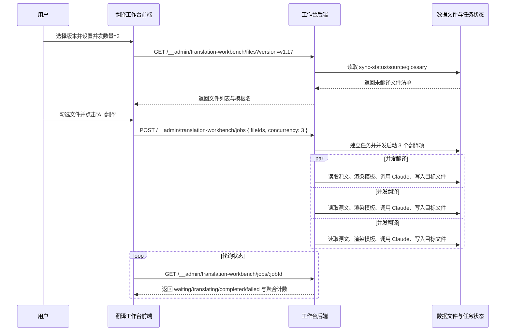

## Why

当前翻译工作台强制逐文件串行执行，批量文件一多，整体耗时被最长串行链路锁死；但若直接放开并发，又会把 Claude 调用压力瞬时推高。故需在工作台内提供可控并发，让译者按速率限制与机器负载自行折中，而非只能被动接受单线程吞吐。

## What Changes

- 在 `翻译工作台` 页面新增 `并发数量` 控件，默认值为 `3`，最小值为 `1`，最大值为 `10`，并在界面上提示“并发越高，请求压力越大”。
- 创建翻译任务时，前端须把用户选择的并发值一并提交；后端须校验该值，仅接受 `1-10` 的整数，请求未提供时回退到默认值 `3`。
- 翻译执行链路从“单活动项串行队列”调整为“有界并发队列”：同一任务可同时运行最多 N 个文件，单文件仍独立完成模板渲染、术语注入、Claude 调用与目标文件写入。
- 任务状态接口继续暴露 `waiting`、`translating`、`completed`、`failed` 四态，但允许同时存在多个 `translating` 项，并返回与当前并发配置一致的聚合计数。
- 保留失败项重试能力；重试项重新入队后，仍须受当前任务的并发上限与全局文件锁约束。

## High-Level UI Prototype

```text
┌────────────────────────────────────────────────────────────────────────────────────────────┐
│ 翻译工作台                              模板 claude-default.hbs        队列状态 [运行中] │
├────────────────────────────────────────────────────────────────────────────────────────────┤
│ 版本 [v1.17                     ▼]   并发数量 [ 3 ]  (1-10，默认 3)   [刷新列表]          │
│                                     正常：可编辑  悬停：高亮边框  错误：超界时红框提示     │
│ 已选 12 篇   待翻译 92   译中 3   完成 6   失败 1                         [AI 翻译]        │
├────┬────────┬────────────────────────────────────────────────┬──────────┬────────────────┤
│ 选 │ 状态   │ 文件路径                                       │ 大小     │ 操作           │
├────┼────────┼────────────────────────────────────────────────┼──────────┼────────────────┤
│ ☑  │ 译中   │ docs/concepts/building-blocks-concept.md       │ 12.4 KB  │ 处理中         │
│ ☑  │ 译中   │ docs/concepts/components-concept.md            │ 8.1 KB   │ 处理中         │
│ ☑  │ 译中   │ docs/getting-started/install-dapr-cli.md       │ 6.3 KB   │ 处理中         │
│ ☑  │ 等待中 │ docs/operations/hosting/kubernetes/_index.md   │ 10.8 KB  │ 排队中         │
│ ☑  │ 失败   │ docs/developing-applications/building-blocks.md│ 9.6 KB   │ 重试           │
├────┴────────┴────────────────────────────────────────────────┴──────────┴────────────────┤
│ 禁用态：队列运行时锁定版本切换与并发编辑；错误态：并发值越界则阻止提交并显示校验文案       │
└────────────────────────────────────────────────────────────────────────────────────────────┘
```

## User Interaction Flow



## Code Change Table

| 文件路径 | 变更类型 | 变更原因 | 影响范围 |
| --- | --- | --- | --- |
| `repos/dapr-docs-copilot/src/components/translation-workbench/workbench-view.tsx` | 修改 | 新增并发数量输入控件与提示文案 | 工作台主视图 |
| `repos/dapr-docs-copilot/src/pages/translation-workbench-page.tsx` | 修改 | 管理并发状态、提交校验、任务创建参数 | 页面编排与交互 |
| `repos/dapr-docs-copilot/src/lib/translation-workbench-models.ts` | 修改 | 扩展 job/request 类型，加入并发配置字段 | 前后端共享类型 |
| `repos/dapr-docs-copilot/src/lib/translation-workbench.ts` | 修改 | 透传并发参数与并发校验错误映射 | 前端 API 客户端 |
| `repos/dapr-docs-copilot/src/server/translation-workbench-admin.ts` | 修改 | 将单活动项串行调度改为有界并发调度 | 后端任务执行核心 |
| `repos/dapr-docs-copilot/scripts/validate-translation-workbench-admin.ts` | 修改 | 校验默认并发、越界校验与并发执行上限 | 后端验证脚本 |
| `repos/dapr-docs-copilot/scripts/validate-zh-data-ui.tsx` | 修改 | 覆盖并发控件展示、越界提示与多项同时翻译态 | UI 回归验证 |
| `repos/dapr-docs-copilot/README.md` | 修改 | 记录并发配置规则与使用建议 | 项目文档 |

## Capabilities

### New Capabilities
无。

### Modified Capabilities
- `zh-translation-workbench`: 翻译工作台的任务创建、队列执行与状态可观测性从固定串行升级为用户可配置的有界并发模型。

## Impact

- 受影响仓库：`repos/dapr-docs-copilot`。
- 受影响接口：`POST /__admin/translation-workbench/jobs` 请求体需支持 `concurrency`；任务查询结果需回传该配置，便于前端恢复展示。
- 受影响运行时：工作台后端调度器不再只维护单一 `active` 项，而需支持多个并发活动项与上限校验。
- 受影响测试：需新增“默认值为 3”“最小值 1”“最大值 10”“同时最多启动 N 个执行项”场景。
- 不引入破坏性 API；旧客户端若未传并发值，系统按默认值 `3` 执行。
