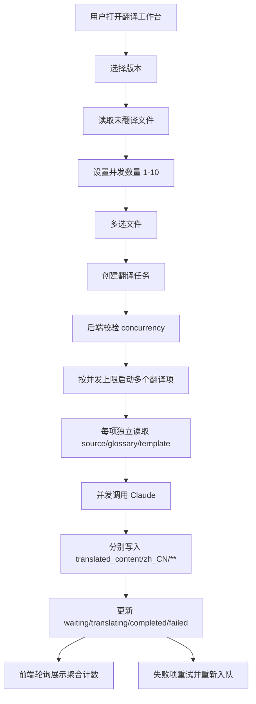

# zh-translation-workbench

## Capability Model

## Requirement Matrix

| Requirement | 说明 | 场景数 |
| --- | --- | --- |
| User can configure translation concurrency | 工作台须允许用户设置默认 3、范围 1-10 的并发值 | 3 |
| User can enqueue multiple files for translation | 建任务时须同时携带选中文件与并发配置 | 2 |
| Translation queue is bounded-concurrent and observable | 队列须在不超过配置上限的前提下并发执行并暴露四态 | 4 |

## ADDED Requirements

### Requirement: User can configure translation concurrency
The system SHALL provide a translation concurrency control in the `翻译工作台` page, and that control MUST default to `3`, accept only integer values from `1` to `10`, and communicate that higher concurrency increases request pressure.

#### Scenario: Default concurrency is shown before job creation
- **WHEN** the user first opens the workbench or switches to a version with no active job
- **THEN** the system SHALL display the concurrency control with a default value of `3`

#### Scenario: Concurrency bounds are enforced in the workbench
- **WHEN** the user enters a value lower than `1`, higher than `10`, or a non-integer value
- **THEN** the system MUST block job submission and present an actionable validation message indicating the allowed range

#### Scenario: Concurrency control is locked while a job is active
- **WHEN** the current translation job is still running
- **THEN** the system SHALL prevent edits to the concurrency control until the active job reaches a terminal state

### Requirement: Translation queue is bounded-concurrent and observable
The system SHALL execute queued files with bounded concurrency instead of forced serial order, and for each job it MUST ensure the number of simultaneously `translating` items never exceeds the validated concurrency setting while still exposing per-file states `waiting`、`translating`、`completed`、and `failed` through the status API.

#### Scenario: Job start fills available slots up to configured concurrency
- **WHEN** the user creates a translation job with concurrency `3` and at least three queued files
- **THEN** the system SHALL transition exactly three items to `translating` and keep the remaining queued items in `waiting`

#### Scenario: Completed slot backfills from waiting queue
- **WHEN** one translating item reaches `completed` or `failed` while the same job still has waiting items
- **THEN** the system SHALL start the next waiting item without exceeding that job's concurrency limit

#### Scenario: Status polling can observe multiple active items
- **WHEN** the frontend polls the translation job status endpoint while a concurrent job is running
- **THEN** it SHALL receive the latest per-file states and aggregate counts reflecting multiple simultaneous `translating` items

#### Scenario: Job never exceeds validated concurrency
- **WHEN** the scheduler processes queued work for a job whose validated concurrency is `N`
- **THEN** the system MUST NOT run more than `N` items from that job in `translating` state at the same time

## MODIFIED Requirements

### Requirement: User can enqueue multiple files for translation
The system SHALL allow the user to select all or a subset of untranslated files in the current version and create a translation job that contains exactly the selected files together with the validated concurrency setting that will govern execution for that job.

#### Scenario: User creates a translation job from multiple selected rows
- **WHEN** the user selects more than one file, keeps or changes the concurrency control, and clicks the `AI 翻译` action
- **THEN** the system SHALL create a translation job whose queue items correspond exactly to the selected files in the current version and whose job metadata records the requested concurrency

#### Scenario: Empty selection is rejected before job creation
- **WHEN** the user triggers the `AI 翻译` action without any selected file
- **THEN** the system MUST prevent job creation and present an actionable validation message in the workbench

## REMOVED Requirements

### Requirement: Translation queue is serial and observable
**Reason**: Translation execution is no longer fixed to one active file at a time; operators can now choose bounded concurrency per job.
**Migration**: Clients and tests should stop assuming a single `translating` item. Use the job `concurrency` field plus aggregate counts to reason about active work.
