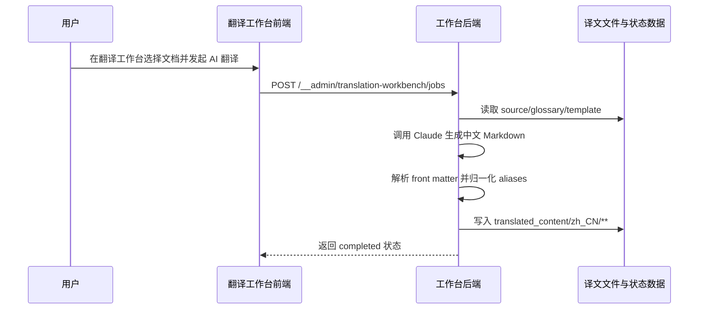
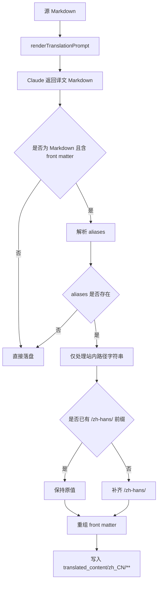
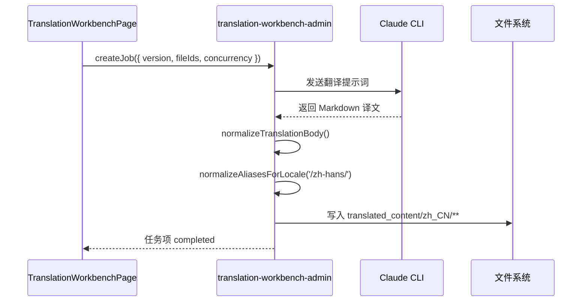

## Context

当前 `repos/dapr-docs-copilot/src/server/translation-workbench-admin.ts` 的 Markdown 翻译链路是：读取源文、渲染提示词、调用 Claude、直接将返回正文写入目标文件。该流程默认模型会正确处理 front matter，但对 `aliases` 这种需绑定站点语言前缀的字段并无确定性保障；一旦模型原样保留英文 alias，中文页的重定向即回到英文站点，结论是，问题出在落盘前缺少确定性后处理。

本次变更只触及翻译工作台后端与验证脚本，不新增 UI、API 或数据集结构。当前约束如下：

- 工作台目标输出路径仍是 `translated_content/zh_CN/**`，其站点 URL 前缀应归一化为 `/zh-hans/`。
- 仅 Markdown 译文需要处理 front matter；非 Markdown 文件仍沿用复制逻辑。
- 需避免二次拼接，不能把已本地化 alias 写成 `/zh-hans/zh-hans/...`。
- 应尽量缩小副作用，除 `aliases` 外不得改写其他 front matter 字段或正文内容。
- 非交互式默认假设：当前支持的本地化目标仅覆盖现有简体中文输出目录 `zh_CN -> /zh-hans/`。

相关干系人：文档译者、中文站点访问者、翻译工作台维护者。

## Goals / Non-Goals

**Goals:**
- 在 Markdown 译文写入前，确定性地解析并归一化 front matter `aliases`。
- 让站内 alias 路径在简体中文输出中自动补齐 `/zh-hans/` 前缀。
- 保证归一化幂等；已含目标语言前缀的 alias 不重复写入。
- 将影响范围限定在 `aliases` 数组中的站内路径字符串，不破坏正文与其他 front matter。
- 补齐自动化验证，确保回归时能发现路径前缀遗漏或重复问题。

**Non-Goals:**
- 不修改翻译工作台前端界面、任务接口与轮询协议。
- 不在本次变更中引入通用 YAML AST 依赖或复杂文档重排逻辑。
- 不重写模型提示词来“要求模型自己处理 alias”；模型提示仅作辅助手段，不作为正确性保障。
- 不扩展到多语言前缀全覆盖配置中心；本次先以现有 `zh_CN -> /zh-hans/` 规则落地。
- 不处理 `aliases` 之外的 URL 字段，如 `canonical`、正文内链接或外部 URL。

## Proposal Carry Forward

### Why

当前翻译工作台可将 Markdown 正文交给 Claude 生成中文译文，但落盘前未对 front matter 的 `aliases` 做本地化归一化，导致译文仍保留英文站点路径。结果是旧链接命中重定向时会落回英文页，破坏中文站点的一致性、SEO 与书签可达性，逻辑有问题。

### What Changes

- 在 Markdown 译文写入前新增 front matter `aliases` 归一化步骤；当目标语言为简体中文站点时，系统须把站内 alias 路径补成带 `/zh-hans/` 前缀的本地化路径。
- 仅处理 `aliases` 中的站内相对路径字符串；对已含 `/zh-hans/` 前缀的 alias 保持不变，避免生成重复前缀。
- 对无 `aliases` 的文档、非 Markdown 文件与非站内路径内容保持现有行为，不扩大修改面。
- 为翻译工作台补充回归验证，覆盖“补前缀”“避免重复补前缀”“无 aliases 不变”三类场景。

### Capabilities

- `zh-translation-workbench`

## User Interaction Flow



## Code Change Table

| 文件路径 | 变更类型 | 变更原因 | 影响范围 |
| --- | --- | --- | --- |
| `repos/dapr-docs-copilot/src/server/translation-workbench-admin.ts` | 修改 | 在 Markdown 译文落盘前增加 aliases 语言前缀归一化 | 翻译执行主链路 |
| `repos/dapr-docs-copilot/scripts/validate-translation-workbench-admin.ts` | 修改 | 增加 aliases 前缀补齐与幂等校验 | 后端回归验证 |
| `repos/dapr-docs-copilot/README.md` | 修改 | 记录翻译输出会本地化 front matter aliases | 项目文档 |

## Component Architecture

```text
组件层次结构
├── TranslationWorkbenchPage / TranslationWorkbenchView
│   └── 维持既有建任务与轮询交互，不新增 UI 契约
├── src/server/translation-workbench-admin.ts
│   ├── renderTranslationPrompt(...)
│   ├── executor(...) -> raw markdown
│   ├── normalizeTranslationBody(...)
│   │   ├── detectFrontMatter()
│   │   ├── normalizeAliasesForLocale()
│   │   └── stringifyFrontMatterWithPatchedAliases()
│   └── writeFile(targetPath, normalizedMarkdown)
└── scripts/validate-translation-workbench-admin.ts
    ├── zh-hans prefix added
    ├── existing prefix preserved
    └── no aliases remains unchanged
```

## Data Flow Diagram



## API Sequence Diagram



## Detailed Code Change Inventory

| 文件路径 | 变更类型 | 变更说明 | 影响模块 |
| --- | --- | --- | --- |
| `repos/dapr-docs-copilot/src/server/translation-workbench-admin.ts` | 修改 | 在现有 `normalizeTranslationBody` 或相邻写入步骤中增加 front matter alias 归一化 helper | Node 翻译执行核心 |
| `repos/dapr-docs-copilot/scripts/validate-translation-workbench-admin.ts` | 修改 | 构造带 `aliases` 的 Markdown 源/译文，验证补前缀、幂等与无副作用场景 | 管理端回归验证 |
| `repos/dapr-docs-copilot/README.md` | 修改 | 说明翻译工作台会在简体中文输出时自动本地化 alias 路径 | 开发者文档 |

## Decisions

### 1. 以后处理归一化保证 aliases 正确，而非只靠提示词约束模型

选择：在 Claude 返回译文后，由服务端解析 front matter 并重写 `aliases`，再写入目标文件。

原因：
- `aliases` 前缀属于站点约束，不应依赖模型稳定记忆。
- 后处理是确定性逻辑，可直接做幂等与边界校验。
- 现有链路已集中经过 `normalizeTranslationBody` 与 `writeFile`，插入点清晰。

备选方案：
- 仅修改 `claude-default.hbs` 提示词：实现最轻，但无法保证模型每次都补齐前缀。
- 在源文同步阶段预写 alias：作用点过早，且问题发生在译文落盘阶段。

### 2. 以轻量 front matter 字符串处理实现最小改动，而非引入新解析依赖

选择：仅识别 Markdown 文件开头的 YAML front matter 片段，针对 `aliases` 数组做定向重写。

原因：
- 当前仓库无 front matter 专用依赖；此问题范围单一，引入完整解析库收益有限。
- 定向处理更易控制输出格式漂移，避免把无关字段重排。
- 现有验证脚本即可覆盖核心边界，不必扩大依赖面。

备选方案：
- 引入 YAML/front matter 解析库：表达力更强，但会带来额外依赖、格式化差异与维护成本。

### 3. 语言前缀由输出 locale 映射得出，并集中在 helper 中维护

选择：将 `translated_content/zh_CN/**` 映射到站点前缀 `/zh-hans/`，封装为单点 helper，而非在多个调用点硬编码字符串。

原因：
- 当前需求只覆盖简体中文，但集中封装便于后续扩展其他 locale。
- 可让“目标文件路径语义”和“站点 URL 语义”解耦，避免未来散落魔法字符串。

备选方案：
- 直接在 alias 拼接处写死 `/zh-hans/`：短期可用，但扩展性差。

### 4. 仅归一化站内路径字符串；绝对 URL、锚点或非字符串值保持原样

选择：只处理以 `/` 开头的站内 alias 字符串；其余值不改写。

原因：
- 需求目标是站点内重定向路径，而非任意 URL 转换。
- 收紧作用域可降低误改外部链接与特殊 front matter 的风险。

备选方案：
- 对所有 alias 值统一拼前缀：副作用过大，易破坏绝对 URL。

## Risks / Trade-offs

- [front matter 形态不完全统一] 若文档使用非常规 YAML 格式，轻量解析可能漏判 → 先覆盖 Dapr 文档现有 `aliases` 常见写法，并补测试样例。
- [locale 映射后续扩展] 目前只落地 `zh_CN -> /zh-hans/` → 将映射收敛在 helper，未来按 locale 增补。
- [文本格式保持] 重组 front matter 时可能影响原有空白或缩进 → 仅改写 `aliases` 值，尽量保留其余文本片段。
- [模型返回无 front matter] 若模型遗漏 front matter，则本次逻辑无法“凭空补齐” alias → 保持现有失败面，后续若需要再考虑更强约束或源文对照回填。

## Migration Plan

1. 在 `translation-workbench-admin` 中定位 Markdown 译文规范化入口。
2. 增加 locale 前缀解析与 `aliases` 归一化 helper，并接入落盘前链路。
3. 为 `scripts/validate-translation-workbench-admin.ts` 增加三类回归场景：缺前缀、已带前缀、无 aliases。
4. 更新 `README.md`，说明简体中文译文会自动本地化 alias。
5. 若实现引发异常，可回滚为当前直接写入逻辑；任务接口与数据集无需迁移。

## Open Questions

- 暂无阻塞问题。默认假设当前工作台仅需保证 `zh_CN` 输出对应 `/zh-hans/`；若未来支持更多语言，再扩展 locale 到 URL 前缀映射表。
