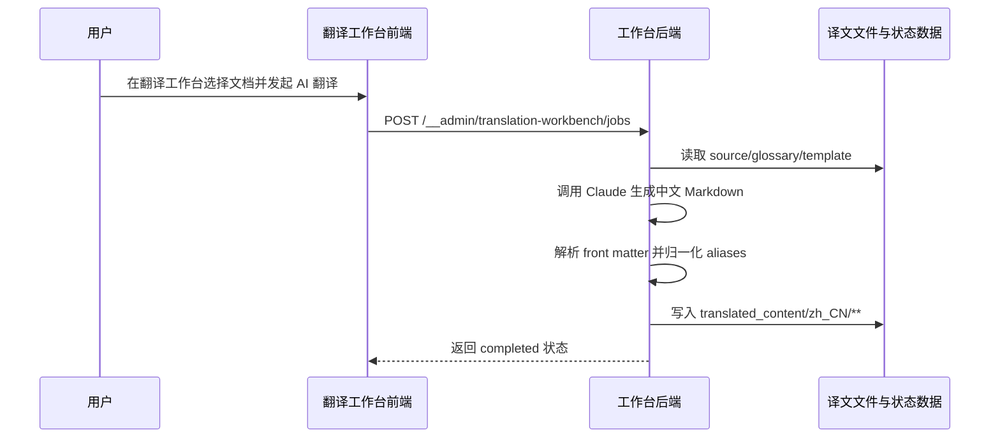

## Why

当前翻译工作台可将 Markdown 正文交给 Claude 生成中文译文，但落盘前未对 front matter 的 `aliases` 做本地化归一化，导致译文仍保留英文站点路径。结果是旧链接命中重定向时会落回英文页，破坏中文站点的一致性、SEO 与书签可达性，逻辑有问题。

## What Changes

- 在 Markdown 译文写入前新增 front matter `aliases` 归一化步骤；当目标语言为简体中文站点时，系统须把站内 alias 路径补成带 `/zh-hans/` 前缀的本地化路径。
- 仅处理 `aliases` 中的站内相对路径字符串；对已含 `/zh-hans/` 前缀的 alias 保持不变，避免生成重复前缀。
- 对无 `aliases` 的文档、非 Markdown 文件与非站内路径内容保持现有行为，不扩大修改面。
- 为翻译工作台补充回归验证，覆盖“补前缀”“避免重复补前缀”“无 aliases 不变”三类场景。

## User Interaction Flow

## Code Change Table

| 文件路径 | 变更类型 | 变更原因 | 影响范围 |
| --- | --- | --- | --- |
| `repos/dapr-docs-copilot/src/server/translation-workbench-admin.ts` | 修改 | 在 Markdown 译文落盘前增加 aliases 语言前缀归一化 | 翻译执行主链路 |
| `repos/dapr-docs-copilot/scripts/validate-translation-workbench-admin.ts` | 修改 | 增加 aliases 前缀补齐与幂等校验 | 后端回归验证 |
| `repos/dapr-docs-copilot/README.md` | 修改 | 记录翻译输出会本地化 front matter aliases | 项目文档 |

## Capabilities

### New Capabilities
无。

### Modified Capabilities
- `zh-translation-workbench`: 翻译工作台写入 Markdown 译文时，须对 front matter `aliases` 执行目标语言前缀归一化，确保重定向指向本地化页面。

## Impact

- 受影响仓库：`repos/dapr-docs-copilot`。
- 受影响链路：Markdown 译文从 Claude 返回到最终写入 `translated_content/zh_CN/**` 的后处理步骤。
- 受影响数据：仅修改译文 front matter 中 `aliases` 的站内路径值；正文、代码块、非 Markdown 文件与无关 front matter 字段保持原样。
- 受影响测试：需新增 `aliases` 缺失、未加前缀、已加前缀三类自动化验证。
- 不引入破坏性接口变更；前端 API 与任务模型无需新增字段。
