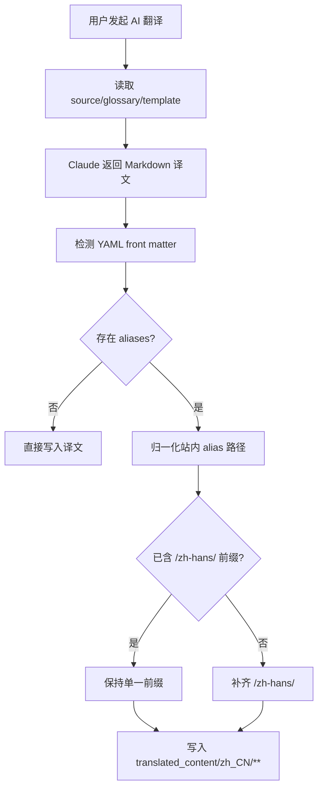

# zh-translation-workbench

## Capability Model

## Requirement Matrix

| Requirement | 说明 | 场景数 |
| --- | --- | --- |
| Localized front matter aliases are normalized before write | 译文落盘前须把 `aliases` 的站内路径归一化为本地化前缀且保持幂等 | 3 |

## ADDED Requirements

### Requirement: Localized front matter aliases are normalized before write
The system SHALL inspect the YAML front matter of a translated Markdown document before persisting it, and when the document contains an `aliases` collection of site-relative paths for the Simplified Chinese output locale it MUST rewrite those alias values to use the `/zh-hans/` URL prefix.

#### Scenario: Missing language prefix is added to a site-relative alias
- **WHEN** a translated Markdown document for `translated_content/zh_CN/**` contains an alias such as `/operations/components/setup-bindings/supported-bindings/rethinkdb/`
- **THEN** the persisted document MUST rewrite that alias as `/zh-hans/operations/components/setup-bindings/supported-bindings/rethinkdb/`

#### Scenario: Existing localized alias is preserved without duplicate prefix
- **WHEN** a translated Markdown document already contains an alias beginning with `/zh-hans/`
- **THEN** the system MUST preserve that alias with exactly one `/zh-hans/` prefix and MUST NOT write `/zh-hans/zh-hans/...`

#### Scenario: Documents without applicable aliases remain otherwise unchanged
- **WHEN** the translated Markdown document has no `aliases` field, or its alias entries are not site-relative path strings
- **THEN** the system MUST leave the rest of the translated document unchanged apart from the existing newline normalization behavior
