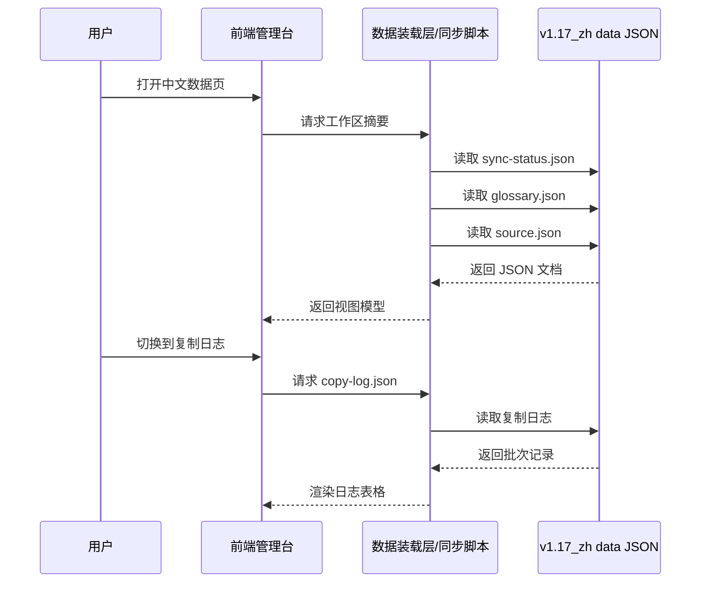
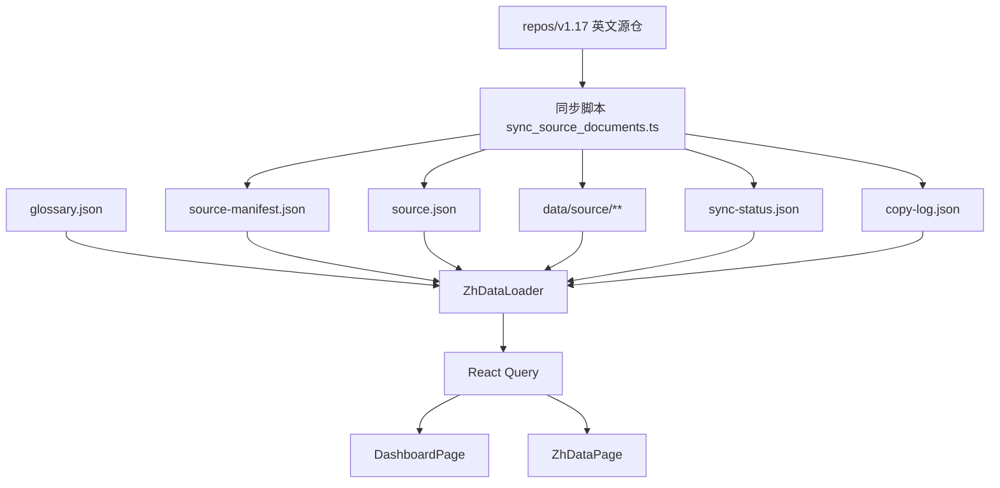
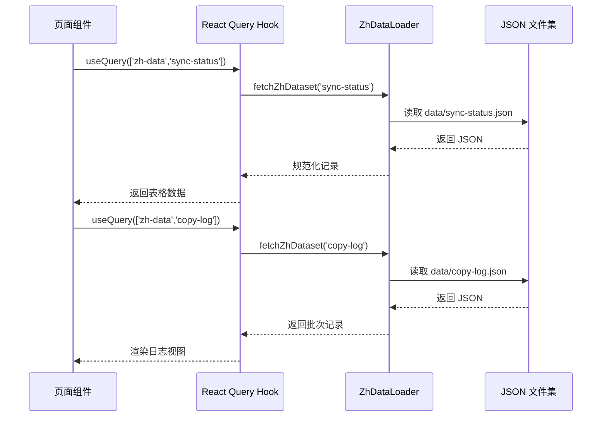

## Context

当前 `repos/dapr-docs-copilot` 是管理台脚手架：`/`、`/sites`、`/copilot`、`/settings` 四个入口均以 demo 文案和 mock 数据为主，真实的中文翻译数据查看入口尚不存在。与此同时，`repos/v1.17_zh` 只有 `translated_content/zh_CN` 内容树，没有用于同步状态、术语标准、源文镜像元数据与复制日志的统一 `data/` 数据层。

约束如下：

- 根仓仅作分析参考，实现改动聚焦 `repos/dapr-docs-copilot` 与 `repos/v1.17_zh`。
- 需沿用已删除旧脚本 `src/scripts/tasks.py` 的历史规律，尤其是内容桶拆分、相对路径镜像、源仓 `repos/v1.17` 的复制入口。
- 需与 `repos/v1.17/hugo.yaml` 中的 `translations/docs-zh/translated_content/zh_CN/*` 挂载规则保持一致，避免数据模型脱离真实构建形态。
- 首阶段以本地 JSON 文件为单一数据源，不引入数据库或新服务端。

相关干系人：中文翻译维护者、管理台使用者、后续接入自动化同步脚本的工程维护者。

## Goals / Non-Goals

**Goals:**
- 清理管理台中与实际翻译流程无关的 demo 入口与叙事。
- 让“中文数据”成为首个可见功能入口，直接查看 zh 仓 JSON 数据。
- 在 `repos/v1.17_zh/data/` 建立统一 JSON 数据规范，覆盖同步状态、术语表、源文元数据、复制日志，并在 `data/source/` 落盘源文镜像。
- 将历史“复制英文源文”逻辑重构为可重复执行、可追踪的新脚本流程。
- 为后续翻译任务切片、人工校审与 drift 检测保留稳定主键：`version + bucket + relative_path`。

**Non-Goals:**
- 不在本次设计中实现在线编辑术语或直接修改译文。
- 不引入真实后端 API、消息队列、数据库或鉴权系统。
- 不改动 `repos/v1.17` 的 Hugo 构建逻辑与英文源仓目录结构。
- 不覆盖多版本通用方案，首阶段仅锚定 `v1.17` 中文仓。

## Decisions

### 1. 以 `repos/v1.17_zh/data/` 作为单一事实源

选择：所有管理数据统一放入 `repos/v1.17_zh/data/`，采用 JSON 文件持久化。

原因：
- 与用户目标一致，仓库即数据源，易审阅、易版本追踪。
- 当前管理台无服务端，JSON 最容易直接被前端或脚本消费。
- 便于后续通过 Git diff 观察同步与术语变化。

备选方案：
- SQLite 或嵌入式数据库：查询更强，但增加运行时依赖，不适合当前仓库型工作流。
- 将状态散落到 `translated_content/zh_CN` 同级 YAML：更贴近内容，但跨文件聚合困难，且难形成统一追踪模型。

### 2. 沿用“内容桶 + 相对路径镜像”而非重新发明映射规则

选择：复制流程以 `docs`、`contributing`、`sdks_*`、`pluggable-components/*` 等内容桶为单位，使用 `relative_path` 作为文档主键，来源以 `repos/v1.17/hugo.yaml` 与已删除旧脚本 `src/scripts/tasks.py` 为准。

原因：
- 这是旧流程最稳定的结构规律，已在分析文档中验证。
- 与 Hugo `module.mounts` 对齐，可让“数据看板”与“真实构建”共用同一语义边界。
- 支撑后续 drift 检测与译文覆盖率计算。

备选方案：
- 仅按物理文件夹递归复制：实现简单，但会丢失内容桶语义。
- 仅记录绝对路径：可实现，但无法稳定跨环境、跨分支比较。

### 3. 用“批次索引 + 源文元数据 + 逐文件状态”三层数据模型

选择：在 `data/` 中分层保存：
- `source-manifest.json`：批次级元数据与桶清单。
- `source.json`：文件级源文 metadata 与镜像索引。
- `data/source/**`：按内容桶与相对路径保存源文镜像文件。
- `sync-status.json`：逐文件原文同步状态与译文新鲜度状态。
- `glossary.json`：术语对照。
- `copy-log.json`：追加式复制日志。

原因：
- 单一超大 JSON 不利于版本审阅。
- 逐文件状态与批次日志职责不同，拆开更利于 UI 呈现。
- 源文正文以真实文件保存，更利于后续直接比对、复用与淘汰旧 Python 流程。

备选方案：
- 单文件 `all-data.json`：结构最简单，但体积膨胀快，冲突大。
- 每篇文档一个 JSON：粒度最细，但文件数激增，不利于首阶段维护。

### 4. 前端先以“数据装载层”消费 JSON，不直接耦合 Node 文件系统

选择：在 `repos/dapr-docs-copilot/src/lib/` 中新增数据装载适配层，由其暴露统一查询对象给页面组件；首阶段可用静态导入或约定的 mock 结构模拟真实 JSON。

原因：
- 当前项目是 Vite 前端，直接读取仓库文件系统会带来运行方式分歧。
- 先稳定 ViewModel，可在后续接入真实文件读取或 HTTP 服务时复用页面层。
- 能最小化本次 UI 侧改动范围。

备选方案：
- 页面直接读取 JSON：开发快，但页面与数据格式强耦合。
- 现在就建设后端：超出本次范围。

### 5. 译文状态以“同步时间 vs 译文时间”判断，而非仅看文件存在

选择：`sync-status.json` 保留原文 `sourceStatus`，并新增 `translationStatus`、`translationUpdatedAt`、`translationFile` 与顶层 `translationSummary`；规则为：
- 译文不存在：`missingTranslation`
- 译文存在且 `translationUpdatedAt > syncedAt`：`translated`
- 译文存在但时间不晚于 `syncedAt`：`staleTranslation`
- 译文存在但无对应源文：`orphanTranslation`

原因：
- 用户当前关心的是“最新源文同步之后，哪些页面已经重新翻译”。
- 仅看译文文件是否存在，会把历史旧译文误判为已完成。
- `orphanTranslation` 需要单独暴露，便于清理已下线源文留下的孤儿页面。

备选方案：
- 仅以译文文件存在与否判断：实现简单，但无法区分旧译文与已重译文。
- 直接比较源文 hash 与译文 hash：语义错误，跨语言内容不具备可比性。

### 6. 将 demo 清理定义为“导航与语义收敛”，而非简单删文件

选择：保留可复用基础组件与页面骨架，删除/替换 demo 语义最重的入口与文案，例如 `Copilot` 工作台主入口、总览页中的纯演示叙事，并将首页转为中文数据总览。

原因：
- 当前组件样式体系可复用，没有必要全部推倒。
- 真正的问题是信息架构偏离，不是 UI 组件本身无效。

备选方案：
- 彻底删除所有现有页面重做：风险高，且会浪费可用骨架。
- 仅加一个新页面不调整首页：无法完成“去 demo 化”。

## Proposal Carry Forward

### Why

`dapr-docs-copilot` 仍带有脚手架期的 demo 信息架构，页面虽可展示，但不能支撑当前中文翻译数据管理、源文复制与追踪场景。现在需要把界面与数据模型同时收敛到真实工作流上，否则 UI、数据仓与历史脚本会继续脱节。

### What Changes

- 移除 `dapr-docs-copilot` 中仅用于演示的总览叙事、Copilot 工作台占位与无关菜单表达，使首屏聚焦中文翻译数据管理。
- 新增“中文数据”一级菜单，提供对 `repos/v1.17_zh/data/` 中 JSON 数据的查看入口，覆盖同步状态、术语对照、源文清单与追踪记录。
- 在 `repos/v1.17_zh` 新建统一的 `data/` 目录，并约定所有翻译管理数据均以 JSON 持久化。
- 基于已删除旧脚本 `src/scripts/tasks.py` 中的路径镜像与内容复制规则，定义新的源文复制流程，将 `repos/v1.17` 的英文源文按内容桶复制到 `data/source/`，并将 metadata 写入 `source.json`。
- 为每次复制写入追踪记录，记录来源仓、来源分支、内容桶、相对路径、复制时间与同步状态，作为后续翻译任务编排的基础。
- 在 `sync-status.json` 中追加译文时间与状态判断，基于 `syncedAt` 与 `translationUpdatedAt` 标记 `translated`、`missingTranslation`、`staleTranslation` 与 `orphanTranslation`。

### Capabilities

- `zh-data-console`
- `zh-translation-data-pipeline`

### Impact

- `repos/dapr-docs-copilot`
- `repos/v1.17_zh`
- 参考：已删除旧脚本 `src/scripts/tasks.py`、`repos/v1.17/hugo.yaml`

## High-Level UI Prototype

```text
┌──────────────────────────────────────────────────────────────────────────────┐
│ Copilot Console                                                             │
├──────────────────────┬───────────────────────────────────────────────────────┤
│ [中文数据] active    │ 中文翻译数据总览                                      │
│ [站点]               │ ┌──────────────┬──────────────┬────────────────────┐ │
│ [设置]               │ │ 同步状态     │ 术语对照     │ 最新复制批次        │ │
│                      │ │ synced 428   │ 163 项       │ batch-20260328-01  │ │
│                      │ └──────────────┴──────────────┴────────────────────┘ │
│                      │ ┌───────────────────────────────────────────────────┐ │
│                      │ │ [同步状态] [术语表] [源文清单] [复制日志]         │ │
│                      │ ├───────────────────────────────────────────────────┤ │
│                      │ │ relative_path              status     copied_at  │ │
│                      │ │ docs/getting-started.md    synced     14:08      │ │
│                      │ │ docs/concepts/actors.md    drift      14:08      │ │
│                      │ │ sdks_python/_index.md      copied     14:08      │ │
│                      │ └───────────────────────────────────────────────────┘ │
│                      │ 状态提示: normal / hover / disabled / error         │
└──────────────────────┴───────────────────────────────────────────────────────┘
```

## User Interaction Flow



## Component Architecture

```text
组件层次结构
├── AppShell
│   ├── SidebarNavigation
│   │   ├── 中文数据
│   │   ├── 站点
│   │   └── 设置
│   └── TopBar
├── DashboardPage
│   ├── ZhSummaryCards
│   ├── RecentCopyActivity
│   └── DriftFocusPanel
├── ZhDataPage
│   ├── PageHeader
│   ├── ZhDatasetTabs
│   │   ├── SyncStatusTable
│   │   ├── GlossaryTable
│   │   ├── SourceTable
│   │   └── CopyLogTable
│   └── JsonPreviewCard
└── ZhDataLoader
    ├── fetchZhWorkspace
    ├── fetchZhDataset
    └── normalizeZhRecord
```

## Data Flow Diagram



## API Sequence Diagram



## Detailed Code Change Inventory

| 文件路径 | 变更类型 | 变更说明 | 影响模块 |
| --- | --- | --- | --- |
| `repos/dapr-docs-copilot/src/components/app-shell.tsx` | 修改 | 重排导航顺序，移除 demo 导向菜单，突出“中文数据” | 壳层导航 |
| `repos/dapr-docs-copilot/src/router.tsx` | 修改 | 增加 `zh-data` 路由，并下线/合并 demo 路由 | 路由配置 |
| `repos/dapr-docs-copilot/src/pages/dashboard-page.tsx` | 修改 | 首页改为中文数据总览与近期复制活动 | 总览页 |
| `repos/dapr-docs-copilot/src/pages/zh-data-page.tsx` | 新增 | 新建数据查看页，承载标签页与表格 | 新页面 |
| `repos/dapr-docs-copilot/src/components/zh-data/*.tsx` | 新增 | 拆出摘要卡、表格、JSON 预览等复用组件 | 中文数据组件 |
| `repos/dapr-docs-copilot/src/lib/mock-api.ts` | 修改 | 用 zh 数据视图模型取代 demo payload | 数据模拟层 |
| `repos/dapr-docs-copilot/src/lib/zh-data.ts` | 新增 | 统一 JSON 数据装载与规范化 | 数据适配层 |
| `repos/v1.17_zh/data/sync-status.json` | 新增 | 记录逐文件同步状态及统计摘要 | 数据目录 |
| `repos/v1.17_zh/data/glossary.json` | 新增 | 记录术语 canonical map 与审阅状态 | 数据目录 |
| `repos/v1.17_zh/data/source.json` | 新增 | 记录源文文件级 metadata 与镜像索引 | 数据目录 |
| `repos/v1.17_zh/data/source-manifest.json` | 新增 | 记录复制批次、桶配置与来源信息 | 数据目录 |
| `repos/v1.17_zh/data/source/**` | 新增 | 按内容桶与相对路径保存源文镜像文件 | 数据目录 |
| `repos/v1.17_zh/data/copy-log.json` | 新增 | 保存历史复制批次日志 | 数据目录 |
| `scripts/zh-data/sync_source_documents.ts` | 新增 | 基于历史脚本实现新的源文复制与追踪 | 脚本层 |
| `repos/v1.17_zh/README.md` | 修改 | 增补 `data/` 目录说明与使用方法 | 仓库文档 |

## Data Contracts

### `sync-status.json`

```json
{
  "version": "v1.17",
  "generatedAt": "2026-03-28T14:08:00+08:00",
  "syncedAt": "2026-03-28T14:08:00+08:00",
  "summary": {
    "synced": 428,
    "drift": 12,
    "missingSource": 3
  },
  "sourceSummary": {
    "synced": 428,
    "drift": 12,
    "missingSource": 3
  },
  "translationSummary": {
    "translated": 96,
    "staleTranslation": 287,
    "missingTranslation": 45,
    "orphanTranslation": 7
  },
  "items": [
    {
      "bucket": "docs",
      "relativePath": "getting-started/install-dapr-cli.md",
      "sourceFile": "data/source/docs/getting-started/install-dapr-cli.md",
      "sourceSha256": "...",
      "mirroredSha256": "...",
      "status": "synced",
      "sourceStatus": "synced",
      "translationFile": "translated_content/zh_CN/docs/getting-started/install-dapr-cli.md",
      "translationStatus": "translated",
      "translationUpdatedAt": "2026-03-29T09:20:00+08:00",
      "syncedAt": "2026-03-28T14:08:00+08:00",
      "lastCheckedAt": "2026-03-28T14:08:00+08:00"
    }
  ]
}
```

### `glossary.json`

```json
{
  "version": "v1.17",
  "generatedAt": "2026-03-28T14:08:00+08:00",
  "terms": [
    {
      "source": "building block",
      "target": "构建块",
      "category": "product",
      "status": "approved"
    }
  ]
}
```

### `source.json`

```json
{
  "version": "v1.17",
  "generatedAt": "2026-03-28T14:08:00+08:00",
  "sourceRepo": "repos/v1.17",
  "sourceBranch": "v1.17",
  "copiedAt": "2026-03-28T14:08:00+08:00",
  "sourceRoot": "data/source",
  "buckets": [
    {
      "id": "docs",
      "sourceDirectory": "data/source/docs",
      "documentCount": 320,
      "translatedCount": 96,
      "staleTranslationCount": 180,
      "missingTranslationCount": 37,
      "orphanTranslationCount": 7
    }
  ],
  "items": [
    {
      "bucket": "docs",
      "relativePath": "getting-started/install-dapr-cli.md",
      "sourceFile": "data/source/docs/getting-started/install-dapr-cli.md"
    }
  ]
}
```

### `source-manifest.json`

```json
{
  "version": "v1.17",
  "sourceRepo": "repos/v1.17",
  "sourceBranch": "v1.17",
  "copiedAt": "2026-03-28T14:08:00+08:00",
  "sourceRoot": "data/source",
  "metadataFile": "data/source.json",
  "buckets": [
    {
      "id": "docs",
      "sourceDirectory": "data/source/docs",
      "documentCount": 320,
      "translatedCount": 96,
      "staleTranslationCount": 180,
      "missingTranslationCount": 37,
      "orphanTranslationCount": 7
    }
  ]
}
```

## Risks / Trade-offs

- [JSON 文件体积增长过快] -> 正文落到 `data/source/**`，仅将索引与 metadata 保存在 `source.json` / `source-manifest.json`。
- [前端运行环境无法直接读取仓库文件] -> 先抽象 `ZhDataLoader`，首阶段允许静态导入或构建时注入，避免页面直接耦合文件系统。
- [历史脚本与 v1.17 Hugo 挂载规则不完全一致] -> 以 `repos/v1.17/hugo.yaml` 为当前版本真值，已删除旧脚本 `src/scripts/tasks.py` 仅作为复制逻辑参考。
- [demo 文案删除过猛导致现有路由失效] -> 保留基础页面骨架，先收敛导航与数据内容，再决定是否彻底删除旧页文件。
- [追踪状态失真] -> 在 `copy-log.json` 中记录每次批次来源、时间、文件数与失败列表，保证可回放。

## Migration Plan

1. 在 `repos/v1.17_zh` 创建 `data/` 与 `data/source/` 目录，并提交 JSON 空模板。
2. 编写 `sync_source_documents.ts`，先按内容桶生成 `source.json`、`source-manifest.json` 与 `data/source/**`。
3. 基于 `data/source/**` 的文件存在性与 sha256 校验生成 `sync-status.json`，人工导入首版 `glossary.json`。
4. 在 `repos/dapr-docs-copilot` 新增 `zh-data` 路由与页面，将首页改为中文数据摘要。
5. 替换 `mock-api` 中 demo payload，使页面读取新的 zh 数据视图模型。
6. 验证桌面与移动导航、空数据态、缺失数据态与复制日志展示。

回滚策略：
- 若数据结构不稳定，可仅保留 `source-manifest.json` 与 `copy-log.json`，延后引入 `source.json` 与 `data/source/**`。
- 若新首页影响过大，可暂时将“中文数据”页面独立上线，首页保留但移除 demo 文案。

## Open Questions

- `data/source/**` 是否需要进一步按版本或目录分层；首阶段先按内容桶实现，后续根据体积再拆。
- `glossary.json` 的初始来源是否直接人工维护；本变更默认先由人工维护首版，不接外部术语系统。
