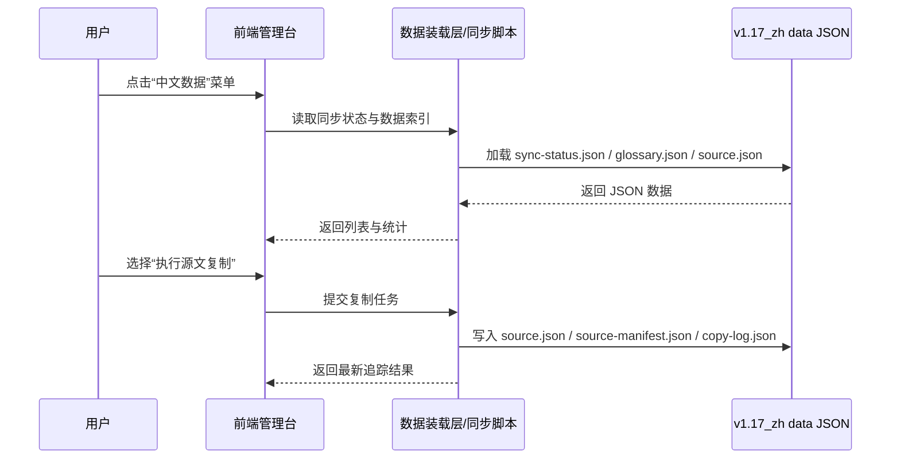

## Why

`dapr-docs-copilot` 仍带有脚手架期的 demo 信息架构，页面虽可展示，但不能支撑当前中文翻译数据管理、源文复制与追踪场景。现在需要把界面与数据模型同时收敛到真实工作流上，否则 UI、数据仓与历史脚本会继续脱节。

## What Changes

- 移除 `dapr-docs-copilot` 中仅用于演示的总览叙事、Copilot 工作台占位与无关菜单表达，使首屏聚焦中文翻译数据管理。
- 新增“中文数据”一级菜单，提供对 `repos/v1.17_zh/data/` 中 JSON 数据的查看入口，覆盖同步状态、术语对照、源文清单与追踪记录。
- 在 `repos/v1.17_zh` 新建统一的 `data/` 目录，并约定所有翻译管理数据均以 JSON 持久化。
- 基于已删除旧脚本 `src/scripts/tasks.py` 中的路径镜像与内容复制规则，定义新的源文复制流程，将 `repos/v1.17` 的英文源文按内容桶复制到 `data/source/`，并将文件级 metadata 写入 `source.json`。
- 为每次复制写入追踪记录，记录来源仓、来源分支、内容桶、相对路径、复制时间与同步状态，作为后续翻译任务编排的基础。
- 在 `sync-status.json` 中追加译文时间与状态判断，基于 `syncedAt` 与 `translationUpdatedAt` 标记 `translated`、`missingTranslation`、`staleTranslation` 与 `orphanTranslation`。

## High-Level UI Prototype

```text
┌──────────────────────────────────────────────────────────────────────┐
│ Copilot Console                                                     │
├──────────────────────┬───────────────────────────────────────────────┤
│ [中文数据] active    │ 中文翻译数据总览                              │
│ [站点]               │ ┌──────────────┬──────────────┬─────────────┐ │
│ [设置]               │ │ 同步状态     │ 术语对照     │ 源文追踪    │ │
│                      │ │ 正常 428     │ 规则 163     │ 最新 14:08  │ │
│                      │ └──────────────┴──────────────┴─────────────┘ │
│                      │ ┌───────────────────────────────────────────┐ │
│                      │ │ 数据分类                                  │ │
│                      │ │ [同步状态] [术语表] [源文清单] [复制日志] │ │
│                      │ └───────────────────────────────────────────┘ │
│                      │ ┌───────────────────────────────────────────┐ │
│                      │ │ 文件列表                                  │ │
│                      │ │ docs/getting-started.md    synced        │ │
│                      │ │ docs/concepts/actors.md    drift         │ │
│                      │ │ sdks_python/_index.md      copied        │ │
│                      │ └───────────────────────────────────────────┘ │
│                      │ 状态: normal / hover / disabled / error     │
└──────────────────────┴───────────────────────────────────────────────┘
```

## User Interaction Flow



## Code Change Table

| 文件路径 | 变更类型 | 变更原因 | 影响范围 |
| --- | --- | --- | --- |
| `repos/dapr-docs-copilot/src/components/app-shell.tsx` | 修改 | 清理 demo 菜单并将“中文数据”设为首个入口 | 侧边栏、移动导航 |
| `repos/dapr-docs-copilot/src/router.tsx` | 修改 | 新增中文数据路由，移除或收缩 demo 页面路由 | 前端路由树 |
| `repos/dapr-docs-copilot/src/pages/dashboard-page.tsx` | 修改 | 取消 demo 叙事，改为真实中文数据概览 | 首页信息结构 |
| `repos/dapr-docs-copilot/src/pages/zh-data-page.tsx` | 新增 | 提供 JSON 数据查看页 | 中文数据查看功能 |
| `repos/dapr-docs-copilot/src/lib/mock-api.ts` | 修改 | 用 zh 数据对象替代 demo 假数据 | 前端数据装载层 |
| `repos/v1.17_zh/data/sync-status.json` | 新增 | 统一记录文件同步状态 | 数据仓规范 |
| `repos/v1.17_zh/data/glossary.json` | 新增 | 统一记录中英术语对照 | 术语治理 |
| `repos/v1.17_zh/data/source.json` | 新增 | 记录源文文件级 metadata 与镜像路径 | 原文复制链路 |
| `repos/v1.17_zh/data/source-manifest.json` | 新增 | 记录批次级来源信息与桶汇总 | 原文复制链路 |
| `repos/v1.17_zh/data/copy-log.json` | 新增 | 记录复制批次、时间与来源 | 数据追踪 |
| `scripts/zh-data/sync_source_documents.ts` | 新增 | 沿用历史复制逻辑，建立可重复执行的新流程 | 源文复制自动化 |

## Capabilities

### New Capabilities
- `zh-data-console`: 定义中文翻译数据查看入口、导航结构与 JSON 数据浏览行为。
- `zh-translation-data-pipeline`: 定义中文仓 `data/` JSON 规范、源文复制流程与追踪记录要求。

### Modified Capabilities
- None.

## Impact

- 受影响仓库：`repos/dapr-docs-copilot`、`repos/v1.17_zh`。
- 参考但不修改：根仓历史流程分析、已删除旧脚本 `src/scripts/tasks.py`、`repos/v1.17/hugo.yaml`。
- 受影响系统：前端导航结构、前端数据装载层、中文翻译数据仓、源文复制脚本。
- 不涉及外部 API 破坏性变更；但会替换当前管理台的 demo 表达与默认入口。
