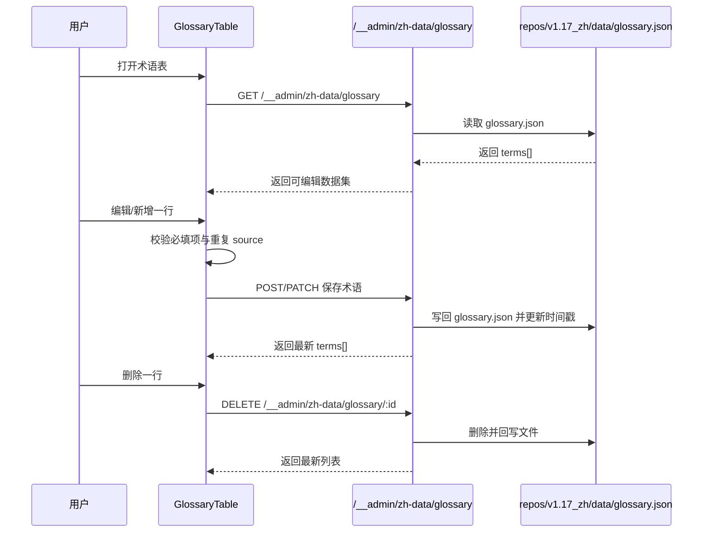
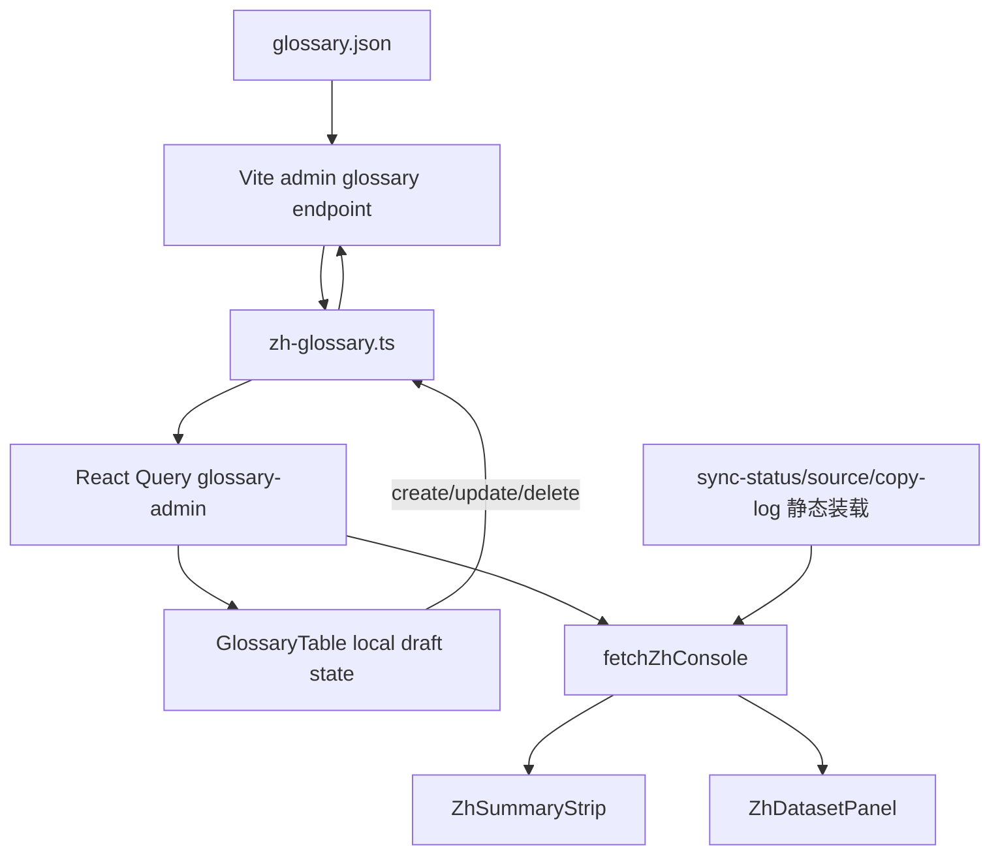
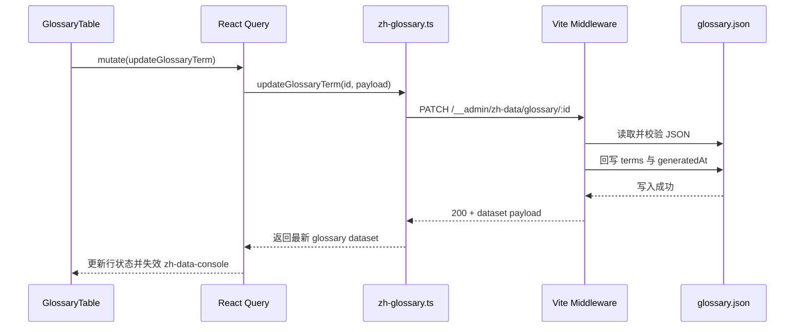

## Context

当前术语表实现仍是只读链路：`repos/dapr-docs-copilot/src/lib/zh-data.ts` 通过 `import.meta.glob(...glossary.json)` 在构建时一次性读取数据，`repos/dapr-docs-copilot/src/components/zh-data/dataset-panel.tsx` 再以通用表格直接渲染，因此页面既没有稳定行标识，也没有写回入口。与此同时，`repos/dapr-docs-copilot/vite.config.ts` 目前只暴露 `POST /__admin/zh-data/sync`，没有任何术语读写端点，导致“术语表”虽在真实工作台内，却仍停留在查看器阶段。

约束如下：

- 可编辑代码仓仅为 `repos/dapr-docs-copilot`，但运行时术语事实源仍是相邻仓 `repos/v1.17_zh/data/glossary.json`。
- 当前项目是 Vite + React + TanStack Query 前端，无独立后端服务；若要写文件，只能复用开发态中间件模式。
- 现有术语数据缺少稳定 `id`，仅靠 `source + target` 不能安全支撑“修改 source 本身”与删除操作。
- 术语表之外的 `同步状态`、`源文清单`、`复制日志` 仍以只读为主，本次不泛化为全量表格编辑框架。
- 非交互式流程下，默认假设主要运行场景为本地管理台开发态；若写入端点不可达，则术语表必须降级为只读并显式说明。

相关干系人：中文术语维护者、翻译校对人员、管理台前端维护者。

## Goals / Non-Goals

**Goals:**
- 在术语表标签内支持搜索、行内新增、行内编辑、删除与即时反馈。
- 让前端变更可写回 `repos/v1.17_zh/data/glossary.json`，并在成功后刷新术语列表与首页术语统计。
- 为每个术语条目建立稳定身份与基础校验规则，避免误删、误改与重复术语。
- 让术语数据模型收敛为 `source`、`target`、`notes` 三类业务字段，不再维护术语状态与分类。
- 保持 UI 改动集中在术语表，不破坏其他数据标签的只读行为。

**Non-Goals:**
- 不为 `sync-status`、`source`、`copy-log` 三类数据添加编辑能力。
- 不引入数据库、云端 API、鉴权系统或多人协同锁。
- 不把术语编辑扩展为批量导入、批量导出或跨版本术语同步系统。
- 不在术语表中保留审批流、状态流或任何额外的术语状态管理。

## Proposal Carry Forward

### Why

当前 `dapr-docs-copilot` 的术语表仅能读取 `glossary.json` 并以只读表格展示，维护者若要修正译法、补充术语或删除废弃项，仍需跳出当前视图手工改 JSON。随着中文数据台已成为真实工作入口，术语治理继续停留在只读模式，逻辑有问题，也会拖慢校对与回写效率。

### What Changes

- 在 `中文数据 -> 术语表` 标签内加入可搜索的行内 CRUD 工作流，支持新增术语、编辑已有术语、删除术语，并保留原有查询与浏览能力。
- 为术语条目补充稳定行标识与前端草稿状态，使 `source`、`target`、`notes` 可在表格中直接修改并校验，不再维护术语状态与分类字段。
- 新增术语表读写适配层与开发态管理端点，将前端变更持久化回 `repos/v1.17_zh/data/glossary.json`，成功后刷新摘要卡与术语列表。
- 让术语表在保存中、校验失败、保存失败、空态与只读降级态下都给出显式反馈，避免误判已写入。
- 保持 `同步状态`、`源文清单`、`复制日志` 三个标签页为只读，不扩散为整页通用编辑器。

### Capabilities

- `zh-glossary-inline-editing`
- `zh-data-console`

## High-Level UI Prototype

```text
┌──────────────────────────────────────────────────────────────────────────────┐
│ 中文数据 / 术语表                       搜索[workflow      ] [+ 新增术语]    │
├──────────────────────────────────────────────────────────────────────────────┤
│ badge: 可写 / 只读降级 / 保存中 / 保存失败                                    │
├──────────────┬──────────────┬──────────────┬──────────┤
│ 英文         │ 中文         │ 备注         │ 操作     │
├──────────────┼──────────────┼──────────────┼──────────┤
│ workflow     │ 工作流       │ API 术语     │ 编辑 删除 │
│ sidecar      │ [边车      ] │ [沿用术语  ] │ 保存 取消 │
│ drift        │ [漂移      ] │ [重复待查  ] │ 保存 取消 │
│ [source    ] │ [target    ] │ [notes     ] │ 创建 取消 │
├──────────────────────────────────────────────────────────────────────────────┤
│ 错误行：source 为空 / source 重复 / 写入失败                                 │
└──────────────────────────────────────────────────────────────────────────────┘
```

## User Interaction Flow



## Component Architecture

```text
组件层次结构
├── ZhDataPage
│   └── ZhDataConsoleView
│       ├── ZhSummaryStrip
│       └── ZhDatasetPanel
│           ├── GenericDatasetTable (sync/source/copy-log)
│           └── GlossaryTable
│               ├── GlossaryToolbar
│               │   ├── SearchInput
│               │   └── AddTermButton
│               ├── GlossaryEditableRow
│               ├── GlossaryCreateRow
│               └── GlossaryStatusBanner
├── useQuery(['zh-data-console'])
├── useQuery(['glossary-admin'])
└── useMutation(create/update/delete glossary term)
    └── zh-glossary.ts
        ├── fetchGlossaryDataset
        ├── createGlossaryTerm
        ├── updateGlossaryTerm
        └── deleteGlossaryTerm
```

## Data Flow Diagram



## API Sequence Diagram



## Detailed Code Change Inventory

| 文件路径 | 变更类型 | 变更说明 | 影响模块 |
| --- | --- | --- | --- |
| `repos/dapr-docs-copilot/src/components/zh-data/dataset-panel.tsx` | 修改 | 区分术语表与通用数据表的渲染分支 | 术语表入口 |
| `repos/dapr-docs-copilot/src/components/zh-data/glossary-table.tsx` | 新增 | 提供搜索、编辑、新增、删除、错误提示、只读降级提示 | 术语交互 |
| `repos/dapr-docs-copilot/src/components/ui/input.tsx` | 复用/可能微调 | 适配行内输入与错误态样式 | 表单基础组件 |
| `repos/dapr-docs-copilot/src/pages/zh-data-page.tsx` | 修改 | 注入 glossary query/mutation，并在成功后失效 console query | 页面协调层 |
| `repos/dapr-docs-copilot/src/lib/zh-data.ts` | 修改 | 让术语数据支持运行时刷新，并将摘要统计与新数据保持一致 | 控制台聚合数据 |
| `repos/dapr-docs-copilot/src/lib/zh-data-models.ts` | 修改 | 增加 glossary term、editor state、write capability 等类型 | 领域模型 |
| `repos/dapr-docs-copilot/src/lib/zh-glossary.ts` | 新增 | 定义 glossary DTO、校验、HTTP 客户端与错误转换 | 数据访问层 |
| `repos/dapr-docs-copilot/vite.config.ts` | 修改 | 增加 GET/POST/PATCH/DELETE 术语管理端点与串行写保护 | 本地管理 API |
| `repos/dapr-docs-copilot/scripts/validate-zh-data-ui.tsx` | 修改 | 增加术语表编辑态与错误态验证样例 | 回归脚本 |
| `repos/v1.17_zh/data/glossary.json` | 数据模型演进 | 术语项新增 `id`、`updatedAt` 等写链路所需字段，并移除 `status` | 术语事实源 |

## Decisions

### 1. 只让术语表进入可编辑模式，不抽象成全局“可编辑数据表”

选择：在 `ZhDatasetPanel` 内对 `glossary` 分支单独渲染 `GlossaryTable`，其余数据集仍走现有只读表格。

原因：
- 术语表字段固定、交互密度高，适合专用组件。
- 其他数据集仍是同步追踪视图，强行泛化会放大状态复杂度。
- 用户目标明确是术语治理，不是整页 JSON 管理器。

备选方案：
- 抽象统一 editable table：复用度高，但当前字段差异、错误态和操作语义并不一致。
- 全页表单编辑：实现更简单，但失去“就地改一行”的效率优势。

### 2. 为术语条目补充持久化 `id`，而不是继续使用 `source + target` 作为主键

选择：`glossary.json` 中每条术语在写回后都拥有不可变 `id`，可附带 `updatedAt`。

原因：
- 用户可能直接修改 `source`，组合主键会在编辑中失稳。
- 删除、保存、错误定位都需要稳定主键。
- 未来若支持排序、批量校验，也需要稳定身份。

备选方案：
- 前端临时 key：刷新即失效，无法支持 PATCH/DELETE。
- 继续用 `source` 作为主键：遇到改英文词本身时会冲突。

### 3. 术语数据改为“运行时读取 + 变更后失效重拉”，而非继续完全依赖 `import.meta.glob`

选择：新增 `zh-glossary.ts` 通过开发态端点拉取和变更 glossary 数据；`fetchZhConsole()` 在构建 summary 时优先使用最新 glossary 数据，其他三类数据仍沿用现有静态装载。

原因：
- 静态导入会缓存构建时内容，无法反映刚保存的术语。
- 将 live glossary 读取单独抽离，改动范围最小。
- TanStack Query 已在项目中存在，适合处理失效重拉与 mutation 状态。

备选方案：
- 所有数据集一起改为 HTTP API：长期更统一，但超出本次最小变更。
- 保存后全页强刷：能工作，但体验粗暴且难保留编辑上下文。

### 4. 复用 Vite 中间件提供本地 CRUD 端点，并在服务端串行写文件

选择：在 `vite.config.ts` 现有 `__admin` 模式下补 `GET/POST/PATCH/DELETE /__admin/zh-data/glossary`，所有写入串行执行，读写都以 `glossary.json` 为事实源。

原因：
- 现有项目已用同模式暴露 `sync` 端点，实现一致。
- 无需新建 Node 服务或引入额外依赖。
- 串行写入可避免快速连点产生交叉覆盖。

备选方案：
- 直接前端写文件：浏览器环境不可行。
- 引入 Express/Fastify：结构更完整，但超出当前仓库需要。

### 5. 采用“行级保存/取消 + 即时删除 + 客户端搜索”的交互模型

选择：每行独立进入编辑态；新增行与编辑行都用本地草稿校验后再保存；删除操作即时提交并刷新列表；搜索仅过滤当前列表。

原因：
- 行级模型最贴合“修一条术语即走”的维护节奏。
- 局部 mutation 状态更易解释，失败也只影响当前行。
- 不需要额外引入批量草稿缓存与整体提交栏。

备选方案：
- 全表批量保存：适合重度编辑，但状态复杂度明显更高。
- 抽屉表单编辑：表单空间更大，但违背“行内编辑”目标。

### 6. 从术语 schema 中移除 `status` 与 `category` 字段，保持最小术语模型

选择：术语记录只保留 `source`、`target`、`notes` 与持久化元字段（如 `id`、`updatedAt`），不再暴露或维护 `status`、`category`。

原因：
- 当前反馈已明确术语不需要状态管理与分类管理，继续保留只会增加录入成本。
- 术语表职责是维护映射与备注，不承担审批流或分类体系。
- 去掉 `status`、`category` 后，行内表格更轻，新增与编辑路径更直接。

备选方案：
- 保留字段但隐藏 UI：数据模型仍冗余，后续读写逻辑仍需维护。
- 将 `category` 改为标签体系：本质仍是分类管理，不符合反馈。

## Risks / Trade-offs

- [数据模型迁移] 旧 `glossary.json` 可能带有 `status`、`category` 且无 `id` → 首次成功写入时统一补齐 `id` 与 `updatedAt`，并移除旧 `status`、`category` 字段。
- [开发态依赖] Vite 管理端点只在本地服务可用 → UI 必须检测端点可用性，不可写时明确降级为只读。
- [并发覆盖] 多窗口同时写 glossary 可能互相覆盖 → 服务端串行写入，并以“每次操作返回最新全量 terms”降低前端陈旧缓存风险。
- [校验边界] 术语重复规则若仅按 `source` 可能过严 → 先按 `source` 唯一处理；既然不再管理分类，也不再支持按分类拆分同名术语。

## Migration Plan

1. 前端上线后，术语表首次读取先兼容旧格式，包括缺少 `id` 或仍带 `status`、`category` 的历史数据。
2. 当发生首次新增、编辑或删除时，管理端点在写回阶段为所有历史条目补齐 `id`、刷新顶层 `generatedAt`，并清理旧 `status`、`category` 字段。
3. 保存成功后失效 `['glossary-admin']` 与 `['zh-data-console']` 查询，使术语列表、摘要卡、首页术语数同时更新。
4. 若写入失败，前端保留当前行草稿，不修改已持久化文件；回滚仅需重新加载最新 glossary 数据。

## Open Questions

- 无阻塞问题。默认假设历史 `status`、`category` 仅作兼容读取，后续写回时即从术语 schema 中移除。
