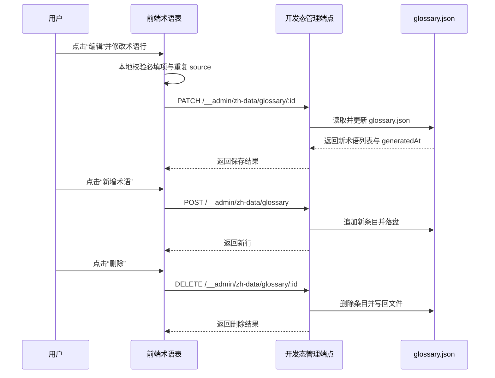

## Why

当前 `dapr-docs-copilot` 的术语表仅能读取 `glossary.json` 并以只读表格展示，维护者若要修正译法、补充术语或删除废弃项，仍需跳出当前视图手工改 JSON。随着中文数据台已成为真实工作入口，术语治理继续停留在只读模式，逻辑有问题，也会拖慢校对与回写效率。

## What Changes

- 在 `中文数据 -> 术语表` 标签内加入可搜索的行内 CRUD 工作流，支持新增术语、编辑已有术语、删除术语，并保留原有查询与浏览能力。
- 为术语条目补充稳定行标识与前端草稿状态，使 `source`、`target`、`notes` 可在表格中直接修改并校验，不再维护术语状态与分类字段。
- 新增术语表读写适配层与开发态管理端点，将前端变更持久化回 `repos/v1.17_zh/data/glossary.json`，成功后刷新摘要卡与术语列表。
- 让术语表在保存中、校验失败、保存失败、空态与只读降级态下都给出显式反馈，避免误判已写入。
- 保持 `同步状态`、`源文清单`、`复制日志` 三个标签页为只读，不扩散为整页通用编辑器。

## High-Level UI Prototype

```text
┌──────────────────────────────────────────────────────────────────────────────┐
│ 中文数据 / 术语表                         搜索[workflow      ] [+ 新增术语]   │
├──────────────────────────────────────────────────────────────────────────────┤
│ 交互: ready / editing / saving / error                                       │
├──────────────┬──────────────┬──────────────┬──────────┤
│ 英文         │ 中文         │ 备注         │ 操作     │
├──────────────┼──────────────┼──────────────┼──────────┤
│ workflow     │ 工作流       │ API 术语     │ 编辑 删除 │
│ sidecar      │ [边车      ] │ [沿用术语  ] │ 保存 取消 │
│ state store  │ 状态存储     │ ——           │ 编辑 删除 │
│ [source    ] │ [target    ] │ [notes     ] │ 创建 取消 │
├──────────────────────────────────────────────────────────────────────────────┤
│ 悬停: 操作显现  禁用: 保存中按钮灰化  错误: 行内红框 + 错误文案               │
└──────────────────────────────────────────────────────────────────────────────┘
```

## User Interaction Flow



## Code Change Table

| 文件路径 | 变更类型 | 变更原因 | 影响范围 |
| --- | --- | --- | --- |
| `repos/dapr-docs-copilot/src/components/zh-data/dataset-panel.tsx` | 修改 | 将术语表从只读表格拆为可编辑视图入口 | 术语表渲染 |
| `repos/dapr-docs-copilot/src/components/zh-data/glossary-table.tsx` | 新增 | 承载搜索、行内编辑、新增与删除交互 | 术语表 CRUD UI |
| `repos/dapr-docs-copilot/src/pages/zh-data-page.tsx` | 修改 | 接入术语查询与变更后的重新拉取逻辑 | 页面数据流 |
| `repos/dapr-docs-copilot/src/lib/zh-data.ts` | 修改 | 为术语数据提供可刷新的读取路径，避免静态导入缓存 | 数据装载层 |
| `repos/dapr-docs-copilot/src/lib/zh-data-models.ts` | 修改 | 扩展术语表视图模型与编辑态字段 | 类型模型 |
| `repos/dapr-docs-copilot/src/lib/zh-glossary.ts` | 新增 | 封装 glossary 读写 API、校验与 DTO 转换 | 术语数据访问 |
| `repos/dapr-docs-copilot/vite.config.ts` | 修改 | 扩展开发态 `__admin` 中间件，支持 glossary CRUD | 本地持久化端点 |
| `repos/dapr-docs-copilot/scripts/validate-zh-data-ui.tsx` | 修改 | 覆盖术语表编辑态、错误态与新增态快照 | UI 校验 |
| `repos/v1.17_zh/data/glossary.json` | 运行时数据更新 | 保存术语新增、修改、删除结果，并回填稳定 ID | 术语事实源 |

## Capabilities

### New Capabilities
- `zh-glossary-inline-editing`: 定义术语表的行内新增、编辑、删除、校验与持久化回写行为。

### Modified Capabilities
- `zh-data-console`: 术语表标签由只读浏览扩展为可搜索、可编辑且带保存反馈的数据视图。

## Impact

- 受影响仓库：`repos/dapr-docs-copilot`。
- 运行时写入目标：`repos/v1.17_zh/data/glossary.json`。
- 受影响系统：术语表列表渲染、React Query 数据刷新、Vite 开发态管理端点、本地 JSON 持久化。
- 不引入外部数据库或新服务；CRUD 能力仍依托仓库内 JSON 文件。
