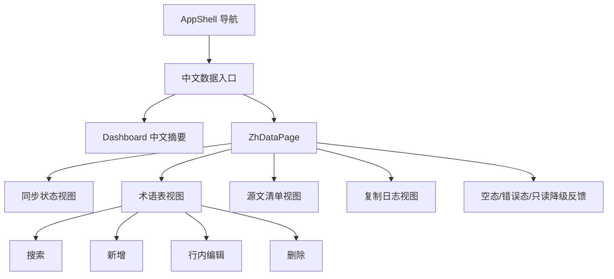

# zh-data-console

## Capability Model

## Requirement Matrix

| Requirement | 说明 | 场景数 |
| --- | --- | --- |
| Console renders standardized datasets | 页面须展示统一 JSON 数据集；术语表支持行内 CRUD | 3 |
| Console handles empty and failed datasets | 页面须处理缺失、空数据、写入失败与只读降级 | 4 |

## MODIFIED Requirements

### Requirement: Console renders standardized datasets
The system SHALL provide a dedicated zh data view that loads standardized JSON datasets from the zh repository and renders summary cards plus dataset-specific tables or editors for sync status, glossary, source manifest, and copy log; the sync status view MUST expose both source synchronization and translation freshness signals, and the glossary view MUST support search, inline create, inline update, and delete without requiring route navigation.

#### Scenario: Workspace summary loads successfully
- **WHEN** the zh data view loads with valid dataset files
- **THEN** the page SHALL display summary metrics derived from sync status, glossary size, and latest copy batch metadata

#### Scenario: User switches dataset tabs
- **WHEN** the user selects one of `同步状态`、`术语表`、`源文清单` or `复制日志`
- **THEN** the console SHALL render records from the corresponding standardized dataset without requiring route navigation

#### Scenario: User manages glossary rows inline
- **WHEN** the user creates, updates, or deletes a glossary row with valid input inside the `术语表` tab
- **THEN** the console SHALL persist the change and refresh the glossary-derived view state without leaving the current page

### Requirement: Console handles empty and failed datasets
The system SHALL expose explicit empty-state and error-state feedback when expected zh datasets are missing, unreadable, or have zero records, and it SHALL also surface glossary write-path failures or unavailability without hiding already readable glossary data.

#### Scenario: Dataset file is missing
- **WHEN** the zh data loader cannot locate a required dataset file
- **THEN** the console SHALL render an error state that identifies which dataset is unavailable

#### Scenario: Dataset has no records
- **WHEN** the zh data loader returns an empty record set for a valid dataset
- **THEN** the console SHALL render an empty-state message instead of an empty table shell

#### Scenario: Glossary mutation fails
- **WHEN** a glossary create, update, or delete request returns failure
- **THEN** the console SHALL keep the affected glossary row in an actionable state and display an inline or banner error message describing the failure

#### Scenario: Glossary write path is unavailable
- **WHEN** the glossary tab can load readable data but the write endpoint is unavailable in the current runtime
- **THEN** the console SHALL render the glossary dataset in read-only mode and explain that create, edit, and delete actions are temporarily disabled
