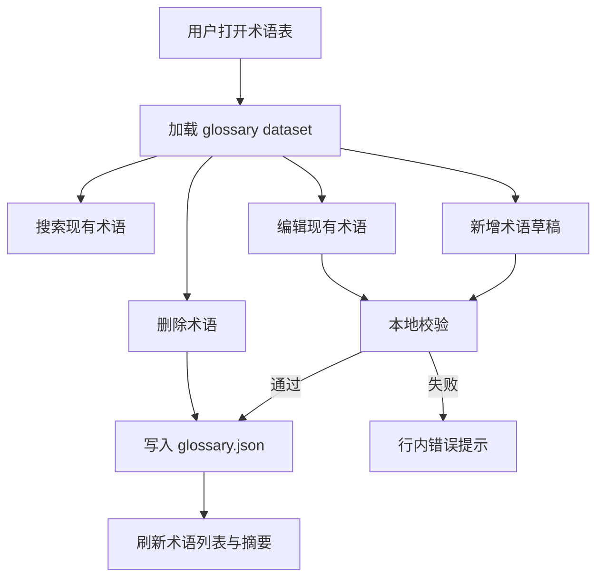

# zh-glossary-inline-editing

## Capability Model

## Requirement Matrix

| Requirement | 说明 | 场景数 |
| --- | --- | --- |
| Glossary terms have stable identity | 术语项需具备稳定主键与可编辑字段 | 2 |
| User can create glossary term inline | 支持在列表内新增术语 | 2 |
| User can update glossary term inline | 支持对单行术语直接编辑并保存 | 2 |
| User can delete glossary term inline | 支持删除无效术语 | 1 |
| Glossary mutations persist safely | 写入后需刷新列表并保持 JSON 可读 | 2 |

## ADDED Requirements

### Requirement: Glossary terms have stable identity
The system SHALL persist each glossary term with an immutable `id` and editable fields including `source`, `target`, `category`, `status`, and `notes`, and it MUST continue to load legacy glossary records that do not yet contain `id`.

#### Scenario: Legacy glossary records are normalized on first successful write
- **WHEN** the glossary dataset contains existing terms without `id` and the user completes any successful create, update, or delete operation
- **THEN** the persisted glossary dataset SHALL assign stable `id` values to all stored terms before the write completes

#### Scenario: Editing source text does not change row identity in session
- **WHEN** the user edits the `source` field of an existing glossary term
- **THEN** the system SHALL continue to address that row by its immutable `id` rather than by the old `source` text

### Requirement: User can create glossary term inline
The system SHALL allow the user to open a new inline row inside the glossary table, populate the required fields, validate the draft locally, and persist the new term without leaving the current dataset tab.

#### Scenario: Valid new glossary term is created from inline row
- **WHEN** the user clicks the add action, fills valid `source` and `target` values, and confirms creation
- **THEN** the system SHALL persist the new glossary term and render it in the glossary table within the current page context

#### Scenario: Invalid new glossary term is blocked before persistence
- **WHEN** the new glossary draft is missing a required field or duplicates an existing term's `source`
- **THEN** the system MUST prevent persistence and show an inline validation message on the draft row

### Requirement: User can update glossary term inline
The system SHALL allow the user to switch an existing glossary row into edit mode, modify its editable fields inline, and either save or cancel the row without affecting other rows.

#### Scenario: Edited glossary row is saved inline
- **WHEN** the user updates an existing glossary row with valid values and clicks save
- **THEN** the system SHALL persist the updated term and return that row to read mode with refreshed values

#### Scenario: Row edit can be canceled without persistence
- **WHEN** the user enters edit mode and cancels before saving
- **THEN** the system SHALL discard the unsaved draft values for that row and leave the persisted glossary dataset unchanged

### Requirement: User can delete glossary term inline
The system SHALL allow the user to delete an existing glossary term directly from the glossary table and remove it from the persisted dataset once the delete action succeeds.

#### Scenario: Existing glossary row is deleted
- **WHEN** the user triggers delete on an existing glossary row and the delete request succeeds
- **THEN** the system SHALL remove that glossary term from the persisted dataset and from the currently rendered glossary table

### Requirement: Glossary mutations persist safely
The system SHALL write create, update, and delete operations back to `repos/v1.17_zh/data/glossary.json`, refresh glossary-derived UI state after success, and preserve a machine-readable glossary dataset on every successful write.

#### Scenario: Successful mutation refreshes glossary table and summary
- **WHEN** any glossary create, update, or delete operation succeeds
- **THEN** the system SHALL refresh both the glossary table data and any summary values derived from glossary term counts

#### Scenario: Failed mutation leaves persisted glossary unchanged
- **WHEN** a glossary mutation request fails during validation or file write
- **THEN** the system SHALL keep the last persisted glossary dataset readable and return an actionable error to the current editing context
