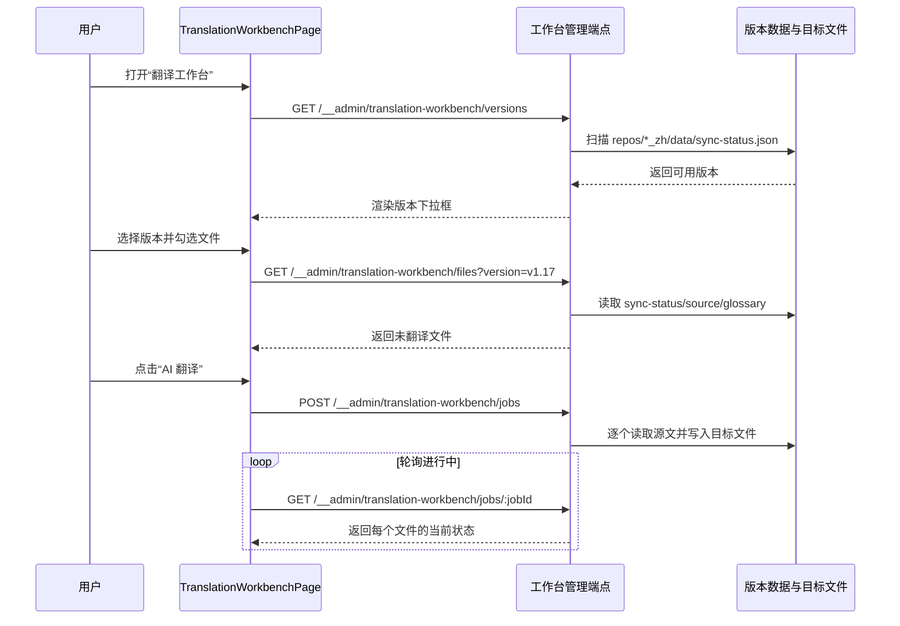
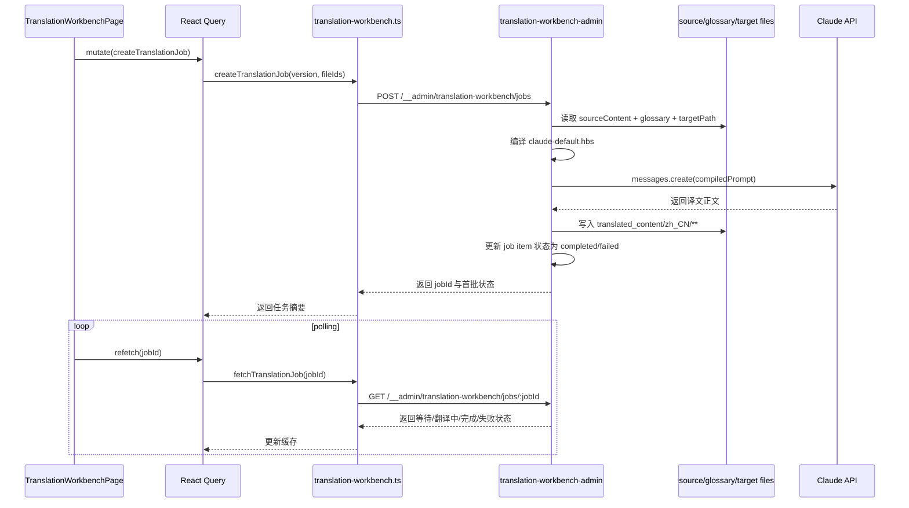

## Context

当前 `repos/dapr-docs-copilot` 仍是“数据查看台”而非“翻译工作台”：侧边栏只有 `中文数据`，`src/lib/zh-data.ts` 通过 `import.meta.glob('../../../v1.17_zh/data/{sync-status,glossary,source,copy-log}.json')` 静态读取单一版本数据，`vite.config.ts` 也仅暴露 `POST /__admin/zh-data/sync` 一个开发态端点。结果是页面能看见未翻译状态，却无法从同一界面发起翻译、注入术语表、跟踪队列，提示词也没有独立文件资产可供非开发者调整。

本次设计同时涉及前端路由、导航、Vite 本地管理端点、Claude API 调用、模板文件管理、跨版本数据发现与任务状态轮询，属于跨模块变更。约束如下：

- 可编辑仓库仅为 `repos/dapr-docs-copilot`，但运行时需要读写相邻版本仓中的 `data/` 与 `translated_content/`。
- 当前应用无独立 Node 服务；若要访问文件系统与 Claude，只能沿用 Vite 开发态中间件模式。
- 现有 `sync-status.json` 已给出 `translationFile`、`sourceFile`、`syncedAt` 等基础信息，可作为工作台文件清单基底，但其内容是批量同步快照，不适合直接承担实时队列状态。
- 用户需求允许 WebSocket 或轮询；现有项目只有 Vite 内置 full reload 通道，没有自定义消息总线。
- 提示词须以 `.hbs` 文件独立存放，且术语表注入必须来自现有 `glossary.json`，不能再散落为硬编码常量。
- 非交互式假设下，默认运行环境是本地开发态管理台，并通过环境变量提供 `ANTHROPIC_API_KEY`。

相关干系人：中文译者、术语维护者、管理台前端维护者。

## Goals / Non-Goals

**Goals:**
- 提供独立 `翻译工作台` 路由，完成版本选择、未翻译文件浏览、多选建队、串行 AI 翻译与状态追踪。
- 基于版本仓中的 `sync-status.json`、`source.json`、`glossary.json` 装载工作台数据，并把术语表稳定注入 Claude 提示词。
- 将翻译提示词拆为可版本化的 `.hbs` 文件，允许运维或译者直接调整翻译策略而无需改代码。
- 对每个文件暴露 `等待中`、`翻译中`、`翻译完成`、`翻译失败` 四态，并支持失败项重试。
- 保持现有 `中文数据` 页面继续承担底层数据核对职责，不与工作台角色混淆。

**Non-Goals:**
- 不在本次变更中为 `中文数据` 页做全量多版本改造。
- 不引入持久化数据库、消息队列、独立后端服务或分布式任务系统。
- 不提供提示词在线编辑器；模板文件独立存储即可。
- 不把译后结果自动提交到 Git、自动发 PR 或自动部署站点。
- 不扩展为并行翻译执行；本次明确采用单队列串行模式。

## Proposal Carry Forward

### Why

当前 `dapr-docs-copilot` 已具备术语表与版本化翻译数据，但译者仍需在数据视图、文件系统与零散提示词之间来回切换，无法在一个工作空间内完成“选版本、选文件、批量翻译、看进度”的闭环。既然中文数据管理台已替代 demo 成为真实入口，翻译执行链路继续停留在分散状态，逻辑有问题，也会直接拖慢产能与一致性控制。

### What Changes

- 新增一级菜单 `翻译工作台` 与独立页面，为译者提供版本选择、未翻译文件浏览、多选队列与进度跟踪的一体化工作区。
- 新增工作台后端管理端点，按版本读取 `repos/*_zh/data` 数据集，筛出未翻译文件，并串行调用 Claude 完成单文件翻译与目标文件落盘。
- 将 Claude 翻译提示词收拢为独立 `.hbs` 模板文件，并在运行时注入 `sourceContent`、`glossary`、`targetPath` 等变量，避免提示词继续散落在代码中。
- 在翻译执行链路中系统化引入术语表映射，保证术语对照进入每次提示词构造，而不是依赖人工复制。
- 为每个队列文件提供 `等待中`、`翻译中`、`翻译完成`、`翻译失败` 四态，并支持失败项重试；前端通过轮询获取状态，无需手动刷新。
- 保留现有 `中文数据` 页面作为底层数据查看入口，但侧边栏导航扩展为“工作台 + 数据台”双入口，而非只停留在数据集浏览。

### Capabilities

- `zh-translation-workbench`
- `zh-data-console`

## High-Level UI Prototype

```text
┌──────────────────────────────────────────────────────────────────────────────────────┐
│ 翻译工作台                                版本 [v1.17 ▼]   模板 [claude-default.hbs] │
├──────────────────────────────────────────────────────────────────────────────────────┤
│ 未翻译 92 | 队列中 12 | 完成 3 | 失败 1                                              │
│ [全选当前页] [清空选择] [AI 翻译] [刷新列表]                                         │
├────┬────────┬───────────────────────────────────────────────┬─────────┬──────────────┤
│ 选 │ 状态   │ 文件路径                                      │ 大小    │ 操作         │
├────┼────────┼───────────────────────────────────────────────┼─────────┼──────────────┤
│ ☑  │ 等待中 │ docs/concepts/building-blocks-concept.md      │ 12.4 KB │ 移出队列     │
│ ☑  │ 翻译中 │ docs/concepts/components-concept.md           │ 8.1 KB  │ 禁用         │
│ ☑  │ 翻译完成│ docs/getting-started/install-dapr-cli.md     │ 6.3 KB  │ 查看目标文件 │
│ ☑  │ 翻译失败│ docs/operations/hosting/kubernetes/_index.md │ 10.8 KB │ 重试         │
├────┴────────┴───────────────────────────────────────────────┴─────────┴──────────────┤
│ 版本切换：队列运行中禁用  /  失败态：显示错误摘要  /  空态：提示当前版本无未翻译文件 │
└──────────────────────────────────────────────────────────────────────────────────────┘
```

## User Interaction Flow



## Component Architecture

```text
组件层次结构
├── AppShell
│   ├── PrimaryNavigation
│   │   ├── 翻译工作台
│   │   └── 中文数据
│   └── RouterOutlet
├── TranslationWorkbenchPage
│   ├── useQuery(['translation-workbench', 'versions'])
│   ├── useQuery(['translation-workbench', 'files', version])
│   ├── useMutation(createTranslationJob)
│   └── useQuery(['translation-workbench', 'job', jobId])
│       └── TranslationWorkbenchView
│           ├── WorkbenchToolbar
│           │   ├── VersionSelect
│           │   ├── TemplateBadge
│           │   └── TranslateButton
│           ├── FileQueueTable
│           └── JobStatusSummary
├── src/lib/translation-workbench.ts
│   ├── fetchAvailableVersions
│   ├── fetchUntranslatedFiles
│   ├── createTranslationJob
│   ├── fetchTranslationJob
│   └── retryTranslationItem
└── src/server/translation-workbench-admin.ts
    ├── scanVersionDatasets
    ├── loadWorkbenchDataset
    ├── enqueueTranslationJob
    ├── runSerialTranslationQueue
    ├── compilePromptTemplate
    └── callClaudeAndWriteTarget
```

## Data Flow Diagram

```mermaid
flowchart TD
    A[repos/*_zh/data/sync-status.json] --> B[loadWorkbenchDataset]
    C[repos/*_zh/data/source.json] --> B
    D[repos/*_zh/data/glossary.json] --> B
    B --> E[/__admin/translation-workbench/files/]
    E --> F[React Query files query]
    F --> G[TranslationWorkbenchView]
    G --> H[createTranslationJob]
    H --> I[/__admin/translation-workbench/jobs/]
    I --> J[in-memory job store]
    J --> K[serial queue worker]
    L[prompts/translation/claude-default.hbs] --> K
    M[data/source/** markdown] --> K
    K --> N[Claude API]
    N --> O[translated_content/zh_CN/**]
    J --> P[/__admin/translation-workbench/jobs/:jobId]
    P --> Q[React Query polling]
    Q --> G
```

## API Sequence Diagram



## Detailed Code Change Inventory

| 文件路径 | 变更类型 | 变更说明 | 影响模块 |
| --- | --- | --- | --- |
| `repos/dapr-docs-copilot/src/lib/primary-navigation.ts` | 修改 | 加入 `翻译工作台` 导航项并保留 `中文数据` | 一级菜单 |
| `repos/dapr-docs-copilot/src/router.tsx` | 修改 | 注册 `translation-workbench` 路由 | 路由系统 |
| `repos/dapr-docs-copilot/src/pages/translation-workbench-page.tsx` | 新增 | 组织版本查询、文件查询、任务创建与任务轮询 | 页面协调层 |
| `repos/dapr-docs-copilot/src/components/translation-workbench/workbench-view.tsx` | 新增 | 组合工具栏、统计、表格与错误提示 | 页面视图 |
| `repos/dapr-docs-copilot/src/components/translation-workbench/file-queue-table.tsx` | 新增 | 支持多选、全选、状态 badge、失败重试 | 文件表格 |
| `repos/dapr-docs-copilot/src/components/translation-workbench/job-status-summary.tsx` | 新增 | 汇总等待中/翻译中/完成/失败计数 | 进度摘要 |
| `repos/dapr-docs-copilot/src/lib/translation-workbench-models.ts` | 新增 | 定义 version/file/job/status DTO | 类型模型 |
| `repos/dapr-docs-copilot/src/lib/translation-workbench.ts` | 新增 | 封装工作台 HTTP 客户端与轮询参数 | 前端数据访问 |
| `repos/dapr-docs-copilot/src/server/translation-workbench-admin.ts` | 新增 | 提供版本发现、数据装载、任务存储、队列执行与重试 | Node 侧管理逻辑 |
| `repos/dapr-docs-copilot/src/server/translation-template.ts` | 新增 | 负责读取 `.hbs` 模板并渲染运行时变量 | 提示词编译 |
| `repos/dapr-docs-copilot/vite.config.ts` | 修改 | 注册工作台相关 GET/POST 端点 | 开发态后端 |
| `repos/dapr-docs-copilot/prompts/translation/claude-default.hbs` | 新增 | 默认翻译模板，明确 glossary/sourceContent/targetPath 占位 | 提示词资产 |
| `repos/dapr-docs-copilot/package.json` | 修改 | 新增 `@anthropic-ai/sdk` 与 `handlebars` 依赖 | 依赖管理 |
| `repos/dapr-docs-copilot/README.md` | 修改 | 记录环境变量、模板目录、仅开发态可写等前提 | 项目文档 |
| `repos/dapr-docs-copilot/scripts/validate-zh-data-ui.tsx` | 修改 | 补工作台基础渲染与状态展示校验 | UI 回归 |

## Decisions

### 1. 采用“Vite 管理端点 + 内存队列”，而非新建独立后端服务

选择：继续沿用 `vite.config.ts` 中现有 `__admin` 模式，新增工作台端点，并在 Node 侧维护进程内任务状态。

原因：
- 当前项目已存在 `POST /__admin/zh-data/sync`，扩展模式一致，改动面最小。
- 需求聚焦本地管理台，不值得为单机翻译流程引入额外服务形态。
- 内存队列足够覆盖“串行处理 + 实时轮询”需求。

备选方案：
- 新建 Express/Fastify 服务：结构更完整，但明显超出当前仓库规模。
- 直接前端调用 Claude：会暴露密钥，也无法安全写本地文件。

### 2. 采用轮询拉取任务状态，而非自定义 WebSocket 推送

选择：前端以 React Query `refetchInterval` 轮询 `GET /jobs/:jobId`，当所有条目进入终态时停止。

原因：
- 用户允许 WebSocket 或轮询；轮询更贴合当前项目现状。
- 项目没有自定义消息协议，新增 WebSocket 会放大 Vite 中间件复杂度。
- 任务状态粒度是秒级，轮询足以支撑可观测性。

备选方案：
- 自定义 WebSocket 推送：实时性更高，但实现成本与调试负担更大。
- 全页刷新：体验过粗，不满足逐文件状态反馈。

### 3. 以 `sync-status.json` 为索引基底，并在工作台读取时叠加文件系统真值

选择：文件列表先读 `sync-status.json`，取默认 `translationStatus === missingTranslation` 的记录；同时结合 `translationFile` 与目标文件实际存在性，避免队列执行后仍完全依赖旧快照。

原因：
- `sync-status.json` 已提供稳定 `relativePath`、`sourceFile`、`translationFile` 与 `syncedAt`，足够支撑列表生成。
- 队列执行后若只看旧 JSON，用户会看到“刚翻完仍显示未翻译”，逻辑有问题。
- 叠加文件系统检查可以不修改既有同步脚本即可获得更接近实时的结果。

备选方案：
- 队列完成后强制执行一次 `zh:data:sync`：结果更统一，但批量翻译时会极慢。
- 直接改写 `sync-status.json`：风险较高，且会与同步管道职责边界交叉。

### 4. 提示词模板独立为 `.hbs` 文件，并由服务端动态注入 glossary

选择：在 `prompts/translation/` 下保存 `.hbs` 模板，服务端读取模板后注入 `sourceContent`、`glossary`、`targetPath`、`version` 等变量。

原因：
- 满足非开发人员可直接调整策略的诉求。
- 模板可被版本控制，便于追踪翻译策略演进。
- Handlebars 足够轻量，适合当前占位变量需求。

备选方案：
- 继续硬编码模板字符串：维护门槛高，违背需求。
- 用 JSON/YAML 片段拼提示词：变量替换不如模板语义清晰。

### 5. 仅允许单任务串行翻译，并为失败项提供显式重试

选择：单次点击创建一个 job，job 内文件按顺序逐个调用 Claude；失败项保留错误并允许单项重试。

原因：
- 用户已明确要求串行处理。
- 串行更易控制速率、错误定位与文件写入次序。
- 失败项重试能避免整批重新开始。

备选方案：
- 并发多文件翻译：速度更快，但更难处理速率限制与写入冲突。
- 批次失败即整体中断：用户恢复成本太高。

## Risks / Trade-offs

- [开发态依赖] 端点与文件写入依赖 Vite 本地服务 → 在 UI 显式提示“仅开发态可执行翻译”，非开发态仅保留只读说明。
- [Claude 响应不稳定] 模型可能返回额外解释文字或格式噪音 → 在模板中强约束“只返回译文正文”，并在写入前做最小输出校验。
- [大文件 token 成本] 个别 Markdown 文档过长，连同 glossary 可能逼近上下文上限 → 初版只处理单文件全文，后续可按标题切片；当前先在失败态给出明确错误。
- [多窗口竞争] 同一版本多窗口同时发起工作台任务可能重复写同一目标文件 → 以内存队列按 `version + relativePath` 做运行中锁，阻止同文件重复执行。
- [版本发现不完整] 某些 `repos/*_zh` 目录可能缺少完整 `data/` → 版本扫描时仅返回具备 `sync-status.json` 与 `glossary.json` 的版本，并说明缺失原因。

## Migration Plan

1. 新增导航、路由与工作台页面骨架，但先不影响现有 `中文数据` 页面。
2. 引入服务端工作台管理模块，完成版本发现、文件列表查询与任务状态查询端点。
3. 接入 `.hbs` 模板读取与 Claude API 调用，并打通“读取源文 -> 渲染提示词 -> 写入目标文件”闭环。
4. 前端启用任务创建与轮询，补齐等待中/翻译中/完成/失败四态以及失败重试。
5. 更新 README 与校验脚本，说明环境变量、模板位置、运行方式与已知限制。
6. 若需要回滚，只需移除新路由与端点，不会破坏现有 `中文数据` 读链路；已写出的目标文件按内容仓常规流程人工复核即可。

## Open Questions

- 无阻塞问题。默认假设工作台首版仅使用 `claude-default.hbs` 作为默认模板，后续若需多模板切换，可在相同目录继续扩展模板清单接口。
