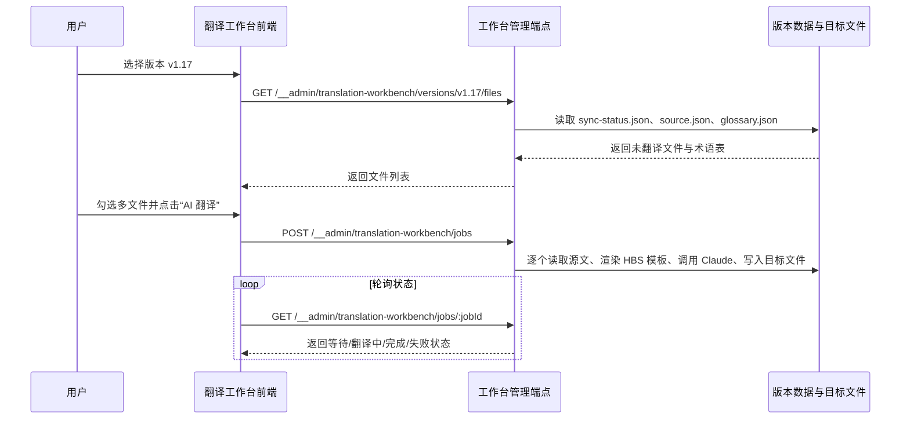

## Why

当前 `dapr-docs-copilot` 已具备术语表与版本化翻译数据，但译者仍需在数据视图、文件系统与零散提示词之间来回切换，无法在一个工作空间内完成“选版本、选文件、批量翻译、看进度”的闭环。既然中文数据管理台已替代 demo 成为真实入口，翻译执行链路继续停留在分散状态，逻辑有问题，也会直接拖慢产能与一致性控制。

## What Changes

- 新增一级菜单 `翻译工作台` 与独立页面，为译者提供版本选择、未翻译文件浏览、多选队列与进度跟踪的一体化工作区。
- 新增工作台后端管理端点，按版本读取 `repos/*_zh/data` 数据集，筛出未翻译文件，并串行调用 Claude 完成单文件翻译与目标文件落盘。
- 将 Claude 翻译提示词收拢为独立 `.hbs` 模板文件，并在运行时注入 `sourceContent`、`glossary`、`targetPath` 等变量，避免提示词继续散落在代码中。
- 在翻译执行链路中系统化引入术语表映射，保证术语对照进入每次提示词构造，而不是依赖人工复制。
- 为每个队列文件提供 `等待中`、`翻译中`、`翻译完成`、`翻译失败` 四态，并支持失败项重试；前端通过轮询获取状态，无需手动刷新。
- 保留现有 `中文数据` 页面作为底层数据查看入口，但侧边栏导航扩展为“工作台 + 数据台”双入口，而非只停留在数据集浏览。

## High-Level UI Prototype

```text
┌────────────────────────────────────────────────────────────────────────────────────┐
│ 翻译工作台                                             版本 [v1.17        ▼]       │
├────────────────────────────────────────────────────────────────────────────────────┤
│ 筛选：未翻译  92 篇      已选 12 篇         模板 claude-default.hbs                │
│ [全选] [清空] [AI 翻译] [仅看失败]                                             │
├────┬──────┬──────────────────────────────────────────────┬──────────┬────────────┤
│ 选 │ 状态 │ 文件路径                                     │ 大小     │ 操作       │
├────┼──────┼──────────────────────────────────────────────┼──────────┼────────────┤
│ ☑  │ 等待 │ docs/concepts/building-blocks-concept.md     │ 12.4 KB  │ 移出队列   │
│ ☑  │ 译中 │ docs/concepts/components-concept.md          │ 8.1 KB   │ 禁用中     │
│ ☑  │ 完成 │ docs/getting-started/install-dapr-cli.md     │ 6.3 KB   │ 查看目标   │
│ ☑  │ 失败 │ docs/operations/hosting/kubernetes/_index.md │ 10.8 KB  │ 重试       │
├────┴──────┴──────────────────────────────────────────────┴──────────┴────────────┤
│ 正常：可多选 / 可批量发起   禁用：队列运行中锁定版本切换   错误：失败行显红框      │
└────────────────────────────────────────────────────────────────────────────────────┘
```

## User Interaction Flow



## Code Change Table

| 文件路径 | 变更类型 | 变更原因 | 影响范围 |
| --- | --- | --- | --- |
| `repos/dapr-docs-copilot/src/lib/primary-navigation.ts` | 修改 | 新增 `翻译工作台` 一级菜单 | 应用导航 |
| `repos/dapr-docs-copilot/src/router.tsx` | 修改 | 注册工作台路由 | 页面路由 |
| `repos/dapr-docs-copilot/src/pages/translation-workbench-page.tsx` | 新增 | 承载工作台查询、队列与轮询逻辑 | 页面编排 |
| `repos/dapr-docs-copilot/src/components/translation-workbench/workbench-view.tsx` | 新增 | 渲染版本选择、文件列表与状态区 | 工作台 UI |
| `repos/dapr-docs-copilot/src/components/translation-workbench/file-queue-table.tsx` | 新增 | 承载多选、状态、重试等交互 | 队列表格 |
| `repos/dapr-docs-copilot/src/lib/translation-workbench.ts` | 新增 | 封装版本列表、文件列表、建队列、状态轮询请求 | 前端数据访问 |
| `repos/dapr-docs-copilot/src/lib/translation-workbench-models.ts` | 新增 | 定义版本、文件、任务、队列状态类型 | 类型模型 |
| `repos/dapr-docs-copilot/src/server/translation-workbench-admin.ts` | 新增 | 管理端点读写 JSON、编译提示词并驱动 Claude 调用 | 本地管理 API |
| `repos/dapr-docs-copilot/vite.config.ts` | 修改 | 挂载工作台管理端点 | 开发态后端 |
| `repos/dapr-docs-copilot/prompts/translation/claude-default.hbs` | 新增 | 独立管理翻译提示词模板 | 提示词资产 |
| `repos/dapr-docs-copilot/package.json` | 修改 | 引入 Claude SDK 与 Handlebars 依赖 | 构建依赖 |
| `repos/dapr-docs-copilot/README.md` | 修改 | 记录工作台运行前提、环境变量与模板位置 | 使用文档 |

## Capabilities

### New Capabilities
- `zh-translation-workbench`: 定义版本选择、未翻译文件装载、串行 AI 翻译、术语表注入、任务状态轮询与失败重试行为。

### Modified Capabilities
- `zh-data-console`: 侧边栏导航从单一 `中文数据` 入口扩展为 `翻译工作台` 与 `中文数据` 双入口，以承载执行型工作流。

## Impact

- 受影响仓库：`repos/dapr-docs-copilot`。
- 新增本地管理端点：版本列表、未翻译文件列表、翻译任务创建、任务状态查询、失败重试。
- 新增依赖：Claude SDK、Handlebars 模板引擎；新增环境变量依赖如 `ANTHROPIC_API_KEY`。
- 运行时读写对象：`repos/*_zh/data/*.json`、`repos/*_zh/data/source/**`、`repos/*_zh/translated_content/zh_CN/**`。
- 不引入独立后端服务或数据库；默认仍依托 Vite 开发态中间件与本地文件系统完成闭环。
