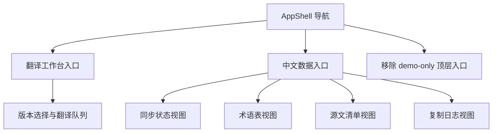

# zh-data-console

## Capability Model

## Requirement Matrix

| Requirement | 说明 | 场景数 |
| --- | --- | --- |
| Sidebar prioritizes zh data | 侧边栏须以翻译工作台与中文数据作为主工作流入口 | 3 |

## MODIFIED Requirements

### Requirement: Sidebar prioritizes zh data
The system SHALL present first-level navigation items named `翻译工作台` and `中文数据` as the primary translation workflow entries in the management console, and it MUST remove demo-only top-level navigation items that do not correspond to active translation workflows.

#### Scenario: Sidebar exposes both execution and data workspaces
- **WHEN** the user opens the management console sidebar
- **THEN** the primary actionable navigation set SHALL include both `翻译工作台` and `中文数据`

#### Scenario: User enters translation workbench from sidebar
- **WHEN** the user clicks the `翻译工作台` navigation item
- **THEN** the console SHALL route the user to the dedicated translation workbench page without requiring manual URL entry

#### Scenario: Demo-only navigation is removed
- **WHEN** the user reviews available top-level navigation items
- **THEN** the console MUST NOT display a demo-only workspace entry that is unrelated to the current translation management workflows
