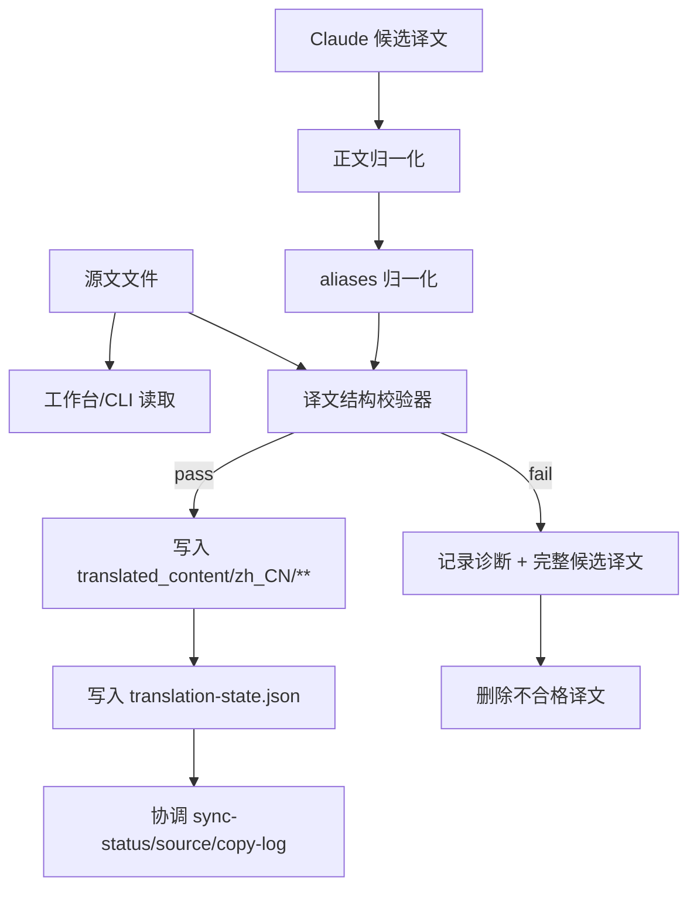
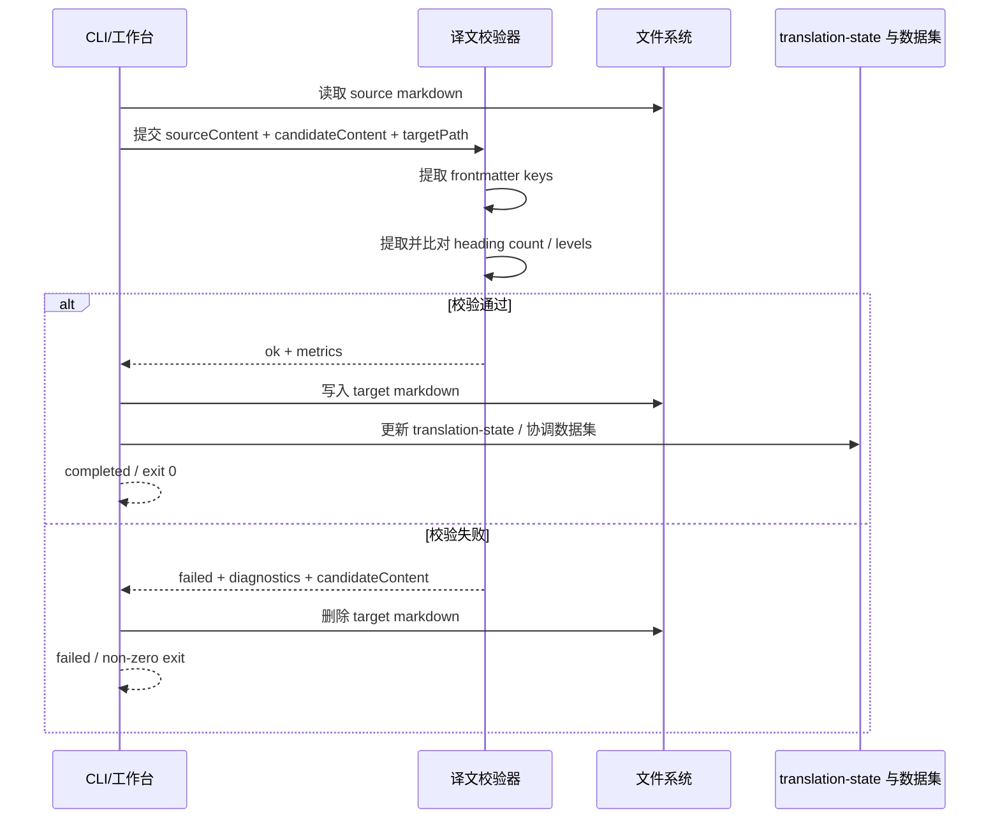

## Context

当前实现里，Markdown 翻译成功路径大致如下：工作台读取源文与模板，调用本机 `claude`，对返回正文做 `normalizeTranslationBody()` 与 `normalizeMarkdownAliases()`，随后直接写入 `translated_content/zh_CN/**`，再回写 `translation-state.json` 与下游协调数据。现状只拦截“空响应”“模板缺失”等显性失败；对 frontmatter key 丢失、正文截断、标题错层或结构性删段等问题，链路并无统一校验。

这带来两个直接后果：

1. 坏译文会先落盘，再被当作成功结果写入权威状态。
2. 历史译文或流程外修订后的文件无法复用同一套规则独立批量审查。

约束亦明确：

- 作用仓主要是 `repos/dapr-docs-copilot`。
- 现有代码已通过手写 frontmatter 归一化逻辑处理 `aliases`，尚未引入 YAML 解析依赖。
- 此提示运行于非交互环境，故独立脚本须提供确定性退出码与可机读摘要。
- 用户要求失败时输出详细错误与完整译文内容，并保证不合格译文不会留在目标路径。

## Goals / Non-Goals

**Goals:**
- 让 Markdown 译文在进入成功态前，先经过统一的结构校验。
- 用同一套规则同时支持工作台自动触发与 CLI 独立执行。
- 把 frontmatter key 缺失、标题数目或层级结构失配这两类结构性问题转成确定性的失败结果。
- 在失败路径中提供完整诊断、完整候选译文内容，以及目标文件清理。
- 为 CI 与本地人工复核提供单文件、批量两种执行方式。

**Non-Goals:**
- 不在本变更中评估译文语义质量、术语准确率或语言流畅度。
- 不引入新的外部翻译服务、任务队列或前端页面。
- 不把校验范围扩展到二进制文件或非 Markdown 文件。
- 不在本变更中重做完整性审计器；本次仅在译文落盘前增加结构校验闸门。

## Decisions

### 1. 新增共享模块 `translation-output-validation.ts`

选择：在 `repos/dapr-docs-copilot/src/server/translation-output-validation.ts` 中实现纯函数式校验器，输入源文内容、候选译文内容、目标路径与文件标识，输出结构化结果：

- `ok` / `failed`
- `sourceHeadingCount` / `targetHeadingCount`
- `sourceHeadingLevels` / `targetHeadingLevels` / `headingLevelMismatches`
- `missingFrontmatterKeys` / `unexpectedFrontmatterKeys`
- `candidateContent`
- `summaryMessage`

理由：工作台与 CLI 都需要复用同一份规则与错误模型。若把规则散落在 CLI 与工作台内部，后续阈值、日志与失败语义会再次分叉。

备选：
- 仅在工作台内部内联实现：逻辑有问题。CLI 无法复用，同一错误会出现两套表述。
- 仅做脚本，不接工作台：无法阻止坏译文先进入成功态。

### 2. frontmatter key 校验采用“原始 Markdown 顶层键提取”，不新增 YAML 依赖

选择：复用当前 frontmatter 正则切片方式，解析 `---` 包裹的 YAML 区段，并以顶层键行为单位提取 key 集合；校验时比较“源文 key 集合 == 译文 key 集合”。

理由：
- 当前仓已存在 `translation-alias-localization.ts` 的无依赖 frontmatter 处理方式。
- 本次只需校验 key 完整性，不要求反序列化完整 YAML 值。
- 避免为单一校验引入额外解析库与边界成本。

备选：
- 引入 YAML 依赖做完整 AST 解析：更重，且当前需求仅需顶层 key 完整性。
- 只校验 frontmatter 是否存在：过弱，无法发现 key 被删或改名。

### 3. 标题结构采用“数目一致 + 层级序列一致”校验

选择：对标准化后的 Markdown 主体提取标题序列，仅校验标题总数与每个标题的层级是否按顺序一一对应；不再以正文行数差作为失败依据。

理由：
- 中英文长度天然差异大，行数并不稳定，继续使用会产生误报。
- 标题数量与层级更能直接反映文档结构是否被删改、折叠或错位。
- 该规则仍然可解释、可测试，且对长短文都稳定。

备选：
- 继续沿用行数阈值：逻辑有问题。会把正常压缩译文误判为坏结果。
- 同时校验标题文本：约束过强，会把合理翻译差异误判为失败。

### 4. 工作台在“归一化之后、落盘之前”校验，并在失败时做兜底清理

选择：Markdown 成功路径改为：

1. `Claude` 返回候选正文
2. `normalizeTranslationBody()`
3. `normalizeMarkdownAliases()`
4. 调用共享校验器
5. 校验通过后才写入目标文件
6. 再持久化 `translation-state.json` 与下游数据集

若校验失败，则：

- 任务项直接进入 `failed`
- 不更新 `translation-state.json`
- 不触发数据集协调
- 对目标路径执行 best-effort 删除，清理历史残留或当前运行遗留文件
- 把详细诊断与完整候选译文写入日志/错误对象

理由：先校验再写入，可最大限度缩短无效文件存在窗口；再补一次删除，可覆盖重试或历史残留场景。

备选：
- 先写再校验再删除：短时间内仍会留下坏文件，且增加误读窗口。
- 校验失败但保留文件供人工看：与“自动删除不合格译文”目标冲突。

### 5. 独立 CLI 同时支持显式文件对与版本批量扫描

选择：新增 `repos/dapr-docs-copilot/scripts/validate-translation-output.ts`，提供两类入口：

- 显式模式：`--source <path> --target <path>`
- 版本模式：`--version <id> [--bucket <name>] [--relative-path <path> ...]`

脚本读取源文/译文对，逐个运行共享校验器；若任一文件失败，进程退出码非零，并输出汇总摘要。失败文件内容完整转储到错误日志。

理由：单文件模式适合本地排查；版本模式适合 CI 与批量核验。二者共享一个实现，维护成本低。

备选：
- 只支持版本批量：人工复核单文件不便。
- 只支持显式文件对：CI 需要额外编排文件发现逻辑。

## 组件架构图

```text
Translation Output Validation
├── Shared Validator
│   ├── translation-output-validation.ts
│   ├── frontmatter key extractor
│   └── heading structure evaluator
├── Workbench Integration
│   └── translation-workbench-admin.ts
├── Standalone CLI
│   └── scripts/validate-translation-output.ts
└── Regression Coverage
    ├── scripts/validate-translation-workbench-admin.ts
    └── validator/CLI contract tests
```

## 数据流图



## API 调用时序图



## 详细代码变更清单

| 文件路径 | 变更类型 | 变更说明 | 影响模块 |
|---------|---------|---------|---------|
| `repos/dapr-docs-copilot/src/server/translation-output-validation.ts` | 新增 | 实现共享校验器、frontmatter key 提取与标题结构比对 | 工作台、CLI |
| `repos/dapr-docs-copilot/src/server/translation-workbench-admin.ts` | 修改 | 在 Markdown 成功路径中接入校验、失败日志与清理 | 翻译任务执行 |
| `repos/dapr-docs-copilot/scripts/validate-translation-output.ts` | 新增 | 提供显式文件对与版本批量模式 | 独立运行、CI |
| `repos/dapr-docs-copilot/package.json` | 修改 | 增加独立校验脚本命令 | npm 入口 |
| `repos/dapr-docs-copilot/scripts/validate-translation-workbench-admin.ts` | 修改 | 增加 frontmatter 缺失、标题结构失配、失败不回写数据集场景 | 回归测试 |
| `repos/dapr-docs-copilot/README.md` | 修改 | 记录独立校验命令与失败语义 | 使用说明 |

## Risks / Trade-offs

- [frontmatter 为非常规 YAML 写法] -> 只保证顶层 key 提取的主流 Hugo frontmatter；遇到超规格式时记录为解析失败，并按失败处理。
- [标题检测遗漏特殊 Markdown 写法] -> 优先覆盖常见 ATX / Setext 标题；遇到超规写法时，可后续扩展解析器。
- [失败日志包含完整译文，日志体积变大] -> 仅在失败时输出全文，并保持结构化摘要，便于 CI 折叠与检索。
- [工作台失败后删除目标文件，可能清理到历史坏文件] -> 这是有意行为；目标即确保无不合格译文残留。
- [CLI 批量删除风险] -> 默认逐文件输出删除日志，并以非零退出码终止 CI；若后续需要只读模式，再作为后续增强单独设计。

## Migration Plan

1. 先新增共享校验模块与结果模型，并为 frontmatter key 提取、标题结构判定建立单元/合同测试。
2. 接入 `translation-workbench-admin.ts`，把 Markdown 成功路径改为“归一化 -> 校验 -> 写入 -> 回写状态”。
3. 新增独立 CLI，支持显式文件对与版本批量模式，并在 `package.json` 暴露命令。
4. 扩展工作台回归脚本，验证校验失败时不会更新 `translation-state.json` 与下游数据。
5. 更新 `README.md`，写明独立校验命令、失败退出码、删除语义与日志输出。
6. 若需回滚：先移除工作台中的自动校验调用，再下线 CLI 命令；共享模块可保留但不被调用。

## Open Questions

- frontmatter key 校验是否需要把“额外 key”也视为失败，还是仅要求覆盖原文 key？本设计倾向于“精确相等”，因用户要求 key 完整一致。
- 版本批量模式是否需要默认只校验 `sync-status` 中待翻译或刚翻译文件，而非扫描全部 `translated_content/zh_CN/**`？当前设计保留两种入口，但默认策略仍待实现时确定。
- 完整候选译文应仅写入 `stderr`/服务端日志，还是同时附在作业错误对象中返回前端？若前端不宜承载大文本，可只保留摘要并把全文留在日志。
