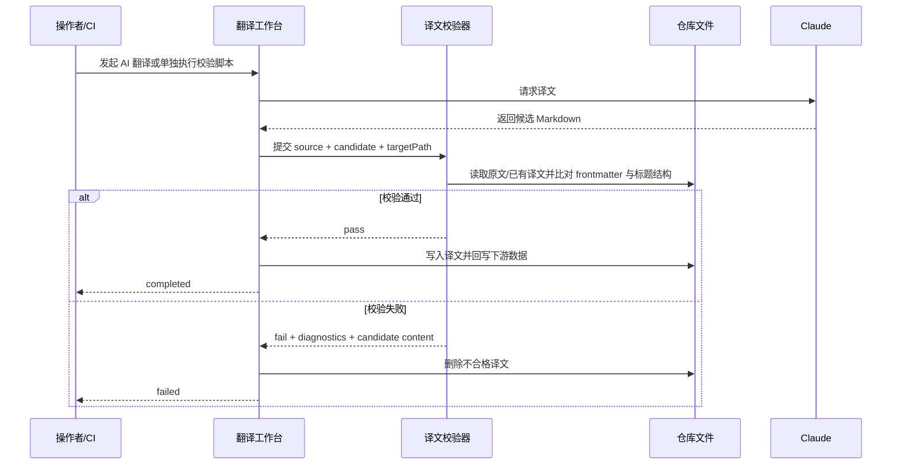

## Why

当前翻译工作台只校验 `Claude` 是否返回空正文，并在落盘前做 `aliases` 归一化；但若译文在生成阶段丢失 frontmatter key、正文被截断、标题层级被改坏、或标题结构失配，这类结构性损坏仍会被当作成功结果写入仓库并继续回写下游数据。问题一旦进入 `translation-state.json` 与 `sync-status.json`，后续排查成本明显升高。

同时，现有链路缺少一个可脱离工作台单独执行的译文结构校验入口。历史译文、批量翻译结果、或流程外手工修订后的文件，都无法用统一规则快速核验并清理坏结果。现在补上自动校验与独立脚本，才能把异常拦在“译文进入权威状态”之前。

## What Changes

- 新增共享的译文结构校验能力，对照原文检查 Markdown 译文的 frontmatter key 完整性与标题数目/层级结构，并输出可机读的失败原因。
- 新增独立 CLI 校验脚本，支持单文件与批量运行，可在翻译流程外单独执行同一套校验规则。
- 修改翻译工作台，在每个 `Claude` Markdown 任务返回后、进入 `translation-state`/数据集协调前自动执行校验；校验失败时任务项直接进入 `failed`。
- 为失败校验补充清理与诊断：保证不合格译文不会留在目标路径，日志中输出详细错误信息与完整候选译文内容，便于复盘。
- 补充回归测试，覆盖 frontmatter key 缺失、标题结构失配、独立脚本批量校验、以及工作台失败收敛路径。

## Capabilities

### New Capabilities
- `zh-translation-output-validation`: 用统一规则校验 Markdown 译文结构，并支持单文件或批量独立执行。

### Modified Capabilities
- `zh-translation-workbench`: 工作台须在译文进入成功态前自动运行结构校验，失败时阻断后续持久化与数据协调。

## Impact

- 代码：`repos/dapr-docs-copilot/src/server/translation-workbench-admin.ts` 需接入新校验器；新增 `repos/dapr-docs-copilot/src/server/translation-output-validation.ts` 作为共享模块。
- CLI：新增 `repos/dapr-docs-copilot/scripts/validate-translation-output.ts`，并在 `repos/dapr-docs-copilot/package.json` 增加独立执行入口。
- 测试：扩展 `repos/dapr-docs-copilot/scripts/validate-translation-workbench-admin.ts`，并补充独立脚本的合同测试。
- 数据与文件系统：涉及 `repos/*_zh/data/source/**` 与 `repos/*_zh/translated_content/zh_CN/**` 的配对读取，以及失败时对不合格译文文件的清理。
- 运维与日志：工作台日志、独立脚本输出、CI 非交互运行都将复用同一份结构化失败信息与候选译文内容转储。

## ASCII 原型

```text
+--------------------------------------------------------------------------------+
| translation-output validation                                                  |
+--------------------------------------------------------------------------------+
| version : v1.17                                                                |
| source  : data/source/docs/getting-started/quickstart.md                       |
| target  : translated_content/zh_CN/docs/getting-started/quickstart.md          |
| result  : FAILED                                                               |
| rules   : missingFrontmatterKeys=title,aliases ; headingLevelMismatchAt=#3:2->3    |
| action  : removed invalid target ; dumped candidate translation to stderr       |
+--------------------------------------------------------------------------------+
```

## 用户交互流程



## 代码变更表

| 文件路径 | 变更类型 | 变更原因 | 影响范围 |
|---------|---------|---------|---------|
| `repos/dapr-docs-copilot/src/server/translation-output-validation.ts` | 新增 | 抽出共享译文结构校验逻辑 | 工作台、CLI、测试 |
| `repos/dapr-docs-copilot/src/server/translation-workbench-admin.ts` | 修改 | 在 `Claude` 返回后接入自动校验与失败清理 | 翻译任务生命周期 |
| `repos/dapr-docs-copilot/scripts/validate-translation-output.ts` | 新增 | 支持单文件/批量独立执行校验 | CI、人工复核 |
| `repos/dapr-docs-copilot/package.json` | 修改 | 暴露独立校验命令 | 执行入口 |
| `repos/dapr-docs-copilot/scripts/validate-translation-workbench-admin.ts` | 修改 | 覆盖校验失败与日志清理回归 | 自动化测试 |
