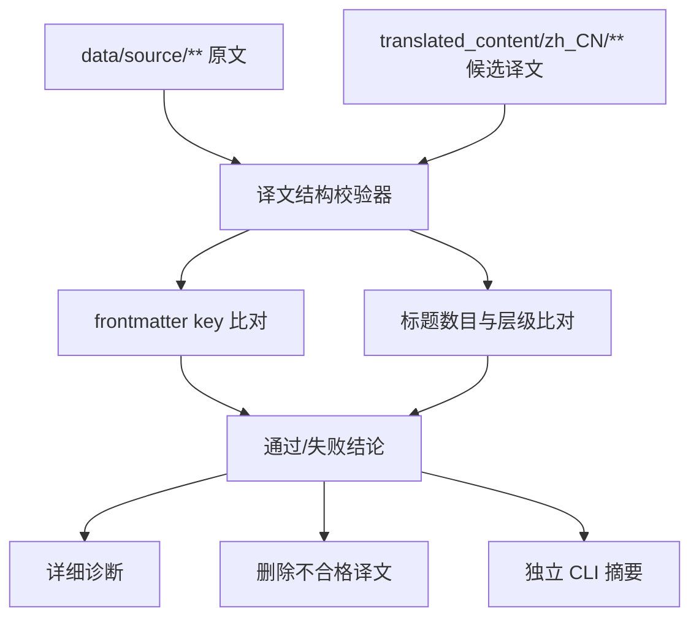

# zh-translation-output-validation

## Capability Model

## Requirement Matrix

| Requirement | 说明 | 场景数 |
| --- | --- | --- |
| Validator enforces structural parity for translated markdown | 校验器须核对 frontmatter key 与标题数目、层级结构 | 3 |
| Validator runs in both explicit-file and batch modes | 校验脚本须支持单文件与批量独立执行 | 2 |
| Validation failures are diagnosable and leave no invalid target behind | 失败时须输出完整诊断并清理不合格译文 | 2 |

## ADDED Requirements

### Requirement: Validator enforces structural parity for translated markdown
The system SHALL validate a translated Markdown document against its source document before the result is accepted, and it MUST compare the normalized document structure by checking that the translated frontmatter preserves the same top-level key set as the source and that the translated heading count and heading levels stay in one-to-one correspondence with the source document.

#### Scenario: Missing source frontmatter key is rejected
- **WHEN** the source Markdown contains frontmatter keys such as `title`, `description`, or `aliases` and the translated document omits any of those keys
- **THEN** the validator SHALL fail that translation and report which frontmatter keys are missing or unexpected

#### Scenario: Matching heading structure is accepted
- **WHEN** the translated Markdown keeps the same frontmatter key set and preserves the same heading count plus heading level sequence as the source document
- **THEN** the validator SHALL mark the document as passed

#### Scenario: Heading structure mismatch is rejected
- **WHEN** the translated Markdown changes the heading count or any heading level relative to the source document
- **THEN** the validator MUST fail the document and include the observed heading counts, heading level sequence, and mismatched heading positions in the diagnostic output

### Requirement: Validator runs in both explicit-file and batch modes
The system SHALL expose the same validation contract through a standalone script that can validate either an explicitly provided source/target pair or a batch of translation files resolved from a version dataset.

#### Scenario: Operator validates one explicit source-target pair
- **WHEN** the operator runs the validation script with a specific source file and target file
- **THEN** the script SHALL validate that single pair and return a per-file pass/fail result with a process exit code that reflects the outcome

#### Scenario: CI validates a batch from version-scoped inputs
- **WHEN** the operator or CI runs the validation script for a version or a filtered list of relative paths
- **THEN** the script SHALL iterate every resolved Markdown translation pair and emit an aggregated summary covering passed and failed files

### Requirement: Validation failures are diagnosable and leave no invalid target behind
The system SHALL treat a failed validation result as a translation failure, it MUST emit detailed diagnostics plus the full translated candidate content to logs, and it MUST ensure that no invalid translation file remains at the target path after failure handling completes.

#### Scenario: Failed validation emits actionable diagnostics
- **WHEN** validation fails for a translated Markdown document
- **THEN** the script or calling workflow SHALL log the failed rules, file identifiers, observed counts, and the full translated candidate content

#### Scenario: Failed validation removes the invalid translation file
- **WHEN** validation fails for a target translation path that currently exists or was created during the current run
- **THEN** the system SHALL delete that target file before reporting the final failure result
