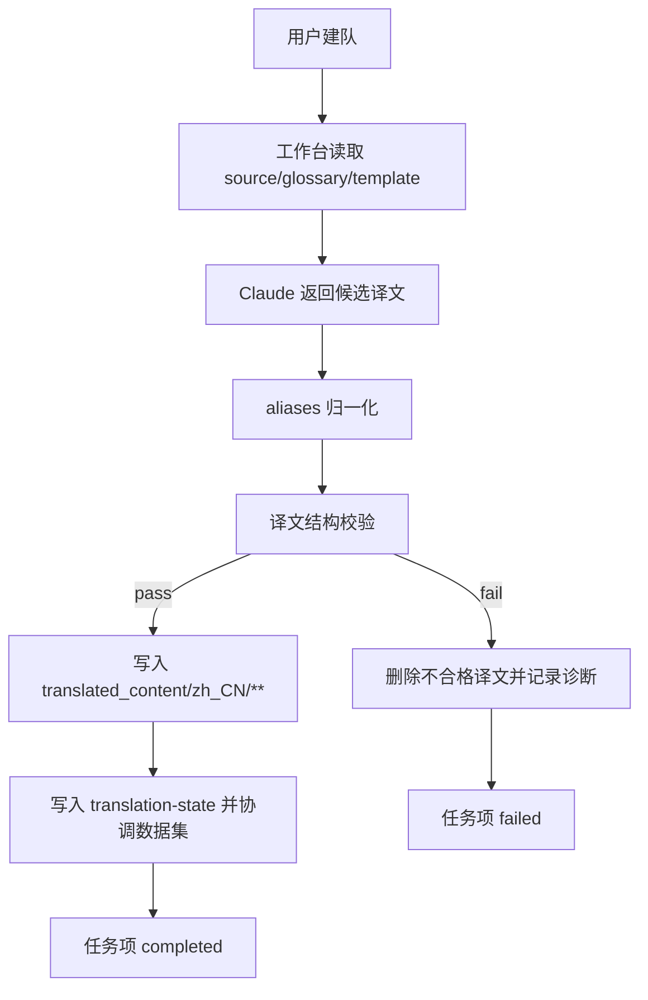

# zh-translation-workbench

## Capability Model

## Requirement Matrix

| Requirement | 说明 | 场景数 |
| --- | --- | --- |
| Workbench validates markdown output before persistence | 工作台须在成功态前完成结构校验 | 2 |
| Validation failure blocks downstream reconciliation | 校验失败不得继续回写权威数据集 | 2 |

## ADDED Requirements

### Requirement: Workbench validates markdown output before persistence
The system SHALL validate every Markdown translation candidate produced by the workbench after output normalization and before the candidate is accepted as a successful translation result.

#### Scenario: Validated markdown is persisted normally
- **WHEN** a Markdown translation candidate passes frontmatter and heading-structure validation
- **THEN** the workbench SHALL write the target translation file and continue the existing `translation-state.json` plus downstream dataset reconciliation flow

#### Scenario: Invalid markdown never reaches completed state
- **WHEN** a Markdown translation candidate fails structural validation
- **THEN** the workbench MUST mark that job item as `failed` rather than `completed`

### Requirement: Validation failure blocks downstream reconciliation
The system SHALL stop the success pipeline when translation validation fails, and it MUST ensure that invalid candidates do not update `translation-state.json`, `sync-status.json`, `source.json`, or `copy-log.json`.

#### Scenario: Failed validation does not update translation-state
- **WHEN** validation fails before the workbench success path completes
- **THEN** the system SHALL leave the corresponding `translation-state.json` entry unchanged

#### Scenario: Failed validation leaves downstream datasets untouched
- **WHEN** validation fails for a queued Markdown file
- **THEN** the workbench SHALL skip dataset reconciliation, delete any invalid target file that exists, and surface the validator diagnostics through the job item error payload or server logs
