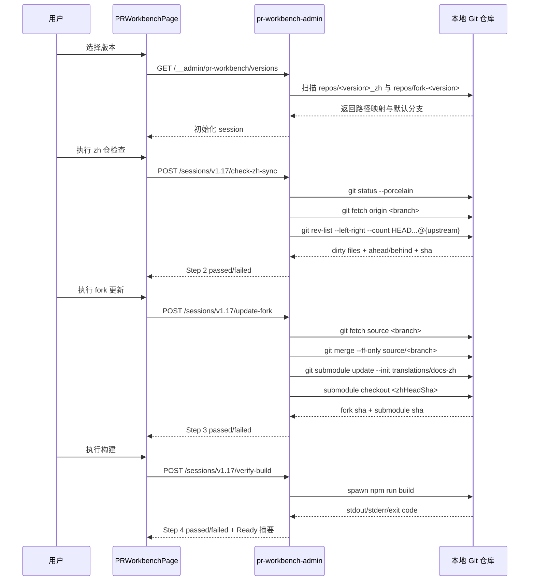
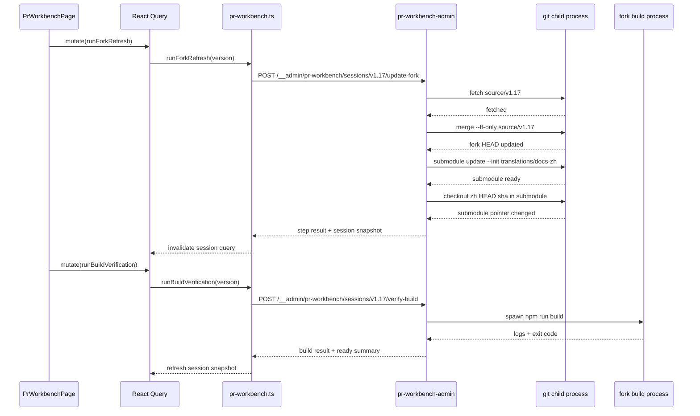

## Context

当前 `repos/dapr-docs-copilot` 已存在三类可复用基础：

- UI 侧已有 `翻译工作台`、`中文数据` 与 Vite `__admin` 本地管理端点模式，前端使用 TanStack Router + React Query，后端侧通过 `vite.config.ts` 挂载本地文件系统操作。
- 服务侧已有 `src/server/translation-workbench-admin.ts` 这类“内存态 + child_process + 文件系统”的编排样式，可复用于 PR 工作台的 Git 与构建 orchestration。
- 仓库侧当前约定已清晰：中文仓位于 `repos/<version>_zh`，fork 仓位于 `repos/fork-<version>`，`fork-v1.17` 中 docs-zh submodule 固定路径为 `translations/docs-zh`，默认 upstream remote 名为 `source`，默认构建入口来自 `package.json` 的 `build` script。

现状缺口也明确：译文生成后，用户仍需手工进入 `v1.17_zh` 查看工作区状态、确认是否已推送；再进入 `fork-v1.17` 拉取 `source/v1.17`、初始化并切换 `translations/docs-zh` submodule、最后运行 `npm run build`。这些步骤跨仓、跨命令、跨上下文，任何一步遗漏都要到 PR 或 CI 阶段才暴露。

约束如下：

- 运行时仍限定在本地开发态，无独立后端服务；故 Git 与构建动作需沿用 Vite 中间件模式。
- 工作台必须避免隐式改写用户仓库状态；凡会修改工作树的步骤都应先校验“目标仓干净”。
- `v1.17_zh` 当前分支 `v1.17_content` 已跟踪 `origin/v1.17_content`；`fork-v1.17` 当前分支 `v1.17` 跟踪 `origin/v1.17`，另有 upstream remote `source` 指向 `https://github.com/dapr/docs.git`。
- `fork-v1.17` 当前 submodule `translations/docs-zh` 可能未初始化，故设计必须覆盖 `git submodule update --init` 前置路径。
- 构建验证需复用 fork 仓既有命令，避免向 `fork-v1.17` 额外注入实现脚本。

相关干系人：中文译者、PR 提交者、文档站构建维护者。

## Goals / Non-Goals

**Goals:**
- 提供一级导航 `PR 工作台`，让用户在一个页面内完成版本选择、zh 仓校验、fork 更新、submodule 切换与构建验证。
- 将跨仓路径解析收束为版本驱动映射，避免用户手填本地路径。
- 对 zh 仓与 fork 仓建立顺序门禁：上一步失败时，下步不可执行。
- 对 Git 与构建步骤输出结构化结果，包括 commit SHA、ahead/behind、未提交文件、exit code、日志摘录。
- 在构建成功后给出稳定的 Ready-for-PR 摘要，供后续提交 PR 使用。

**Non-Goals:**
- 不自动执行 `git add`、`git commit`、`git push`、创建 GitHub PR 或打开浏览器。
- 不替代用户解决 merge conflict、rebase 或 fork 分支分叉问题；此类情况只做阻断与提示。
- 不引入数据库、消息队列或长久化任务存储。
- 不改写 `fork-v1.17` 或 `v1.17_zh` 的构建脚本、仓库结构与 Git remote 配置。
- 不将 PR 工作台并入既有 `翻译工作台` 页面；两者保持独立工作空间。

## Proposal Carry Forward

### Why

当前 `dapr-docs-copilot` 已覆盖翻译工作台、中文数据台与本地校验入口，但译文进入 PR 前的关键准备仍散落在 `v1.17_zh`、`fork-v1.17` 与终端命令之间。结论是，这条链路缺少统一门禁：zh 仓未推送、fork 未同步 upstream、submodule 未切到最新提交、构建未验证，任一步遗漏都可能把 PR 失败推迟到远端才暴露。

### What Changes

- 新增一级菜单 `PR 工作台` 与独立路由，提供版本选择、步骤状态与错误回显的一体化界面。
- 新增版本解析逻辑：按选定版本锁定 `zh` 仓、`fork` 仓与 submodule 路径，避免用户手填仓库位置。
- 新增 zh 仓同步校验：检查工作区是否干净、当前分支是否已配置上游、与远程是否存在 ahead/behind 差异；未通过时阻断后续步骤。
- 新增 fork 更新步骤：从配置的 upstream remote 以 fast-forward 方式更新 fork 分支，并把 `translations/docs-zh` submodule 切换到所选 zh 仓的最新提交。
- 新增 fork 构建验证步骤：在 fork 仓执行约定构建命令并采集 stdout/stderr，仅在构建成功后将流程标记为“可进入 PR 提交阶段”。
- 新增面向本地 Git/构建命令的管理端点、结果模型与 README 使用说明；本次 **不** 自动创建 Git 提交、推送或 GitHub PR。

### Capabilities

- `zh-pr-workbench`

## High-Level UI Prototype

```text
┌────────────────────────────────────────────────────────────────────────────────────────────────────┐
│ PR 工作台                                                版本 [v1.17 ▼]   Ready [未就绪]           │
├────────────────────────────────────────────────────────────────────────────────────────────────────┤
│ 路径锁定： zh=/repos/v1.17_zh   fork=/repos/fork-v1.17   submodule=translations/docs-zh          │
│ 分支约定： zh=v1.17_content -> origin/v1.17_content   fork=v1.17 <- source/v1.17                 │
├────────────────────────────────────────────────────────────────────────────────────────────────────┤
│ Step 1 选择版本            [已完成]  可切换前提：无运行中步骤                                      │
│ Step 2 zh 仓同步校验       [失败/通过]  显示 dirty files、ahead/behind、HEAD、upstream            │
│ Step 3 更新 fork/submodule [锁定/运行中/通过] 显示 fork HEAD、submodule SHA、执行摘要             │
│ Step 4 构建验证            [锁定/运行中/通过] 显示命令、exit code、最近日志                        │
├────────────────────────────────────────────────────────────────────────────────────────────────────┤
│ 最近错误                                                                                           │
│ - zh repo ahead of origin by 2 commits                                                             │
│ - fork working tree is dirty: translations/docs-zh (new commits)                                  │
├────────────────────────────────────────────────────────────────────────────────────────────────────┤
│ [执行当前步骤] [重新检查] [展开日志] [复制 Ready 摘要]                                             │
└────────────────────────────────────────────────────────────────────────────────────────────────────┘
```

## User Interaction Flow



## Component Architecture

```text
组件层次结构
├── AppShell
│   └── PrimaryNavigation
│       ├── 翻译工作台
│       ├── PR 工作台
│       └── 中文数据
├── PrWorkbenchPage
│   ├── useQuery(['pr-workbench', 'versions'])
│   ├── useQuery(['pr-workbench', 'session', version])
│   ├── useMutation(runZhSyncCheck)
│   ├── useMutation(runForkRefresh)
│   └── useMutation(runBuildVerification)
│       └── PrWorkbenchView
│           ├── VersionLockCard
│           ├── StepCard(zh-sync)
│           ├── StepCard(fork-update)
│           ├── StepCard(build-verify)
│           └── LogPanel
├── src/lib/pr-workbench.ts
│   ├── fetchPrWorkbenchVersions
│   ├── fetchPrWorkbenchSession
│   ├── runZhSyncCheck
│   ├── runForkRefresh
│   └── runBuildVerification
└── src/server/pr-workbench-admin.ts
    ├── resolveVersionWorkspace
    ├── ensureSession
    ├── inspectZhRepoSync
    ├── updateForkRepo
    ├── syncDocsZhSubmodule
    ├── verifyForkBuild
    └── deriveReadySummary
```

## Data Flow Diagram

```mermaid
flowchart TD
    A[用户选择版本] --> B[resolveVersionWorkspace]
    B --> C[session store]
    C --> D[Step 2: inspectZhRepoSync]
    D --> E[git status/fetch/rev-list in zh repo]
    E --> F[zh sync result]
    F --> C
    C --> G[Step 3: updateForkRepo]
    G --> H[git fetch/merge in fork repo]
    H --> I[git submodule update + checkout]
    I --> J[fork/submodule result]
    J --> C
    C --> K[Step 4: verifyForkBuild]
    K --> L[spawn npm run build]
    L --> M[stdout/stderr/exit code]
    M --> N[ready summary]
    N --> C
    C --> O[/__admin/pr-workbench/sessions/:version]
    O --> P[React Query polling/refresh]
```

## API Sequence Diagram



## Detailed Code Change Inventory

| 文件路径 | 变更类型 | 变更说明 | 影响模块 |
| --- | --- | --- | --- |
| `repos/dapr-docs-copilot/src/lib/primary-navigation.ts` | 修改 | 加入 `PR 工作台` 导航项并调整入口顺序 | 一级菜单 |
| `repos/dapr-docs-copilot/src/router.tsx` | 修改 | 注册 `pr-workbench` 路由 | 路由系统 |
| `repos/dapr-docs-copilot/src/pages/pr-workbench-page.tsx` | 新增 | 组合版本查询、session 查询、步骤 mutation 与刷新 | 页面协调层 |
| `repos/dapr-docs-copilot/src/components/pr-workbench/pr-workbench-view.tsx` | 新增 | 组织路径锁定摘要、步骤卡片、Ready 摘要与日志区 | 页面视图 |
| `repos/dapr-docs-copilot/src/components/pr-workbench/step-card.tsx` | 新增 | 统一渲染 idle/running/passed/failed 四态 | 交互组件 |
| `repos/dapr-docs-copilot/src/components/pr-workbench/log-panel.tsx` | 新增 | 展示构建日志与 Git 执行摘要 | 诊断展示 |
| `repos/dapr-docs-copilot/src/lib/pr-workbench-models.ts` | 新增 | 定义 `VersionWorkspace`、`PrWorkbenchSession`、`StepResult`、`ReadySummary` | 类型模型 |
| `repos/dapr-docs-copilot/src/lib/pr-workbench.ts` | 新增 | 封装 REST 请求与错误归一化 | 前端数据访问 |
| `repos/dapr-docs-copilot/src/server/pr-workbench-admin.ts` | 新增 | 路径解析、Git 命令执行、会话状态、构建编排 | 本地管理逻辑 |
| `repos/dapr-docs-copilot/src/server/git-runner.ts` | 新增 | 统一封装 `spawn`、超时、stdout/stderr 截断与错误模型 | 进程执行 |
| `repos/dapr-docs-copilot/vite.config.ts` | 修改 | 注册 PR 工作台 GET/POST 端点并转换错误码 | Vite 中间件 |
| `repos/dapr-docs-copilot/README.md` | 修改 | 文档化 remote 约定、dirty-state 阻断与 build 前提 | 项目文档 |
| `repos/dapr-docs-copilot/scripts/validate-pr-workbench-admin.ts` | 新增 | 用临时 Git 仓验证步骤门禁、submodule 指针与日志输出 | 契约测试 |

## Decisions

### 1. 复用 Vite `__admin` + 内存 session，而非新建后端服务

选择：沿用 `translation-workbench-admin` 已验证的模式，在 `vite.config.ts` 下新增 `__admin/pr-workbench/*` 端点，并在 `pr-workbench-admin.ts` 内维护按版本索引的内存 session。

原因：
- 当前应用已在本地开发态执行业务型文件操作，扩展成本最低。
- PR 工作台是本地预检工具，不需要独立部署形态。
- 内存 session 足以保存步骤状态、最近日志与 Ready 摘要。

备选方案：
- 新建独立 Node 服务：隔离更强，但超出仓库规模。
- 纯前端本地 shell bridge：浏览器无法直接安全调用 Git/构建命令，逻辑有问题。

### 2. 以“版本约定 + 本地仓存在性”解析工作空间，而非手工输入路径

选择：扫描 `repos/*_zh` 与 `repos/fork-*`，仅返回同时具备 zh 仓与 fork 仓的版本；选定版本后锁定 `zhRepoPath`、`forkRepoPath`、`submodulePath`、`zhBranch`、`forkBranch`。

原因：
- 用户需求已将版本选择作为第一步，说明版本是稳定主键。
- 目录约定已存在，没必要再引入单独配置文件。
- 锁定路径后，后续步骤可避免误操作到错误仓库。

备选方案：
- 允许用户手填路径：灵活，但高风险且不适合非交互式流程。
- 维护硬编码映射表：短期可行，但扩版本时易失真。

### 3. zh 仓同步检查采用“dirty + upstream + ahead/behind”三重门禁

选择：步骤 2 先检查 `git status --porcelain`，再确认当前分支存在 upstream，随后 `git fetch origin <branch>` 并比较 `HEAD...@{upstream}` 的 ahead/behind 计数；任一失败都阻止进入步骤 3。

原因：
- 仅检查 dirty 不足以发现“本地未推送”或“远端已更新”。
- 先 fetch 再比较，才能避免使用陈旧 remote-tracking 状态。
- 返回文件清单与计数可直接指导用户修复。

备选方案：
- 只看 `git status -sb`：结果简短，但错误不够结构化。
- 自动执行 push/pull：超出工作台职责，也可能破坏用户预期。

### 4. fork 更新使用 fast-forward-only，submodule 切到 zh HEAD 精确 SHA

选择：步骤 3 要求 fork 工作区干净；随后对 fork 仓执行 `fetch source` + `merge --ff-only source/<branch>`，再保证 `translations/docs-zh` 已初始化，并在 submodule 内 checkout 到步骤 2 记录的 zh HEAD SHA；最后由 superproject 记录新的 submodule pointer。

原因：
- `--ff-only` 能显式阻止本地分叉被静默合并。
- 以精确 SHA 锁定 submodule，可确保 fork 指向通过步骤 2 校验过的 zh 提交。
- 当前 `fork-v1.17` submodule 可能未初始化，故必须覆盖 init 分支。

备选方案：
- 直接 `git pull source <branch>`：行为不够可控，可能触发 merge commit。
- 让 submodule 跟随 branch 而非 commit：结果不稳定，不利于 PR 可复现性。

### 5. 构建验证作为异步步骤，结果固化为 session 快照

选择：步骤 4 在服务器侧 `spawn` fork 构建命令，记录 `startedAt`、`finishedAt`、`exitCode`、最近日志与成功时的 `forkHeadSha/submoduleSha` 快照；前端轮询 session 获取状态。

原因：
- fork 构建耗时可能明显高于普通 HTTP 请求。
- 会话快照可支撑页面刷新后继续查看结果。
- 只有把成功结果与具体 SHA 绑定，Ready-for-PR 才可信。

备选方案：
- 同步等待一次请求结束：实现更简单，但易超时，且 UI 反馈差。
- 只返回布尔值：无法满足错误定位需求。

### 6. Ready 状态必须对输入漂移失效

选择：session 在每次成功步骤后记录 `zhHeadSha`、`forkHeadSha`、`submoduleSha`；若用户重新选择版本、zh 仓 HEAD 变化、fork HEAD 变化或构建前后 SHA 不一致，则后续步骤自动标记为 `stale`/需重跑。

原因：
- PR 准备链路受仓库状态强约束，不可把旧结果误当新结果。
- 这能避免“刚校验完又提交了 zh 仓”仍显示 Ready 的错误结论。

备选方案：
- 不做失效控制：实现最简，但状态可信度不足。

## Risks / Trade-offs

- [Git 环境不一致] → 在版本列表与步骤执行前检测 `git` 可执行文件；缺失时返回明确依赖错误。
- [fork 分支已分叉，无法 fast-forward] → 使用 `--ff-only` 直接失败，并附带 remote/local SHA 与修复建议，避免隐式 merge。
- [submodule 未初始化或目标 SHA 未被 submodule remote 获取] → 先执行 `git submodule update --init`，再在 submodule 内显式 `fetch origin <sha>`；失败时回显目标 SHA 与 remote 名称。
- [构建日志过长] → session 只保留完整日志文件路径与最近日志摘录；前端默认展示 tail，避免页面过载。
- [步骤执行期间仓库被外部修改] → 每步前后重新读取关键 SHA；不一致则将结果标记 stale，并要求重跑后续步骤。
- [Windows/Unix shell 差异] → 统一用 `spawn` 与参数数组调用 Git/npm，避免依赖 shell 拼接。

## Migration Plan

1. 新增 `pr-workbench` 类型模型、前端 SDK 与 Vite 管理端点骨架，先打通版本列表与 session 查询。
2. 实现步骤 2 的 zh 仓只读检查，确保 dirty/upstream/ahead-behind 错误模型稳定。
3. 实现步骤 3 的 fork fast-forward 与 docs-zh submodule 切换，并补临时仓契约测试。
4. 实现步骤 4 的构建异步执行、日志采集与 Ready 摘要。
5. 接入页面、导航与日志面板，并更新 `README.md`。
6. 回滚时只需移除新导航、路由与 `__admin/pr-workbench/*` 端点；不会改动既有翻译工作台与中文数据台功能。

## Open Questions

- 默认先以 `package.json` 的 `build` script 作为 fork 构建入口；若未来某版本仓未定义该 script，可再补版本级命令映射。当前按非交互式假设，将其视为既有约定。
