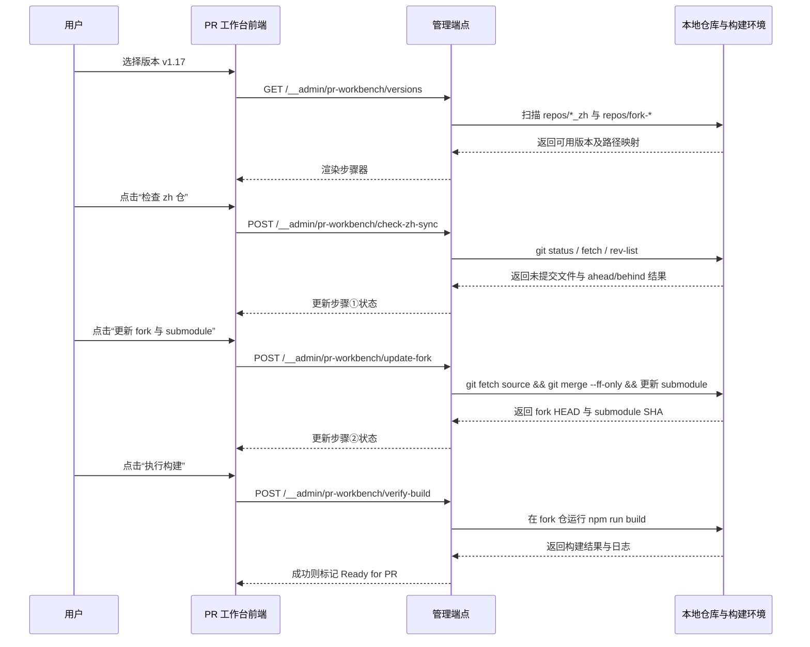

## Why

当前 `dapr-docs-copilot` 已覆盖翻译工作台、中文数据台与本地校验入口，但译文进入 PR 前的关键准备仍散落在 `v1.17_zh`、`fork-v1.17` 与终端命令之间。结论是，这条链路缺少统一门禁：zh 仓未推送、fork 未同步 upstream、submodule 未切到最新提交、构建未验证，任一步遗漏都可能把 PR 失败推迟到远端才暴露。

## What Changes

- 新增一级菜单 `PR 工作台` 与独立路由，提供版本选择、步骤状态与错误回显的一体化界面。
- 新增版本解析逻辑：按选定版本锁定 `zh` 仓、`fork` 仓与 submodule 路径，避免用户手填仓库位置。
- 新增 zh 仓同步校验：检查工作区是否干净、当前分支是否已配置上游、与远程是否存在 ahead/behind 差异；未通过时阻断后续步骤。
- 新增 fork 更新步骤：从配置的 upstream remote 以 fast-forward 方式更新 fork 分支，并把 `translations/docs-zh` submodule 切换到所选 zh 仓的最新提交。
- 新增 fork 构建验证步骤：在 fork 仓执行约定构建命令并采集 stdout/stderr，仅在构建成功后将流程标记为“可进入 PR 提交阶段”。
- 新增面向本地 Git/构建命令的管理端点、结果模型与 README 使用说明；本次 **不** 自动创建 Git 提交、推送或 GitHub PR。

## High-Level UI Prototype

```text
┌──────────────────────────────────────────────────────────────────────────────────────────────┐
│ PR 工作台                                               版本 [v1.17 ▼]  状态 [待校验]       │
├──────────────────────────────────────────────────────────────────────────────────────────────┤
│ 仓库锁定：zh=v1.17_zh   fork=fork-v1.17   submodule=translations/docs-zh                    │
├──────────────────────────────────────────────────────────────────────────────────────────────┤
│ ① zh 仓同步校验                                                                  [执行检查] │
│    正常：工作区干净 / 与 origin 同步 / 分支已跟踪                                           │
│    错误：显示未提交文件、ahead/behind 计数、缺失 upstream                                    │
├──────────────────────────────────────────────────────────────────────────────────────────────┤
│ ② 更新 fork 与 submodule                                                            [执行] │
│    正常：fork 已 fast-forward 至 source/v1.17，docs-zh -> 0e45146                           │
│    禁用：仅当步骤①通过后可执行                                                           │
├──────────────────────────────────────────────────────────────────────────────────────────────┤
│ ③ 本地构建验证                                                                  [执行构建] │
│    命令：npm run build                                                                    │
│    错误：展示最近 stderr 摘要；成功后进入 Ready for PR                                      │
├──────────────────────────────────────────────────────────────────────────────────────────────┤
│ [查看详细日志] [复制状态摘要]                                                Ready for PR ✦ │
└──────────────────────────────────────────────────────────────────────────────────────────────┘
```

## User Interaction Flow



## Code Change Table

| 文件路径 | 变更类型 | 变更原因 | 影响范围 |
| --- | --- | --- | --- |
| `repos/dapr-docs-copilot/src/lib/primary-navigation.ts` | 修改 | 新增 `PR 工作台` 一级菜单 | 管理台导航 |
| `repos/dapr-docs-copilot/src/router.tsx` | 修改 | 注册 `pr-workbench` 路由 | 路由系统 |
| `repos/dapr-docs-copilot/src/pages/pr-workbench-page.tsx` | 新增 | 承载版本加载、步骤执行与状态轮询 | 页面编排 |
| `repos/dapr-docs-copilot/src/components/pr-workbench/pr-workbench-view.tsx` | 新增 | 渲染步骤卡片、仓库摘要、日志面板 | PR 工作台 UI |
| `repos/dapr-docs-copilot/src/components/pr-workbench/step-card.tsx` | 新增 | 封装步骤状态、按钮与错误展示 | 步骤交互 |
| `repos/dapr-docs-copilot/src/lib/pr-workbench-models.ts` | 新增 | 定义版本映射、检查结果、步骤状态、日志模型 | 前后端共享类型 |
| `repos/dapr-docs-copilot/src/lib/pr-workbench.ts` | 新增 | 封装版本读取、zh 检查、fork 更新、构建验证请求 | 前端数据访问 |
| `repos/dapr-docs-copilot/src/server/pr-workbench-admin.ts` | 新增 | 执行 Git 检查、fork 更新、submodule 切换与构建命令 | 本地管理 API |
| `repos/dapr-docs-copilot/vite.config.ts` | 修改 | 挂载 `__admin/pr-workbench/*` 开发态端点 | 开发态后端 |
| `repos/dapr-docs-copilot/README.md` | 修改 | 记录 PR 工作台前提、默认 remote 约定与构建命令 | 使用文档 |
| `repos/dapr-docs-copilot/scripts/validate-pr-workbench-admin.ts` | 新增 | 覆盖 git/build 编排契约测试 | 回归验证 |

## Capabilities

### New Capabilities
- `zh-pr-workbench`: 定义版本选择、仓库路径锁定、zh 仓同步门禁、fork 同步与 docs-zh submodule 更新、fork 本地构建验证及 Ready-for-PR 状态。

### Modified Capabilities

无。

## Impact

- 受影响代码仓：`repos/dapr-docs-copilot`。
- 被读取与校验的工作仓：`repos/v1.17_zh`、`repos/fork-v1.17`，并按版本约定扩展到其他 `repos/<version>_zh` 与 `repos/fork-<version>`。
- 新增本地管理端点：版本列表、zh 仓同步检查、fork 更新、submodule 更新、构建验证。
- 运行时依赖：本机 `git`、Node 运行时，以及 fork 仓可执行的既有构建命令（默认 `npm run build`）。
- 记录的非交互式假设：fork upstream remote 默认名为 `source`；docs-zh submodule 路径固定为 `translations/docs-zh`；build 命令默认取 fork 仓 `package.json` 中的 `build` script。
