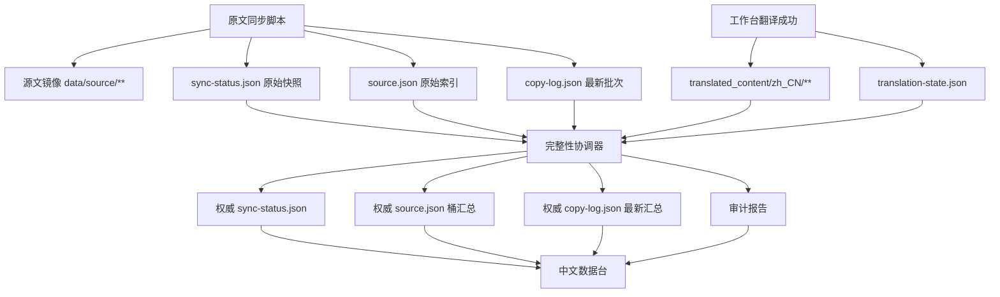
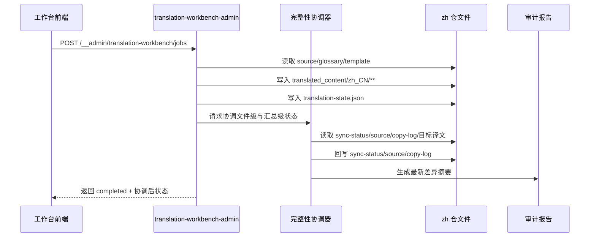

## Context

当前实现把链路拆成四段：

1. 根仓 `scripts/zh-data/sync_source_documents.ts` 复制原文、生成 `sync-status.json` / `source.json` / `copy-log.json`。
2. `repos/dapr-docs-copilot/src/server/translation-workbench-admin.ts` 读取这些数据并驱动翻译工作台。
3. 工作台成功翻译后仅写入 `translated_content/zh_CN/**` 与 `translation-state.json`。
4. `repos/dapr-docs-copilot/src/lib/zh-data.ts` 在控制台读取 `sync-status.json`，再用 `translation-state.json` 做一次前端侧“有效状态”覆盖。

本次审查确认了三处链路断裂：

- `scripts/zh-data/sync_source_documents.ts:281` 仅按 `translationUpdatedAt > syncedAt` 判定 `translated`，忽略 `sourceSha256` 已匹配的已完成译文；在 `2026-03-29` 的复现实验中，译文文件时间早于下一次重同步时间时，会被错误回退为 `staleTranslation`。
- `repos/dapr-docs-copilot/src/server/translation-workbench-admin.ts:841` 与 `repos/dapr-docs-copilot/src/server/translation-workbench-admin.ts:967` 只持久化 `translation-state.json`，未同步协调 `sync-status.json`、`source.json`、`copy-log.json`，导致不同数据集对同一文件给出不同结论。
- `repos/dapr-docs-copilot/src/lib/zh-data.ts:241` 只要 `translation-state.sourceSha256` 命中，就把文件提升为 `translated`，即便 `sync-status` 仍是 `missingTranslation`，甚至目标译文文件已缺失，也会被前端展示为“已翻译”。

约束：当前变更描述仅明确 `repos/dapr-docs-copilot` 为编辑仓；但若不同时修正根仓同步脚本，端到端一致性无法彻底成立。故本设计把根仓同步脚本视为必须落地的外部依赖，并在任务中显式列出。另一个现实约束是：仓内已经存在部分历史译文，且这些译文对应的数据状态并不完全可信；因此实现不能只保证“新写入正确”，还必须提供一次性或可重复执行的存量修复方案。

## Goals / Non-Goals

**Goals:**
- 让 `sync-status.json`、`source.json`、`copy-log.json`、`translation-state.json` 与实际译文文件共享同一套权威判定逻辑。
- 保证工作台翻译成功后，无需等待下一次全量同步，控制台即可读取到一致结果。
- 在重同步时保留“源文未变化”的已翻译状态，避免因时间戳比较导致回退。
- 提供一个可重复执行的审计入口，能把问题定位到具体文件与具体断裂节点。
- 提供一条历史数据回填/修复路径，把仓内已存在但此前未被正确处理的译文重新纳入权威状态与汇总。
- 用端到端自动化测试覆盖“同步 -> 翻译 -> 再同步 -> 展示”主路径。

**Non-Goals:**
- 不在本变更中引入新的翻译模型、模板 DSL 或外部任务队列。
- 不改造术语 CRUD 本身，仅复用其现有读写路径。
- 不把完整性审计扩展到非 zh 文档仓之外的其他语言管线。
- 不在本变更中处理工作台当前与链路审计无关的排序/并发展示问题。

## Decisions

### 1. 以 `sourceSha256` 为主键，建立共享的“权威状态协调器”

选择：新增共享协调模块，输入 `sync-status`、`source`、`translation-state`、目标译文文件存在性与时间戳，输出：

- 文件级权威状态（sourceStatus / translationStatus / translationUpdatedAt）
- 桶级汇总（写回 `source.json`）
- 批次级汇总（写回 `copy-log.json` 最新批次）
- 审计差异列表（供脚本与 UI 使用）

理由：当前问题本质不是单点 bug，而是不同节点各自推导状态。若不抽出共享协调器，工作台、同步脚本、控制台会继续各算各的，回归必然重复。

备选：
- 仅在前端继续做“effective status”覆盖：逻辑有问题。前端拿不到真实文件存在性，也无法回写汇总数据。
- 每次翻译成功后强制触发全量 `zh:data:sync`：能收敛，但延迟高、耦合重、并发成本大。

### 2. `sync-status.json` 成为控制台展示的权威来源，`translation-state.json` 退回证明与审计用途

选择：控制台不再单独把 `translation-state` 命中直接提升为 `translated`。工作台与同步脚本必须先协调并回写 `sync-status.json`；控制台只展示经协调后的权威状态，并在审计发现差异时显式告警。

理由：`translation-state.json` 只记录“某次翻译曾写入”，不等于“目标文件当前仍存在且与其它汇总一致”。它适合作为证明材料，不适合作为单独的展示真值。

备选：
- 保留乐观覆盖但再补更多启发式条件：仍无法完全证明目标文件存在，且规则散落在 UI。

### 3. 工作台把“完成”语义改为“译文与衍生数据均已落盘”

选择：任务项只有在以下动作全部成功后才进入 `completed`：

1. 写入 `translated_content/zh_CN/**`
2. 更新 `translation-state.json`
3. 协调并回写 `sync-status.json`
4. 协调并回写 `source.json` 桶统计
5. 协调并回写 `copy-log.json` 最新批次汇总

理由：当前 `completed` 只代表译文写好了，不代表链路已闭环，导致工作台已完成而数据台仍显示未翻译。

备选：
- 维持现状，仅文档说明“下一次同步后会一致”：这不是修复，只是推迟不一致。

### 4. 根仓同步脚本复用同一状态判定契约

选择：`scripts/zh-data/sync_source_documents.ts` 在生成 `sync-status.json` 时，优先使用“目标译文存在 + `translation-state.sourceSha256 == sourceSha256`”判定 `translated`；仅在缺少 `translation-state` 或 sha 不匹配时回退到时间戳逻辑。

理由：否则下一次重同步仍会把未变源文的译文回退为 `staleTranslation`，破坏工作台刚刚建立的一致性。

备选：
- 仅修 `repos/dapr-docs-copilot`：无法跨越下一次重同步，问题会复发。

### 5. 以“审计 + 回填”修复历史译文，而非只等待未来重跑

选择：在协调器之外，再提供一个可重复执行的历史数据修复入口。它扫描既有 `translated_content/zh_CN/**`、`translation-state.json` 与当前 `sync-status.json`/`source.json`/`copy-log.json`，输出差异，并在确认规则后重建受影响版本的权威状态与汇总。

理由：现状中已有一批历史译文已经生成，但数据未被正确处理。若只修新链路，这批内容仍会长期显示为错误状态，控制台与后续流程继续读到脏数据。

备选：
- 依赖下一次人工全量同步自然修复：逻辑有问题。若同步脚本本身仍带旧规则，历史问题会再次固化。
- 手工改 JSON：不可重复、不可验证，也无法保证文件级与汇总级同步修复。

## 组件架构图

```text
Translation Integrity Architecture
├── Upstream Sync Producer
│   ├── scripts/zh-data/sync_source_documents.ts
│   └── shared integrity reconciler (new contract)
├── Copilot Admin Server
│   ├── translation-workbench-admin.ts
│   ├── translation-integrity-audit.ts (new)
│   └── translation-dataset-reconciler.ts (new)
├── Zh Repository Data
│   ├── data/sync-status.json
│   ├── data/source.json
│   ├── data/copy-log.json
│   ├── data/translation-state.json
│   └── translated_content/zh_CN/**
└── Console Consumers
    ├── src/lib/zh-data.ts
    ├── src/components/zh-data/*
    └── src/components/translation-workbench/*
```

## 数据流图



## API 调用时序图



## 详细代码变更清单

| 文件路径 | 变更类型 | 变更说明 | 影响模块 |
|---------|---------|---------|---------|
| `repos/dapr-docs-copilot/src/server/translation-workbench-admin.ts` | 修改 | 在成功翻译后接入共享协调器，再标记任务完成 | 工作台服务端 |
| `repos/dapr-docs-copilot/src/server/translation-dataset-reconciler.ts` | 新增 | 汇总文件级真值并回写 `sync-status/source/copy-log` | 数据协调 |
| `repos/dapr-docs-copilot/src/server/translation-integrity-audit.ts` | 新增 | 输出文件级差异与批次级完整性报告 | 审计能力 |
| `repos/dapr-docs-copilot/src/lib/zh-data.ts` | 修改 | 消费权威状态，移除仅凭 `translation-state` 的乐观提升 | 中文数据台 |
| `repos/dapr-docs-copilot/src/lib/zh-data-models.ts` | 修改 | 扩充审计摘要/风险模型 | 前端数据模型 |
| `repos/dapr-docs-copilot/src/components/zh-data/*` | 修改 | 展示完整性摘要与差异项 | 中文数据台 UI |
| `repos/dapr-docs-copilot/scripts/validate-translation-pipeline-integrity.ts` | 新增 | 覆盖链路级回归测试 | 测试 |
| `scripts/zh-data/sync_source_documents.ts` | 修改 | 复用共享判定契约，重同步保留 sha 命中译文状态 | 上游同步 |
| `scripts/zh-data/tests/test_sync_source_documents.ts` | 修改 | 增加“翻译后再同步不回退”测试 | 上游测试 |

## Risks / Trade-offs

- [根仓同步脚本不在当前仓作用域] -> 将其列为阻塞依赖；若权限未扩展，需至少在变更说明中标记“实现不完整”。
- [多文件回写引入一致性窗口] -> 协调器按单版本串行写入，先生成完整内存快照，再顺序落盘；失败时保持原文件不变。
- [控制台从乐观展示改为权威展示，短时可能暴露更多 warn] -> 这是有意的真实反馈；通过审计摘要给出修复线索，避免“看起来成功、实际断裂”。
- [新增测试夹具维护成本上升] -> 统一复用临时工作区工厂，减少脚本与工作台测试各自拼装数据的重复。
- [批量翻译后立即协调汇总会增加完成延迟] -> 仅重算受影响版本，且优先增量更新最新批次与命中桶，避免全量扫描所有版本。
- [历史回填误修旧数据] -> 回填入口先产出审计结果与变更摘要，默认按版本执行；仅重建可由文件系统与 `sourceSha256` 证明的状态，不猜测无法验证的数据。

## Migration Plan

1. 在 `repos/dapr-docs-copilot` 内抽出共享协调器与审计器，并为临时工作区夹具补充链路级测试。
2. 让工作台成功路径接入协调器，使 `completed` 语义扩展为“译文 + 衍生数据已闭环”。
3. 修改中文数据台，仅消费权威状态并显示审计摘要。
4. 提供历史译文回填/修复入口，先对既有版本跑一次审计，再重建受影响版本的权威 JSON 汇总。
5. 更新根仓 `scripts/zh-data/sync_source_documents.ts`，让全量重同步与工作台共享同一判定规则。
6. 运行链路级回归：`zh:data:sync` -> `translation-workbench` -> 再次 `zh:data:sync` -> 控制台断言；同时验证历史修复后旧译文状态被正确恢复。
7. 如需回滚：先停用历史回填入口与工作台协调器，再回退同步脚本；保留 `translation-state.json` 兼容读取，不删除已有译文文件。

## Open Questions

- 当前实施阶段是否允许直接修改根仓 `scripts/zh-data/sync_source_documents.ts`？若否，只能先完成 `repos/dapr-docs-copilot` 侧止血，无法彻底防止下一次重同步回退。
- 审计结果是否需要持久化为独立 `integrity-report.json`，还是仅作为运行时 API 输出？本设计倾向于持久化最近一次摘要，便于中文数据台直读。
- `copy-log.json` 的历史批次是否只回写最新批次摘要，还是追溯修正所有历史批次？本变更建议仅修正最新批次，避免篡改历史含义。
