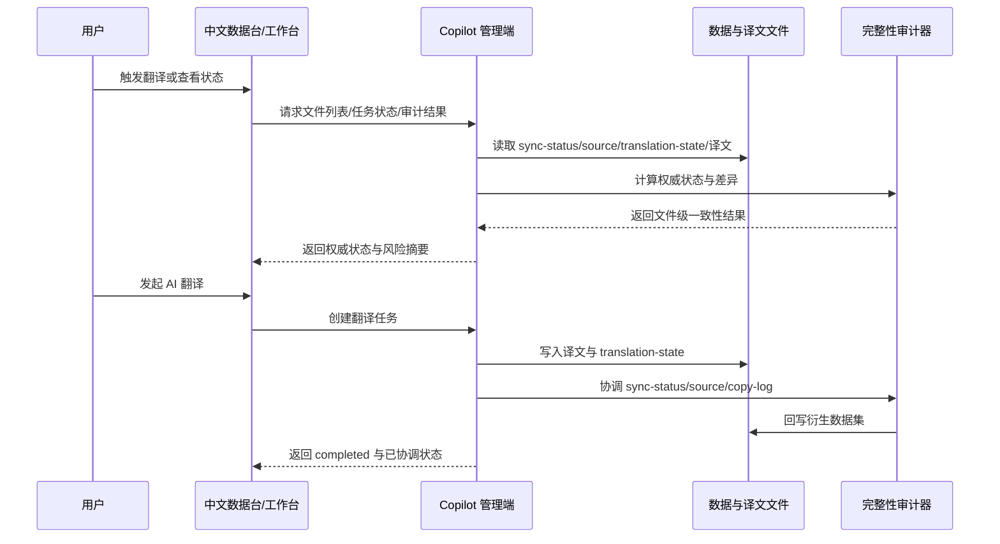

## Why

当前链路把“原文同步”“translation-state”“译文落盘”“控制台汇总”拆成多份数据，但它们并未共享同一套已验证真值。结果是，同一篇文档在不同节点上会同时呈现 `translated`、`staleTranslation`、`missingTranslation` 三种相互冲突的状态，端到端完整性无法证明。

2026-03-29 的本地审查已复现两类根因：一是全量重同步仅按时间戳回推译文新鲜度，忽略 `sourceSha256` 与 `translation-state.json`；二是工作台成功写入译文后只更新 `translation-state.json`，未同步回写 `sync-status.json`、`source.json` 与 `copy-log.json`，导致链路中段与下游汇总长期分叉。并且仓内已存在一批历史译文，部分数据未被正确纳入现有状态汇总，故不仅要修未来写入链路，也要修复既有译文对应的存量数据。

## What Changes

- 建立一套“翻译完整性审计”能力，统一核对 `sync-status.json`、`source.json`、`translation-state.json`、`translated_content/zh_CN/**` 之间的一致性，并输出可定位到文件级别的偏差报告。
- 修改原文同步能力，使其在重同步时以“目标译文存在 + `sourceSha256` 匹配 + 时间戳兜底”为统一判定逻辑，避免未改动源文在重同步后被错误回退为 `staleTranslation`。
- 修改翻译工作台能力，使任务项进入 `completed` 前同步回写衍生数据集，确保工作台、中文数据台、复制日志读取到的是同一份权威状态。
- 修改中文数据台能力，禁止仅凭 `translation-state.json` 的乐观覆盖将缺失译文展示为已翻译；当发现链路断裂时，直接暴露审计风险而非隐藏问题。
- 为仓内已存在的历史译文补一条“存量修复/回填”路径，重新扫描既有 `translated_content/zh_CN/**` 与相关 JSON 数据，修正此前未被正确处理的状态、汇总与差异记录。
- 补充端到端测试，覆盖“同步 -> 翻译 -> 再同步 -> 控制台展示”的完整链路。

## Capabilities

### New Capabilities
- `zh-translation-integrity-audit`: 审计原文同步、译文落盘与衍生 JSON 汇总的一致性，并输出可执行修复线索。

### Modified Capabilities
- `zh-translation-data-pipeline`: 将译文状态判定升级为基于目标文件存在性、`translation-state` 与 `sourceSha256` 的权威回放，并统一回写汇总数据。
- `zh-translation-workbench`: 成功翻译后除写入译文与 `translation-state.json` 外，还要即时协调 `sync-status.json`、`source.json`、`copy-log.json`。
- `zh-data-console`: 控制台须消费经协调后的权威状态，并显式展示完整性异常，而非做不可验证的乐观提升。

## Impact

- 代码与脚本：`repos/dapr-docs-copilot/src/server/translation-workbench-admin.ts`、`repos/dapr-docs-copilot/src/lib/zh-data.ts`、`repos/dapr-docs-copilot/src/lib/zh-data-models.ts`、`repos/dapr-docs-copilot/src/components/zh-data/*`。
- 新增审计与协调模块：建议落在 `repos/dapr-docs-copilot/src/server/` 与 `repos/dapr-docs-copilot/scripts/`。
- 上游同步脚本：`scripts/zh-data/sync_source_documents.ts` 需复用同一判定契约；若实施阶段严格限制为 `repos/dapr-docs-copilot`，则此项需作为外部依赖显式跟踪。
- 数据文件：`repos/*_zh/data/sync-status.json`、`repos/*_zh/data/source.json`、`repos/*_zh/data/copy-log.json`、`repos/*_zh/data/translation-state.json`、`repos/*_zh/translated_content/zh_CN/**`。
- 历史数据修复：需补一条可重复执行的回填/修复流程，用于重新纳入已生成但此前未被正确处理的译文与状态数据。

## ASCII UI 原型

```text
+--------------------------------------------------------------------------------+
| 中文数据 / 完整性审计                                              状态: warn |
+--------------------------------------------------------------------------------+
| 版本: v1.17         最后审计: 2026-03-29T01:53:55Z         [重新审计] [查看差异] |
+--------------------------------------------------------------------------------+
| 风险摘要                                                                       |
| - sync-status 与 translation-state 不一致: 12                                 |
| - translation-state 命中但目标译文缺失: 3                                      |
| - source/copy-log 汇总未回写: 5                                                |
+--------------------------------------------------------------------------------+
| 文件级问题                                                                     |
| [warn] docs/getting-started/install.md   sync-status=stale  expected=translated |
| [warn] docs/alpha.md                     target missing      state says matched  |
+--------------------------------------------------------------------------------+
```

## 用户交互流程



## 代码变更表

| 文件路径 | 变更类型 | 变更原因 | 影响范围 |
|---------|---------|---------|---------|
| `repos/dapr-docs-copilot/src/server/translation-workbench-admin.ts` | 修改 | 翻译成功后立即协调衍生数据集 | 工作台、数据台、译文状态 |
| `repos/dapr-docs-copilot/src/lib/zh-data.ts` | 修改 | 去除仅凭 `translation-state` 的乐观覆盖 | 中文数据台状态可信度 |
| `repos/dapr-docs-copilot/src/server/translation-integrity-audit.ts` | 新增 | 统一审计与回写规则 | 端到端一致性 |
| `repos/dapr-docs-copilot/scripts/validate-translation-pipeline-integrity.ts` | 新增 | 提供链路级回归校验 | 测试与运维审查 |
| `scripts/zh-data/sync_source_documents.ts` | 修改 | 重同步复用 `sourceSha256` 判定，避免状态回退 | 上游同步权威性 |
