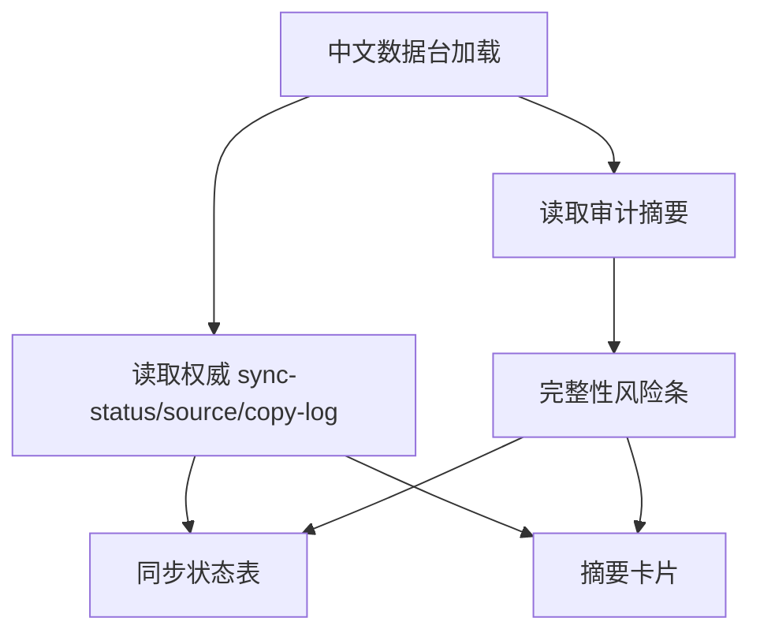

# zh-data-console

## Capability Model

## Requirement Matrix

| Requirement | 说明 | 场景数 |
| --- | --- | --- |
| Console renders standardized datasets | 控制台须展示经协调的权威状态，而非仅凭 translation-state 乐观覆盖 | 3 |
| Console surfaces integrity risks explicitly | 链路断裂时须直出风险，不得把缺失译文伪装为已翻译 | 2 |

## MODIFIED Requirements

### Requirement: Console renders standardized datasets
The system SHALL provide a dedicated zh data view that loads standardized JSON datasets from the zh repository and renders summary cards plus dataset-specific tables or editors for sync status, glossary, source manifest, and copy log; the sync status view MUST expose authoritative source synchronization and translation freshness signals derived from reconciled datasets rather than from `translation-state.json` alone.

#### Scenario: Workspace summary loads successfully
- **WHEN** the zh data view loads with valid dataset files
- **THEN** the page SHALL display summary metrics derived from the reconciled sync status, glossary size, and latest copy batch metadata

#### Scenario: User switches dataset tabs
- **WHEN** the user selects one of `同步状态`、`术语表`、`源文清单` or `复制日志`
- **THEN** the console SHALL render records from the corresponding standardized dataset without requiring route navigation

#### Scenario: Translation-state match alone cannot promote a missing file
- **WHEN** a record has a matching `translation-state.json` source sha but the authoritative sync dataset still reports the target translation as missing or inconsistent
- **THEN** the console MUST NOT render that record as `已翻译` solely because of the translation-state match

## ADDED Requirements

### Requirement: Console surfaces integrity risks explicitly
The system SHALL surface integrity audit warnings when synchronized datasets disagree so that operators can identify where the pipeline is broken.

#### Scenario: Console shows audit summary when datasets disagree
- **WHEN** the current version contains one or more integrity audit findings
- **THEN** the console SHALL render a visible warning summary that reports the count and category of mismatches

#### Scenario: File-level audit finding is actionable
- **WHEN** the operator inspects a file-level integrity warning in the console
- **THEN** the UI SHALL expose enough metadata to identify the affected version, relative path, and conflicting dataset states without opening raw JSON files manually
