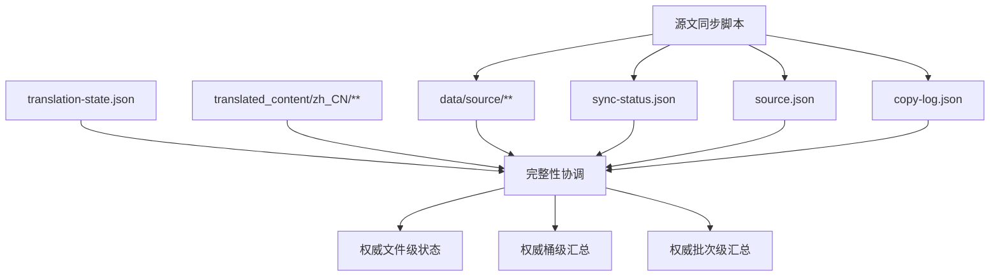

# zh-translation-data-pipeline

## Capability Model

## Requirement Matrix

| Requirement | 说明 | 场景数 |
| --- | --- | --- |
| Translation freshness is derived from sync time | 译文状态须改为基于目标文件存在性、sha 命中与时间戳兜底共同判定 | 3 |
| Pipeline datasets stay internally consistent | `sync-status`、`source`、`copy-log` 须从同一批权威文件状态推导 | 2 |

## MODIFIED Requirements

### Requirement: Translation freshness is derived from sync time
The system SHALL derive translation freshness from a single verified decision path that checks target translation file existence, `translation-state.json` source-sha matches, and translation timestamps as a fallback, while explicitly flagging orphan translations that no longer have a corresponding source document.

#### Scenario: Source sha match survives a later resync
- **WHEN** a mirrored source record still has the same `sourceSha256` as its matching `translation-state.json` entry and the target translation file exists during a later synchronization run
- **THEN** the pipeline SHALL keep that record in `translated` state even if the target file timestamp is earlier than the new `syncedAt`

#### Scenario: Missing target file invalidates translation-state optimism
- **WHEN** a `translation-state.json` entry exists for a source record but the expected target translation file does not exist during synchronization
- **THEN** the pipeline MUST mark the record as `missingTranslation` instead of `translated`

#### Scenario: Orphan translation remains explicit
- **WHEN** a translation file exists without a corresponding mirrored source record
- **THEN** the pipeline SHALL mark the record as `orphanTranslation` and include it in the queryable sync-status dataset

## ADDED Requirements

### Requirement: Pipeline datasets stay internally consistent
The system SHALL derive `sync-status.json`, `source.json` bucket aggregates, and the latest `copy-log.json` translation summary from the same verified file-level translation decisions within a synchronization run.

#### Scenario: Source bucket aggregates reflect verified translation results
- **WHEN** the synchronization run completes its verified file-level decisions
- **THEN** each bucket written to `source.json` SHALL expose translated, stale, missing, and orphan counts that exactly match the corresponding subset of `sync-status.json`

#### Scenario: Latest copy batch summary matches sync-status totals
- **WHEN** the pipeline writes the latest batch record to `copy-log.json`
- **THEN** that batch's `translationSummary` SHALL equal the totals aggregated from the synchronized `sync-status.json` items written in the same run
