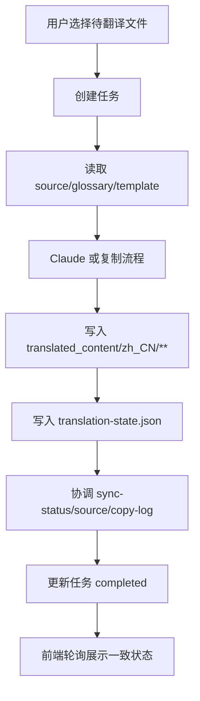

# zh-translation-workbench

## Capability Model

## Requirement Matrix

| Requirement | 说明 | 场景数 |
| --- | --- | --- |
| Translation queue is serial and observable | 任务完成语义须扩展到衍生数据协调完成 | 3 |
| Successful translations reconcile downstream datasets | 工作台成功翻译后须立即闭环回写下游数据集 | 2 |

## MODIFIED Requirements

### Requirement: Translation queue is serial and observable
The system SHALL execute queued files one at a time in submission order, and it MUST expose per-file states `waiting`、`translating`、`completed`、and `failed` through a status API that the frontend can poll without a page refresh; a file MUST NOT transition to `completed` until its translated output and required downstream datasets have been durably reconciled.

#### Scenario: Newly queued files start in waiting state
- **WHEN** a translation job is first created
- **THEN** every queued file except the active head item SHALL be reported as `waiting`

#### Scenario: Active file completes only after dataset reconciliation
- **WHEN** a queued file finishes translation successfully
- **THEN** the system SHALL persist the target file, update `translation-state.json`, reconcile `sync-status.json` plus downstream summary datasets, and only then transition that file from `translating` to `completed`

#### Scenario: Frontend observes post-reconciliation status without manual refresh
- **WHEN** the frontend polls the translation job status endpoint after a file completes
- **THEN** it SHALL receive the final per-file state only after the reconciled dataset view for that version is ready to be consumed by downstream pages

## ADDED Requirements

### Requirement: Successful translations reconcile downstream datasets
The system SHALL reconcile the selected version's authoritative translation datasets immediately after a successful translation write so that downstream consumers do not need to wait for the next full source synchronization run.

#### Scenario: Workbench updates authoritative status for a newly translated file
- **WHEN** a source document is translated successfully from the workbench
- **THEN** the matching `sync-status.json` item SHALL be updated to the effective translated state for that source sha before the job is reported as completed

#### Scenario: Workbench updates aggregate summaries in the same version
- **WHEN** one or more files in a version complete successfully
- **THEN** the system SHALL update the affected bucket aggregates in `source.json` and the latest batch translation summary in `copy-log.json` for that same version before returning the final job state
