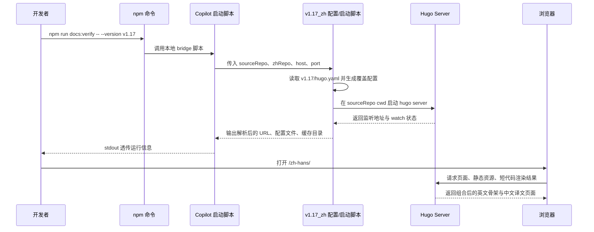
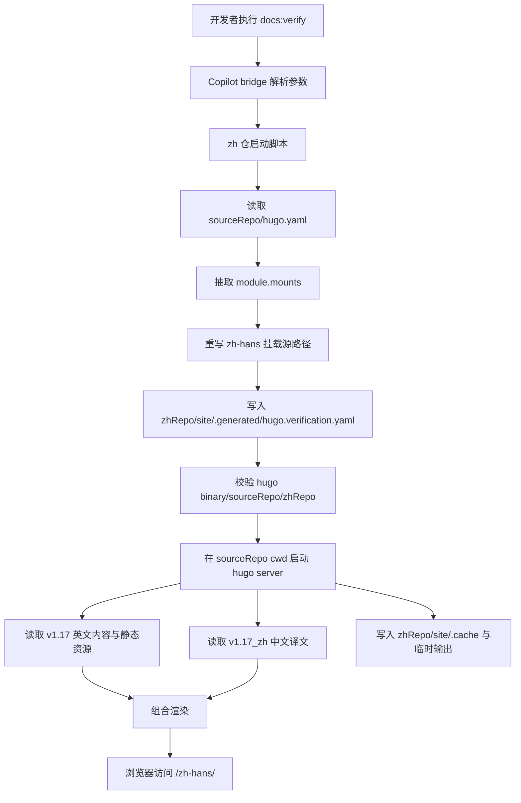
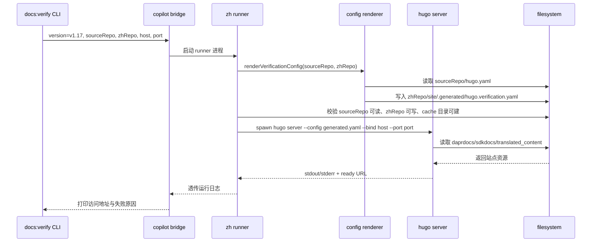

## Context

`repos/v1.17` 当前以 Hugo + Docsy 生成正式文档站点，中文内容通过 `translations/docs-zh` 子模块挂载到 `module.mounts`，并由 `hugo.yaml` 明确声明 `zh-hans` 语言目录与各内容桶映射。与此同时，翻译流程的真实工作产物已迁至独立仓 `repos/v1.17_zh`：源文镜像在 `data/source/**`，中文译文在 `translated_content/zh_CN/**`，二者都不再依赖 `repos/v1.17/translations/docs-zh` 的子模块目录。

问题在于：现有链路能同步数据、能翻译 Markdown，却不能把 `repos/v1.17` 的站点骨架与 `repos/v1.17_zh` 的译文内容组合成一个本地可访问、可 watch、可重复启动的验证站点。若直接改 `repos/v1.17/hugo.yaml` 或替换其子模块路径，会污染参考仓；若简单复制整站，又会引入额外漂移与维护成本。故本次变更属于跨仓、跨启动链路的设计变更，需先把路径策略、配置生成策略、写入边界与命令入口定清。

已知约束：

- `repos/v1.17` 是只读参考仓；不得修改其 `hugo.yaml`、`package.json`、`go.mod`、`.gitmodules` 或任意内容文件。
- `repos/v1.17_zh` 是可写中文仓；所有验证站点脚本、覆盖配置、生成缓存、日志与文档应集中于此。
- `repos/dapr-docs-copilot` 需提供一个 npm 命令，作为统一启动入口，供翻译流程或本地开发直接调用。
- 原站 `module.mounts` 同时包含 `daprdocs/**`、`sdkdocs/**` 与 `translations/docs-zh/**`；其中中文挂载规则必须与原站保持一致，但其源路径需重定向到 `repos/v1.17_zh/translated_content/zh_CN/**`。
- 本地预览应支持快速迭代，故需保留 `hugo server` 的 watch/serve 语义，而非只做一次性静态 build。
- 非交互式上下文默认处理 `v1.17`，但启动链路不应把版本写死在代码中。

相关干系人：译者、翻译流程维护者、`dapr-docs-copilot` 维护者、以及依赖本地预览确认导航/链接/front matter 是否正确的校验人员。

## Goals / Non-Goals

**Goals:**
- 在 `repos/v1.17_zh` 中提供可重复执行的本地验证站点脚本与配置生成能力。
- 复用 `repos/v1.17` 的 Hugo 工程结构、Docsy 模块、静态资源、布局与英文内容，而不修改参考仓任何文件。
- 将中文挂载源从 `repos/v1.17/translations/docs-zh/**` 无损改写为 `repos/v1.17_zh/translated_content/zh_CN/**`，并保持各内容桶映射与原站一致。
- 确保本地运行所需的生成配置、缓存目录、输出目录、日志目录均落在 `repos/v1.17_zh` 范围内，满足数据隔离原则。
- 在 `repos/dapr-docs-copilot` 中增加一键启动命令，允许透传 `version`、`sourceRepo`、`zhRepo`、`host`、`port` 等参数。
- 补充合同验证与文档，覆盖路径解析、挂载改写、依赖缺失提示、端口/URL 输出与基本启动流程。

**Non-Goals:**
- 不在本次变更中改造正式部署模式，不替换原有 `translations/docs-zh` 子模块方案。
- 不修改 `repos/v1.17` 的 `package.json` 脚本、Hugo 模块声明或 mount 配置。
- 不新增浏览器内管理 UI；本次只提供本地 host 启动链路，而非新的站点控制台。
- 不负责自动安装 Hugo、Node.js、Go 或 Docsy 依赖；仅在缺失时给出明确报错。
- 不做多版本并行编排平台；命令可支持版本参数，但默认只需覆盖 `v1.17` 启动路径。

## Proposal Carry Forward

### Why

当前中文翻译流程缺少一套可直接在本地 host 的文档验证站点，译者无法基于原站结构快速验证导航、链接、front matter 与最终页面渲染。若继续沿用正式环境的子模块集成思路，又会把翻译流程绑回参考仓，违背数据隔离原则。

### What Changes

- 在 `repos/v1.17_zh` 内新增本地验证站点脚本、Hugo 覆盖配置与运行目录约定。
- 本地启动链路仅读取 `repos/v1.17`，所有生成与缓存均写入 `repos/v1.17_zh`。
- `repos/dapr-docs-copilot` 暴露统一 npm 启动命令。
- 补充文档与基础校验脚本，保障路径解析与错误输出可诊断。

### Capabilities

- `zh-local-docs-verification-site`

## High-Level Prototype

```text
┌─────────────────────────────────────────────────────────────────────────────────────┐
│ docs:verify                                                                        │
├─────────────────────────────────────────────────────────────────────────────────────┤
│ command    : npm run docs:verify -- --version v1.17 --host 127.0.0.1 --port 1313  │
│ sourceRepo : repos/v1.17                     zhRepo : repos/v1.17_zh               │
│ cwd        : repos/v1.17                     writable : repos/v1.17_zh/site/.cache │
│ config     : repos/v1.17_zh/site/.generated/hugo.verification.yaml                 │
│ url        : http://127.0.0.1:1313/zh-hans/                                         │
├─────────────────────────────────────────────────────────────────────────────────────┤
│ browser                                                                             │
│ ┌────────────────────┬────────────────────────────────────────────────────────────┐ │
│ │ 导航树             │ Dapr 文档库 /zh-hans/                                     │ │
│ │ - docs             │ 标题、front matter、图片、短代码、站内链接均按原站渲染    │ │
│ │ - sdks             │ 正常：保存 zh 译文后自动重载                              │ │
│ │ - reference        │ 异常：挂载缺失/404/资源缺失时控制台直出错误               │ │
│ └────────────────────┴────────────────────────────────────────────────────────────┘ │
└─────────────────────────────────────────────────────────────────────────────────────┘
```

## User Interaction Flow



## Component Architecture

```text
组件层次结构
├── repos/dapr-docs-copilot/package.json
│   └── docs:verify
├── repos/dapr-docs-copilot/scripts/start-local-docs-verification.ts
│   ├── parseCliArgs(version, sourceRepo, zhRepo, host, port)
│   ├── resolveWorkspaceRelativePaths()
│   └── spawnZhVerificationRunner()
├── repos/v1.17_zh/scripts/render-local-docs-verification-config.mjs
│   ├── readSourceHugoConfig(repos/v1.17/hugo.yaml)
│   ├── rewriteZhMountSources(translations/docs-zh -> translated_content/zh_CN)
│   ├── forceWritableDirsIntoZhRepo()
│   └── writeGeneratedConfig(repos/v1.17_zh/site/.generated/hugo.verification.yaml)
├── repos/v1.17_zh/scripts/run-local-docs-verification-site.mjs
│   ├── verifySourceRepoReadable()
│   ├── verifyZhRepoWritable()
│   ├── verifyHugoBinary()
│   ├── renderConfigIfNeeded()
│   └── spawnHugoServer(cwd=sourceRepo)
└── Hugo runtime
    ├── reads repos/v1.17/daprdocs/**
    ├── reads repos/v1.17/sdkdocs/**
    ├── reads repos/v1.17_zh/translated_content/zh_CN/**
    └── writes repos/v1.17_zh/site/.cache/** and logs/**
```

## Data Flow Diagram



## API Sequence Diagram



## Detailed Code Change Inventory

| 文件路径 | 变更类型 | 变更说明 | 影响模块 |
| --- | --- | --- | --- |
| `repos/v1.17_zh/scripts/render-local-docs-verification-config.mjs` | 新增 | 读取 `repos/v1.17/hugo.yaml` 并重写中文 mount 源路径 | 配置生成 |
| `repos/v1.17_zh/scripts/run-local-docs-verification-site.mjs` | 新增 | 执行依赖预检、生成配置、启动 `hugo server` | 本地 host 链路 |
| `repos/v1.17_zh/site/.gitignore` | 新增 | 忽略 `.generated`、`.cache`、`logs` 等运行产物 | 仓库整洁度 |
| `repos/v1.17_zh/README.md` | 修改 | 增加本地验证站点启动与排障说明 | 使用文档 |
| `repos/dapr-docs-copilot/scripts/start-local-docs-verification.ts` | 新增 | 作为统一命令入口，桥接参数到 zh 仓脚本 | 开发者入口 |
| `repos/dapr-docs-copilot/package.json` | 修改 | 暴露 `docs:verify` npm 命令 | 命令发现性 |
| `repos/dapr-docs-copilot/scripts/validate-local-docs-verification.ts` | 新增 | 校验 mount 改写、路径解析、报错与 URL 输出契约 | 合同测试 |

## Decisions

### 1. 以“生成完整覆盖配置”替代“叠加局部配置”

选择：由 `repos/v1.17_zh` 脚本读取 `repos/v1.17/hugo.yaml`，生成一份完整的 `hugo.verification.yaml` 到 zh 仓，而不是简单追加第二份局部配置文件。

原因：
- `module.mounts` 属于数组结构；若只做配置叠加，Hugo 合并行为易出现重复 mount 或残留 `translations/docs-zh` 源路径，逻辑有问题。
- 生成完整配置可把所有中文 mount 一次性改写为 `repos/v1.17_zh/translated_content/zh_CN/**`，并保留英文 mount、语言配置与主题导入的一致性。
- 参考仓保持只读，不需要任何补丁，也便于后续对 `v1.18` 复用同一生成器。

备选方案：
- 追加 override config：实现看似简单，但 mount 合并不稳定，难以保证只替换中文路径。
- 直接修改 sourceRepo/hugo.yaml：违背参考仓只读约束。

### 2. `hugo server` 在 sourceRepo cwd 启动，所有写目录显式重定向到 zhRepo

选择：运行进程的 cwd 设为 `repos/v1.17`，以复用其 `go.mod`、Node 依赖与 Hugo module 解析；同时通过生成配置或 CLI 参数把 cache/log/temp/output 目录定向到 `repos/v1.17_zh/site/**`。

原因：
- Hugo module、Docsy 主题与原站相对路径天然依赖 sourceRepo 目录语义；切换 cwd 到 zh 仓会增加模块解析风险。
- 仅重定向写目录即可同时满足“复用原站环境”与“生成物只落 zh 仓”两项要求。
- 对译者而言，保存 zh 仓译文后由 Hugo watch 直接重建，反馈链最短。

备选方案：
- 在 zh 仓构造完整镜像工作区再启动：实现复杂，且易与原站漂移。
- 使用 sourceRepo 默认 cache/output：最简单，但违背数据隔离要求。

### 3. `dapr-docs-copilot` 只做 bridge，不承载站点配置事实

选择：`repos/dapr-docs-copilot` 仅增加 npm 命令与轻量桥接脚本；真正的配置生成、预检与 `hugo` 启动逻辑都放在 `repos/v1.17_zh`。

原因：
- 用户已明确要求所有验证相关脚本和配置集中在 zh 仓管理。
- bridge 层保持轻量，可避免同一份路径重写逻辑在两个仓重复维护。
- 未来若翻译流程需要直接在 zh 仓内调用，不必绕经管理台代码。

备选方案：
- 全部逻辑放在 copilot 仓：入口集中，但配置事实分散，与目标冲突。
- 完全不经 copilot：可行，但不满足“一键 npm 命令”要求。

### 4. 启动前做显式预检，失败快速退出

选择：runner 在启动 `hugo server` 前校验 sourceRepo 是否存在 `hugo.yaml`、zhRepo 是否存在 `translated_content/zh_CN`、`hugo` 是否可执行、目标端口是否合法，并在失败时输出路径与修复建议。

原因：
- 本地环境差异大；若把所有错误都延后到 Hugo 内部日志，排障成本高。
- 翻译流程需要快速验证，不应让用户在长日志中猜测路径或依赖问题。
- 预检结果可直接作为后续合同测试断言对象。

备选方案：
- 仅依赖 hugo 原生日志：实现更少，但错误上下文不聚焦。

### 5. URL、路径摘要与运行模式作为稳定输出契约

选择：命令启动成功后必须输出 sourceRepo、zhRepo、generated config 路径、cache 路径、以及最终访问 URL，并保持格式稳定，供人工与自动脚本读取。

原因：
- 用户既要人工打开浏览器，也可能在自动化流程中捕获 ready URL。
- 本变更跨多个仓；若不输出解析后的路径摘要，用户无法快速确认当前读写边界是否正确。
- 稳定输出有利于后续扩展健康检查或自动打开浏览器功能。

备选方案：
- 只输出 hugo 默认日志：信息分散，且不含桥接层解析结果。

## Risks / Trade-offs

- [Risk] `repos/v1.17/hugo.yaml` 后续结构变更，导致 mount 重写脚本失配 → Mitigation：以解析 `module.mounts` 的规则驱动生成，不硬编码单一桶列表，并在合同测试中覆盖典型 zh mount 条目。
- [Risk] 本机未安装 Hugo 或 sourceRepo 未完成依赖初始化，启动失败 → Mitigation：预检阶段提前报错，README 明确前置条件，并打印缺失项。
- [Risk] Hugo 在 sourceRepo cwd watch 外部 zhRepo 文件的行为受路径策略影响 → Mitigation：生成配置时使用显式外部 mount 源路径，并在验证脚本中覆盖“修改 zhRepo 译文可触发重载”的最小合同。
- [Risk] 多版本扩展时路径约定分散 → Mitigation：bridge 与 runner 均以 `version/sourceRepo/zhRepo` 参数驱动，不把 `v1.17` 写死在实现中。
- [Trade-off] 生成完整配置会复制一部分原站配置字段 → Mitigation：生成文件视为派生物，来源始终是 sourceRepo 当前 `hugo.yaml`，不手工维护第二份真值。

## Migration Plan

1. 在 `repos/v1.17_zh` 新增 site 运行目录、配置生成脚本与 runner。
2. 在 `repos/dapr-docs-copilot` 增加 bridge 脚本与 `docs:verify` npm 命令。
3. 编写合同验证脚本，覆盖 mount 重写、路径预检、稳定输出与基本启动参数。
4. 更新 `repos/v1.17_zh/README.md` 与 `repos/dapr-docs-copilot/README.md` 的本地验证说明。
5. 以 `v1.17` 为默认样例完成一次本地启动验证。

回滚策略：
- 删除新增命令与脚本即可；不涉及数据迁移，也不改动参考仓，故回滚仅是移除新增文件与 README 入口。

## Open Questions

- 是否需要在首版中支持 `--base-url`、`--open` 等附加参数，还是先固定最小启动参数集即可。
- 合同测试是否只断言配置生成与参数透传，还是需要真正拉起一次短生命周期 `hugo server` 进程做烟测。
- 若未来接入 `v1.18`，是否沿用同一 runner 通过参数切换，还是为各版本生成独立预设命令别名。
