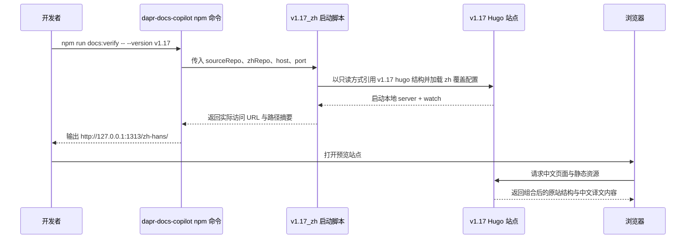

## Why

当前中文翻译流程只有数据同步与翻译落盘，没有一套可直接在本地 host 的文档验证站点。正式环境依赖 `repos/v1.17/translations/docs-zh` 子模块挂载中文内容，但翻译流程实际产物位于独立仓 `repos/v1.17_zh`，若不补上本地验证链路，译者只能静态看 Markdown，无法按原站结构快速验证导航、链接、front matter 与页面渲染结果。

现在补齐此能力，才能在不改动 `repos/v1.17` 任一文件的前提下，把原站 Hugo 结构与中文仓译文数据组合成可反复启动的本地站点，并通过 `repos/dapr-docs-copilot` 暴露一键入口，缩短翻译校验闭环。

## What Changes

- 新增本地文档验证站点能力，在 `repos/v1.17_zh` 内集中存放启动脚本、Hugo 覆盖配置与运行期缓存目录约定，用于组合 `repos/v1.17` 原站结构与 `repos/v1.17_zh/translated_content/zh_CN/**` 译文数据。
- 启动链路改为“只读引用原站、写入与生成物留在 zh 仓”：本地验证所需的配置渲染、临时目录、日志与生成物均落在 `repos/v1.17_zh`，且不得修改 `repos/v1.17` 中的源码、配置或子模块指针。
- 新增 `repos/dapr-docs-copilot` 的 npm 启动命令，统一解析版本、源仓、中文仓、host、port 等参数，并调用 zh 仓内脚本启动本地验证站点。
- 补充配套校验与文档，确保开发者能确认引用的原站路径、中文仓路径、实际访问 URL、以及常见失败原因（缺少 Hugo/npm 依赖、路径错误、端口占用）。

## Capabilities

### New Capabilities
- `zh-local-docs-verification-site`: 在不修改参考仓的前提下，以 zh 仓集中配置本地 Hugo 验证站点，并提供一键启动入口。

### Modified Capabilities
- 无

## Impact

- 参考仓读取：`repos/v1.17/hugo.yaml`、`repos/v1.17/package.json`、`repos/v1.17/go.mod`、`repos/v1.17/daprdocs/**`、`repos/v1.17/sdkdocs/**`、`repos/v1.17/.gitmodules`
- zh 仓新增：本地验证站点配置、启动脚本、运行缓存目录约定与使用文档，位置位于 `repos/v1.17_zh/**`
- 管理台入口：`repos/dapr-docs-copilot/package.json` 增加 npm 命令，并可能新增调用 zh 仓脚本的辅助脚本
- 运行依赖：复用原站 Hugo/Node/Go 模块环境，但本地验证的参数解析、路径拼装、错误输出与缓存目录由 zh 仓负责
- 验证范围：本地浏览器预览、Hugo watch/serve、中文译文路径挂载、静态资源与导航渲染一致性

## ASCII 原型

```text
┌──────────────────────────────────────────────────────────────────────────────┐
│ Local Docs Verification Site                                                │
├──────────────────────────────────────────────────────────────────────────────┤
│ source repo : repos/v1.17                 mode : read-only                  │
│ zh repo     : repos/v1.17_zh              host : 127.0.0.1                  │
│ config      : repos/v1.17_zh/site/hugo.verification.yaml                    │
│ preview url : http://127.0.0.1:1313/zh-hans/                                │
├──────────────────────────────────────────────────────────────────────────────┤
│ browser                                                                    │
│ ┌──────────────────────────────────────────────────────────────────────────┐ │
│ │ Dapr 文档库 /zh-hans/                                                  │ │
│ │ 左侧导航     页面正文     语言切换     站内链接                          │ │
│ │ 正常：页面可打开  错误：缺页/资源缺失  变更：保存译文后自动重载          │ │
│ └──────────────────────────────────────────────────────────────────────────┘ │
└──────────────────────────────────────────────────────────────────────────────┘
```

## 用户交互流程



## 代码变更表

| 文件路径 | 变更类型 | 变更原因 | 影响范围 |
|---------|---------|---------|---------|
| `repos/v1.17_zh/**` | 新增 | 集中承载本地验证站点脚本、覆盖配置与运行目录约定 | 中文仓本地预览能力 |
| `repos/v1.17_zh/README.md` | 修改 | 记录如何启动与排查本地验证站点 | 开发者使用文档 |
| `repos/dapr-docs-copilot/package.json` | 修改 | 暴露一键启动本地验证站点的 npm 命令 | 管理台命令入口 |
| `repos/dapr-docs-copilot/scripts/**` | 新增或修改 | 透传版本/路径/端口参数到 zh 仓启动脚本 | 本地开发体验 |
