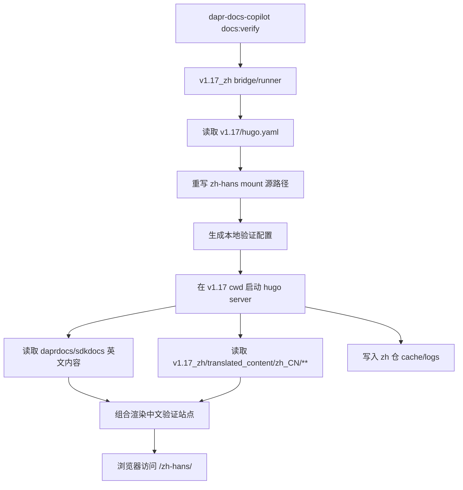

# zh-local-docs-verification-site

## Capability Model

## Requirement Matrix

| Requirement | 说明 | 场景数 |
| --- | --- | --- |
| Verification site startup is zh-repo-owned and source-repo-safe | 启动能力须集中于 zh 仓，且不得修改参考仓 | 2 |
| Generated verification config mirrors source Hugo structure | 本地配置须复用原站 Hugo 结构并改写中文挂载源 | 3 |
| Local host runtime keeps writable artifacts inside zh repo | cache、日志与临时输出须留在 zh 仓 | 2 |
| Copilot exposes a one-command startup entry | 管理台仓须提供统一 npm 启动命令 | 2 |
| Startup flow is diagnosable and iteration-friendly | 成功输出访问地址，失败输出可操作错误 | 3 |

## ADDED Requirements

### Requirement: Verification site startup is zh-repo-owned and source-repo-safe
The system SHALL place local documentation verification scripts, generated configuration, and runtime directory conventions under `repos/*_zh`, and it MUST launch the verification site without modifying any file inside the referenced source repository such as `repos/v1.17`.

#### Scenario: Source repository remains unchanged during startup
- **WHEN** the operator starts the local verification site for `v1.17`
- **THEN** the system SHALL read source-repository files such as `hugo.yaml`, `daprdocs/**`, and `sdkdocs/**` without persisting any edits back into `repos/v1.17`

#### Scenario: Missing source repository is rejected before launch
- **WHEN** the configured source repository path does not exist or does not contain the expected Hugo project files
- **THEN** the startup flow MUST fail before launching Hugo and report which required source-repository path is missing

### Requirement: Generated verification config mirrors source Hugo structure
The system SHALL derive a local verification configuration from the referenced source repository's Hugo configuration, and it MUST preserve the original site structure, language declarations, and mount targets while rewriting Simplified Chinese content mounts to load translated files from `repos/*_zh/translated_content/zh_CN/**`.

#### Scenario: English site structure is preserved from the source repository
- **WHEN** the local verification config is generated from `repos/v1.17/hugo.yaml`
- **THEN** the resulting config SHALL keep the source repository's non-Chinese mounts for `daprdocs/**`, `sdkdocs/**`, layouts, assets, static files, and Docsy module imports intact

#### Scenario: Chinese mounts are redirected to zh translated content
- **WHEN** the source Hugo config contains a mount whose source path begins with `translations/docs-zh/translated_content/zh_CN/`
- **THEN** the generated local verification config SHALL rewrite that mount source to the matching path under the selected zh repository's `translated_content/zh_CN/` tree while preserving the original mount target and `lang: zh-hans`

#### Scenario: Generated config tracks current source mount set
- **WHEN** the source repository adds, removes, or renames a Chinese mount entry in its Hugo config
- **THEN** the next local verification config generation SHALL reflect that current mount set instead of relying on a hard-coded bucket list

### Requirement: Local host runtime keeps writable artifacts inside zh repo
The system SHALL direct runtime-generated verification artifacts such as generated config files, caches, logs, and any temporary output directories into the selected zh repository, and it MUST NOT place those writable artifacts in the source repository.

#### Scenario: Generated config is stored under zh repository control
- **WHEN** the startup flow renders the local verification config
- **THEN** the system SHALL write that generated config into a managed path under `repos/*_zh`

#### Scenario: Cache and logs stay outside the source repository
- **WHEN** the local Hugo server starts successfully
- **THEN** any cache, log, or temporary output directory used by the verification runtime SHALL resolve inside the selected zh repository rather than inside `repos/v1.17`

### Requirement: Copilot exposes a one-command startup entry
The system SHALL provide an npm command in `repos/dapr-docs-copilot` that serves as the canonical entry point for launching the local verification site, and that command MUST pass the requested version and resolved repository paths to the zh-repository runner.

#### Scenario: Operator launches verification site from copilot repository
- **WHEN** the operator runs the documented npm verification command from `repos/dapr-docs-copilot`
- **THEN** the command SHALL invoke the zh-repository startup flow without requiring the operator to manually enter a second repository and run another script by hand

#### Scenario: Version and network parameters are forwarded
- **WHEN** the operator supplies parameters such as `version`, `sourceRepo`, `zhRepo`, `host`, or `port`
- **THEN** the npm entry point SHALL forward those resolved values to the zh-repository runner so the launched site reflects the requested configuration

### Requirement: Startup flow is diagnosable and iteration-friendly
The system SHALL emit stable startup diagnostics that identify the resolved source repository, zh repository, generated configuration path, and preview URL, and it MUST fail with actionable error messages when required dependencies or runtime conditions are not satisfied.

#### Scenario: Successful startup prints preview URL and resolved paths
- **WHEN** the local verification site starts successfully
- **THEN** the command output SHALL include the resolved source-repository path, zh-repository path, generated config path, and the final preview URL that the operator can open in a browser

#### Scenario: Missing runtime dependency is reported clearly
- **WHEN** the startup flow cannot find a required dependency such as the `hugo` executable or a required zh translated-content directory
- **THEN** the system MUST terminate with an explicit dependency-related error that identifies the missing executable or path

#### Scenario: Saved translation changes remain previewable without source-repo edits
- **WHEN** the operator updates a file under `repos/*_zh/translated_content/zh_CN/**` while the verification server is running
- **THEN** the local verification flow SHALL continue serving the site from the unchanged source repository structure while reflecting the updated zh translated content through the running preview server
