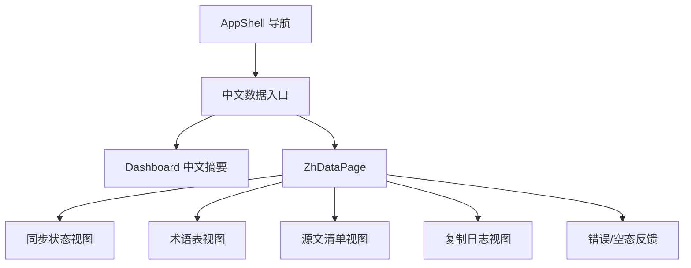

# zh-data-console

## Purpose

TBD

## Capability Model

## Requirement Matrix

| Requirement | 说明 | 场景数 |
| --- | --- | --- |
| Sidebar prioritizes zh data | 导航须以中文数据为首要入口，并移除 demo 主入口 | 2 |
| Console renders standardized datasets | 页面须展示统一 JSON 数据集及摘要 | 2 |
| Console handles empty and failed datasets | 页面须处理空态与错误态 | 2 |

## Requirements

### Requirement: Sidebar prioritizes zh data
The system SHALL present a first-level navigation item named `中文数据` as the primary entry for translation data management, and it MUST remove demo-only top-level navigation items that do not correspond to active translation workflows.

#### Scenario: Sidebar opens zh data as first workflow
- **WHEN** the user opens the management console sidebar
- **THEN** the first actionable navigation item displayed SHALL be `中文数据`

#### Scenario: Demo-only navigation is removed
- **WHEN** the user reviews available top-level navigation items
- **THEN** the console MUST NOT display a demo-only `Copilot` workspace entry as a primary workflow menu

### Requirement: Console renders standardized datasets
The system SHALL provide a dedicated zh data view that loads standardized JSON datasets from the zh repository and renders summary cards plus dataset-specific tables for sync status, glossary, source manifest, and copy log; the sync status view MUST expose both source synchronization and translation freshness signals.

#### Scenario: Workspace summary loads successfully
- **WHEN** the zh data view loads with valid dataset files
- **THEN** the page SHALL display summary metrics derived from sync status, glossary size, and latest copy batch metadata

#### Scenario: User switches dataset tabs
- **WHEN** the user selects one of `同步状态`、`术语表`、`源文清单` or `复制日志`
- **THEN** the console SHALL render records from the corresponding standardized dataset without requiring route navigation

### Requirement: Console handles empty and failed datasets
The system SHALL expose explicit empty-state and error-state feedback when expected zh datasets are missing, unreadable, or have zero records.

#### Scenario: Dataset file is missing
- **WHEN** the zh data loader cannot locate a required dataset file
- **THEN** the console SHALL render an error state that identifies which dataset is unavailable

#### Scenario: Dataset has no records
- **WHEN** the zh data loader returns an empty record set for a valid dataset
- **THEN** the console SHALL render an empty-state message instead of an empty table shell
