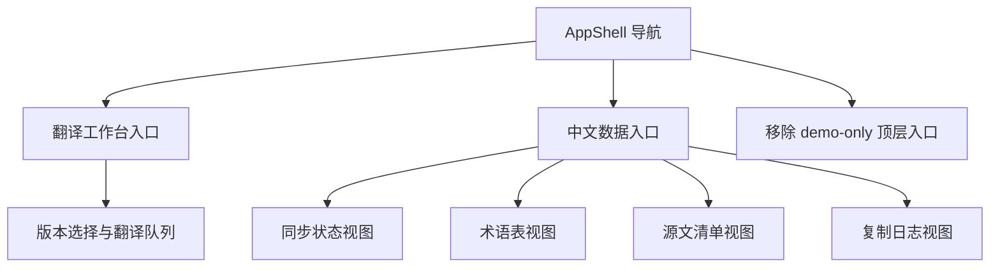

# zh-data-console

## Purpose

TBD

## Capability Model

## Requirement Matrix

| Requirement | 说明 | 场景数 |
| --- | --- | --- |
| Sidebar prioritizes zh data | 侧边栏须以翻译工作台与中文数据作为主工作流入口 | 3 |
| Console renders standardized datasets | 控制台须展示经协调的权威状态，而非仅凭 translation-state 乐观覆盖 | 3 |
| Console surfaces integrity risks explicitly | 链路断裂时须直出风险，不得把缺失译文伪装为已翻译 | 2 |
| Console handles empty and failed datasets | 页面须处理缺失、空数据、写入失败与只读降级 | 4 |

## Requirements

### Requirement: Sidebar prioritizes zh data
The system SHALL present first-level navigation items named `翻译工作台` and `中文数据` as the primary translation workflow entries in the management console, and it MUST remove demo-only top-level navigation items that do not correspond to active translation workflows.

#### Scenario: Sidebar exposes both execution and data workspaces
- **WHEN** the user opens the management console sidebar
- **THEN** the primary actionable navigation set SHALL include both `翻译工作台` and `中文数据`

#### Scenario: User enters translation workbench from sidebar
- **WHEN** the user clicks the `翻译工作台` navigation item
- **THEN** the console SHALL route the user to the dedicated translation workbench page without requiring manual URL entry

#### Scenario: Demo-only navigation is removed
- **WHEN** the user reviews available top-level navigation items
- **THEN** the console MUST NOT display a demo-only workspace entry that is unrelated to the current translation management workflows

### Requirement: Console renders standardized datasets
The system SHALL provide a dedicated zh data view that loads standardized JSON datasets from the zh repository and renders summary cards plus dataset-specific tables or editors for sync status, glossary, source manifest, and copy log; the sync status view MUST expose authoritative source synchronization and translation freshness signals derived from reconciled datasets rather than from `translation-state.json` alone.

#### Scenario: Workspace summary loads successfully
- **WHEN** the zh data view loads with valid dataset files
- **THEN** the page SHALL display summary metrics derived from the reconciled sync status, glossary size, and latest copy batch metadata

#### Scenario: User switches dataset tabs
- **WHEN** the user selects one of `同步状态`、`术语表`、`源文清单` or `复制日志`
- **THEN** the console SHALL render records from the corresponding standardized dataset without requiring route navigation

#### Scenario: Translation-state match alone cannot promote a missing file
- **WHEN** a record has a matching `translation-state.json` source sha but the authoritative sync dataset still reports the target translation as missing or inconsistent
- **THEN** the console MUST NOT render that record as `已翻译` solely because of the translation-state match

### Requirement: Console surfaces integrity risks explicitly
The system SHALL surface integrity audit warnings when synchronized datasets disagree so that operators can identify where the pipeline is broken.

#### Scenario: Console shows audit summary when datasets disagree
- **WHEN** the current version contains one or more integrity audit findings
- **THEN** the console SHALL render a visible warning summary that reports the count and category of mismatches

#### Scenario: File-level audit finding is actionable
- **WHEN** the operator inspects a file-level integrity warning in the console
- **THEN** the UI SHALL expose enough metadata to identify the affected version, relative path, and conflicting dataset states without opening raw JSON files manually

### Requirement: Console handles empty and failed datasets
The system SHALL expose explicit empty-state and error-state feedback when expected zh datasets are missing, unreadable, or have zero records, and it SHALL also surface glossary write-path failures or unavailability without hiding already readable glossary data.

#### Scenario: Dataset file is missing
- **WHEN** the zh data loader cannot locate a required dataset file
- **THEN** the console SHALL render an error state that identifies which dataset is unavailable

#### Scenario: Dataset has no records
- **WHEN** the zh data loader returns an empty record set for a valid dataset
- **THEN** the console SHALL render an empty-state message instead of an empty table shell

#### Scenario: Glossary mutation fails
- **WHEN** a glossary create, update, or delete request returns failure
- **THEN** the console SHALL keep the affected glossary row in an actionable state and display an inline or banner error message describing the failure

#### Scenario: Glossary write path is unavailable
- **WHEN** the glossary tab can load readable data but the write endpoint is unavailable in the current runtime
- **THEN** the console SHALL render the glossary dataset in read-only mode and explain that create, edit, and delete actions are temporarily disabled
