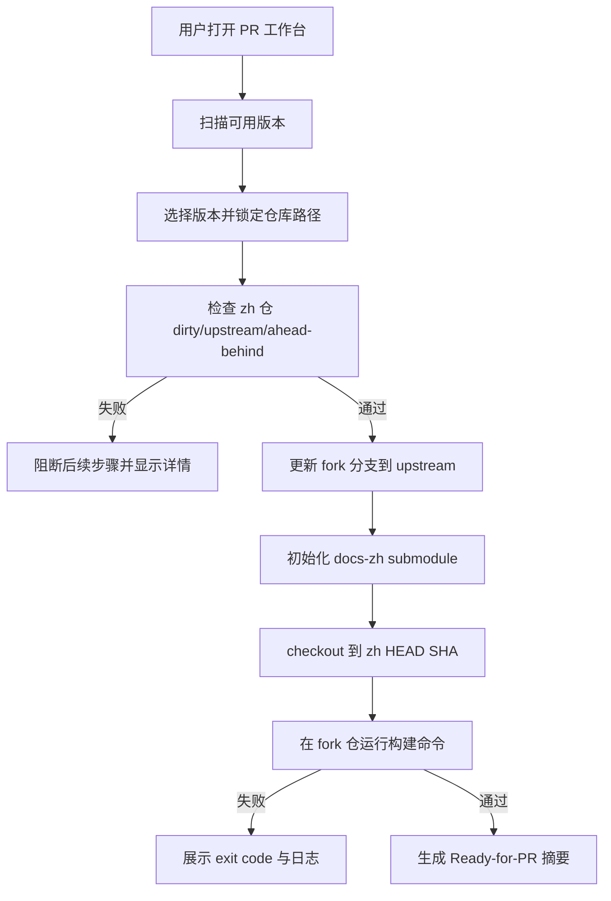

# zh-pr-workbench

## Purpose

TBD: PR 工作台能力用于管理 Dapr 文档翻译的 PR 准备工作流程，包括版本发现、仓库同步检查、fork 更新和构建验证。

## Capability Model

## Requirements

### Requirement: Workbench resolves version-scoped repository mapping
The system SHALL expose a `PR 工作台` workspace that discovers versions from local repository conventions, and when the user selects a version it MUST lock the resolved `zh` repository path, `fork` repository path, target fork branch, and docs-zh submodule path for the remainder of the preparation session.

#### Scenario: Only versions with both zh and fork repositories are selectable
- **WHEN** the workbench scans the local `repos/` directory for available versions
- **THEN** it SHALL list only versions that have both a `repos/<version>_zh` repository and a `repos/fork-<version>` repository

#### Scenario: Selecting a version returns locked repository metadata
- **WHEN** the user selects a version such as `v1.17`
- **THEN** the system SHALL return the resolved `zhRepoPath`, `forkRepoPath`, `forkBranch`, `zhBranch`, and `submodulePath` values that will be used by later steps

#### Scenario: Missing repository path is rejected before any Git mutation
- **WHEN** a previously discoverable version loses one of its required repository paths before step execution
- **THEN** the workbench MUST fail that step before running any Git command and identify which required path is missing

### Requirement: Guided progression enforces sequential PR preparation
The system SHALL model PR preparation as an ordered sequence of version selection, zh sync validation, fork refresh with submodule sync, and build verification, and it MUST prevent the user from executing a later step until all prior required steps for the same version have passed.

#### Scenario: Fork refresh is blocked before zh sync validation passes
- **WHEN** the current session has not yet produced a passing zh sync result for the selected version
- **THEN** the system MUST reject any fork refresh attempt and report that zh sync validation is still required

#### Scenario: Build verification is blocked before fork refresh passes
- **WHEN** the current session has not yet produced a passing fork refresh result for the selected version
- **THEN** the system MUST reject any build verification attempt and report that fork update and submodule sync are still required

#### Scenario: Successful downstream steps become stale after upstream state changes
- **WHEN** the recorded zh HEAD SHA or fork HEAD SHA no longer matches the repository state that a prior successful step used
- **THEN** the system SHALL mark dependent later-step results as stale and require the user to rerun them before Ready-for-PR can be shown

### Requirement: zh repository sync gate blocks out-of-date content
The system SHALL validate the selected zh repository before any fork mutation, and it MUST require a clean working tree, a configured upstream tracking branch, and zero ahead/behind divergence against that upstream branch.

#### Scenario: Dirty zh working tree blocks progression with file details
- **WHEN** the selected zh repository contains uncommitted, staged, or untracked changes
- **THEN** the workbench MUST fail the zh sync step and return the affected file paths or porcelain entries

#### Scenario: Ahead or behind zh branch blocks progression with counts
- **WHEN** the selected zh branch differs from its upstream tracking branch after a fresh fetch
- **THEN** the workbench MUST fail the zh sync step and report the exact ahead/behind counts together with the compared branch names

#### Scenario: Clean and synchronized zh repository unlocks fork refresh
- **WHEN** the selected zh repository is clean, has an upstream tracking branch, and has zero ahead/behind divergence
- **THEN** the workbench SHALL mark the zh sync step as passed and record the validated zh HEAD SHA for downstream use

### Requirement: Fork refresh aligns upstream branch and docs-zh submodule
The system SHALL update the selected fork repository from its configured upstream remote using a fast-forward-only strategy, and it MUST then initialize or reuse the docs-zh submodule working tree and switch that submodule to the validated zh HEAD SHA from the current session.

#### Scenario: Clean fork repository fast-forwards to upstream branch
- **WHEN** the selected fork repository working tree is clean and the upstream branch can be fast-forwarded
- **THEN** the workbench SHALL update the fork branch to the latest upstream commit without creating a merge commit and record the resulting fork HEAD SHA

#### Scenario: Dirty or divergent fork repository blocks update safely
- **WHEN** the selected fork repository has local working-tree changes or cannot fast-forward cleanly to the upstream branch
- **THEN** the workbench MUST fail the fork refresh step before changing the branch or submodule pointer and report the blocking condition

#### Scenario: docs-zh submodule is switched to the validated zh commit
- **WHEN** the fork refresh step reaches submodule synchronization for the selected version
- **THEN** the system SHALL ensure `translations/docs-zh` is initialized and checked out at exactly the validated zh HEAD SHA captured from the passing zh sync step

### Requirement: Build verification gates Ready-for-PR state
The system SHALL run the configured local build command inside the selected fork repository after a successful fork refresh, and it MUST expose the build exit code, diagnostics, and repository SHA snapshot; the workbench MUST NOT report Ready-for-PR unless that build step succeeds against the same fork and submodule SHAs recorded by the session.

#### Scenario: Build runs in the resolved fork repository
- **WHEN** the user starts build verification for the selected version
- **THEN** the system SHALL execute the configured build command with the fork repository as its working directory and capture stdout, stderr, and exit status

#### Scenario: Build failure surfaces actionable diagnostics and blocks readiness
- **WHEN** the build command exits with a non-zero status or cannot start
- **THEN** the workbench MUST mark the build step as failed, preserve the latest diagnostics, and keep the session out of Ready-for-PR state

#### Scenario: Successful build produces a Ready-for-PR summary bound to exact SHAs
- **WHEN** the build command succeeds and the fork HEAD SHA plus docs-zh submodule SHA still match the session snapshot used for that build
- **THEN** the workbench SHALL mark the session as Ready-for-PR and expose a summary containing the version, zh HEAD SHA, fork HEAD SHA, docs-zh submodule SHA, and successful build timestamp
