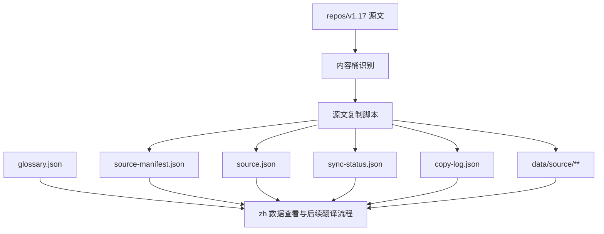

# zh-translation-data-pipeline

## Purpose

TBD

## Capability Model

## Requirement Matrix

| Requirement | 说明 | 场景数 |
| --- | --- | --- |
| Zh repo stores translation management data in JSON | zh 仓须建立统一 JSON 数据目录 | 2 |
| Source copy mirrors bucket and relative path | 源文复制须沿用内容桶与相对路径镜像 | 2 |
| Copy operations are traceable | 每次复制须记录批次、来源与结果 | 2 |
| Translation freshness is derived from sync time | 译文状态须基于同步时间与译文更新时间判断 | 2 |

## Requirements

### Requirement: Zh repo stores translation management data in JSON
The system SHALL create and maintain a `data/` directory in `repos/v1.17_zh` that stores translation management datasets in JSON format, including sync status, glossary, source metadata, source manifest, and copy log, while mirrored source files are persisted under `data/source/`.

#### Scenario: Required dataset files are initialized
- **WHEN** the zh translation data pipeline is initialized for `v1.17`
- **THEN** the repository SHALL contain JSON datasets for `sync-status`, `glossary`, `source`, `source-manifest`, `copy-log`, and at least one mirrored source document under `data/source/`

#### Scenario: Dataset payloads remain machine-readable
- **WHEN** any pipeline dataset is written or updated
- **THEN** the resulting file MUST be valid JSON that can be consumed without repository-specific parsing rules

### Requirement: Source copy mirrors bucket and relative path
The system SHALL copy source documents from the configured source repository into mirrored files under `data/source/` and store file metadata in `source.json`, using the source bucket and relative path conventions derived from the historical translation script and the active Hugo mount rules.

#### Scenario: Source bucket is resolved from known mappings
- **WHEN** the copy script processes source content for `v1.17`
- **THEN** each copied document SHALL be assigned to a bucket such as `docs`, `contributing`, `sdks_python`, or another configured mount bucket

#### Scenario: Relative path remains stable across datasets
- **WHEN** a source document is mirrored into `data/source/` and matched against translation status
- **THEN** the pipeline MUST use the same `relativePath` key to identify that document across manifest, source metadata, and sync-status datasets

### Requirement: Copy operations are traceable
The system SHALL record batch-level and file-level tracking metadata for each source copy operation, including source repository, source branch, copy timestamp, copied document count, and per-file status.

#### Scenario: Batch metadata is recorded
- **WHEN** a source copy run completes
- **THEN** the pipeline SHALL append a batch record to the copy log and update the source manifest with the latest source repository metadata

#### Scenario: File-level tracking is queryable
- **WHEN** the pipeline writes sync status for a copied document
- **THEN** the dataset SHALL include enough metadata to determine the document bucket, relative path, mirrored source file path, sha256, and current synchronization status

#### Scenario: Full verification uses mirrored source files only
- **WHEN** the pipeline performs a synchronization run
- **THEN** it SHALL delete the existing `data/source/` tree first, copy all source files again, and verify mirrored file existence plus sha256 equality without depending on translation files

### Requirement: Translation freshness is derived from sync time
The system SHALL derive translation status from the mirrored source verification time and the translation file timestamp, while explicitly flagging orphan translations that no longer have a corresponding source document.

#### Scenario: Translation newer than sync time is treated as translated
- **WHEN** a translation file exists and its `translationUpdatedAt` is later than the current `syncedAt`
- **THEN** the pipeline SHALL mark the record as `translated`

#### Scenario: Missing or orphan translation is surfaced explicitly
- **WHEN** the translation file is missing for a mirrored source record, or a translation file exists without a corresponding source record
- **THEN** the pipeline SHALL mark the record as `missingTranslation` or `orphanTranslation` respectively and include it in the queryable sync-status dataset
