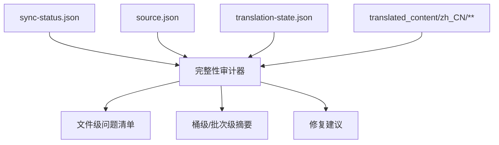

# zh-translation-integrity-audit

## Purpose

提供完整性审计能力，检测跨阶段数据不一致并输出可操作的审计结果。

## Capability Model

## Requirement Matrix

| Requirement | 说明 | 场景数 |
| --- | --- | --- |
| Audit detects cross-stage inconsistencies | 审计须识别文件级与汇总级不一致 | 3 |
| Audit output is actionable and machine-readable | 审计输出须可被脚本与 UI 直接消费 | 2 |

## Requirements

### Requirement: Audit detects cross-stage inconsistencies
The system SHALL inspect source synchronization datasets, translation-state records, and translated output files together and detect which stage introduced an inconsistency for each affected document.

#### Scenario: Audit detects sync-status rollback after a resync
- **WHEN** `translation-state.json` and the target translation file both match the current source sha but `sync-status.json` reports `staleTranslation` or `missingTranslation`
- **THEN** the audit result SHALL flag that file as a synchronization regression and identify the conflicting states

#### Scenario: Audit detects missing translated output behind translation-state
- **WHEN** `translation-state.json` claims a successful translation for a file but the expected target output file is absent
- **THEN** the audit result SHALL classify that file as a broken translation write chain

#### Scenario: Audit detects stale aggregate summaries
- **WHEN** file-level authoritative totals disagree with bucket totals in `source.json` or the latest batch totals in `copy-log.json`
- **THEN** the audit result SHALL report those aggregate mismatches explicitly

### Requirement: Audit output is actionable and machine-readable
The system SHALL emit an audit payload that can be consumed both by automated validation scripts and by the zh data console without repository-specific parsing logic.

#### Scenario: Audit output includes machine-readable mismatch records
- **WHEN** an audit run completes
- **THEN** the result SHALL expose structured records containing version, bucket, relative path, mismatch type, and observed dataset values for every finding

#### Scenario: Audit output includes remediation hints
- **WHEN** an audit run finds at least one mismatch
- **THEN** the result SHALL include a summary grouped by mismatch category with enough detail to suggest whether the fix belongs to source sync, translation write, or summary reconciliation
